# EVM 合约角色、权限与专有名词关系图

日期：2026-10-11。本文依据当前 `contracts/src/` 实现梳理权限关系，描述的是当前代码中的实际调用者检查和签名门槛。

[Mermaid 源码](20261011-01-contract-role-permission-map.mmd) · [合约部署与接入说明](../../contracts/README.md)

## 阅读图例

- **实线**表示治理调用或 `msg.sender` 调用权限。
- **虚线**表示 Permit 签名或 Council 的 ERC-1271 共签校验。
- 彩色框区分治理多签、时间锁、紧急控制、执行者、用途签名者、风险状态和路由配置。
- 中央状态门表达每笔资金操作都要再次读取当前链上状态；签名通过不代表 HOLD、路由、额度或请求状态检查自动通过。

## 1. 先区分身份、签名角色和权限

合约没有把所有参与方放入一套通用 `AccessControl` 角色系统。主要授权由三类机制组合而成：

| 概念 | 合约里的表达 | 作用 |
|---|---|---|
| 治理身份 | `TenantAuthority.governor/council/guardian` | 通过固定地址比较授权配置和紧急控制函数。`Governor` 地址是 `TenantTimelock` 合约。 |
| 交易提交者 | `TenantAuthority.executors[address]` 与 `onlyExecutor` | 允许 Relayer 提交有界交易；Executor 本身不能替代业务签名或 Council 批准。 |
| 用途签名者 | `signers[purpose] = (account, epoch)` | 对精确的 EIP-712 Permit 签名。替换签名者会递增 epoch，使旧 Permit 失效。 |
| Council 共签 | `TenantAuthority.verifyCouncil(digest, signature)` | 由 Council 合约按 ERC-1271 对同一业务 digest 批准；仅在特定业务条件下必需。 |
| 链上状态门 | `RiskRegistry`、`PoolRegistry`、请求状态与额度 | 每次执行读取当前 HOLD、暂停、预留、路由、额度、epoch 和一次性操作状态。 |

因此，`RISK_SIGNER` 是**归集 Permit 的用途签名槽**，不是 Guardian，也不是链上风控裁定器。Guardian 能触发紧急收紧，但不能替 `RISK_SIGNER` 签发普通归集许可。`Executor` 只提交交易；Permit 限定资产、金额、目的地、租户、池、有效期等字段。

业务 Permit 还由 EIP-712 domain 绑定 `chainId` 与实际校验合约。`tenantKey`、`poolId`、用途签名、控制版本共同限制授权范围。更换某个用途 signer 会递增该 signer 的 epoch；资产白名单变化会递增四个用途 signer 的 epoch，相关旧 Permit 随之失效。

`OperationBook` 是供业务合约继承的公共基类，不是单独部署的权限合约。每个继承它的业务合约在自己的地址内保存请求状态；取消某个合约中的 requestId 不会跨合约撤销其他请求。

## 2. 治理身份的精确权限

| 身份 | 可执行的权限 | 限制与恢复边界 |
|---|---|---|
| **Council** | 作为 `TenantTimelock` 的提案者和执行者排队治理；直接逐案解除 HOLD；按 reserve version 调整 reserve；按合约规则配置收款方限制；取消尚未执行操作；对特定资金 Permit 做 ERC-1271 共签。 | 表中这些直接函数不经过 `TenantTimelock` 延迟；只有 Governor 治理调用受至少 2 天延迟约束。Council 共签只批准绑定的 digest，不产生任意转账入口。 |
| **TenantTimelock / Governor** | 配置用途 signer、Executor 和资产；登记池、配置路由、限额；解除 `SECURITY_PAUSED`、恢复路由、按权限调整 reserve；取消尚未执行操作。 | 合约的 `onlyGovernor` 检查的是 Timelock 地址本身。Council 提案需排队，并等待至少 2 天才能执行；延迟不能被降到该下限以下。Council 仍可使用明确授予它的直接入口，例如逐案解除 HOLD。 |
| **Guardian** | 快速加 HOLD、设置安全暂停、暂停路由、收紧限额、禁用 Executor/资产、提高 reserve、拉黑收款方、取消尚未执行操作。 | 仅能做收紧动作；不能解除 HOLD 或安全暂停、减少 reserve、恢复路由、放宽限额、启用 Executor/资产或解除收款方限制。 |
| **Executor** | 调用标有 `onlyExecutor` 的业务入口提交交易。 | 不能生成有效用途签名、Council 共签、绕过链上状态门，或调用不授予 Executor 的合约入口。Guardian 可禁用 Executor。 |

权限对应源码：[`TenantAuthority.sol`](../../contracts/src/control/TenantAuthority.sol)、[`TenantTimelock.sol`](../../contracts/src/control/TenantTimelock.sol)、[`TenantComponent.sol`](../../contracts/src/common/TenantComponent.sol)、[`RiskRegistry.sol`](../../contracts/src/control/RiskRegistry.sol)、[`PoolRegistry.sol`](../../contracts/src/control/PoolRegistry.sol)、[`OperationBook.sol`](../../contracts/src/common/OperationBook.sol)。

### 权限名称容易混淆的地方

- `onlyGuardian` 实际允许 `Guardian` **或** `Governor`，所以时间锁治理也能执行 Guardian 路径上的控制函数。
- `releaseHold` 是 `onlyCouncil`；不能据此说 Guardian 或 Governor 可以逐案解冻。
- `setSecurityPause(false)`、解除路由暂停、放宽限额只能由 Governor 路径执行。
- `setReserve`：Guardian 只能令金额增加或保持不变；Council / Governor 可以按版本修改金额。
- `setExecutor`、`setAsset`：Guardian 只能禁用；启用由 Governor 完成。
- `setRecipientBlocked`：Guardian 只能拉黑；Council / Governor 可按函数规则设置或解除。

## 3. 用途签名与资金入口

| 资金入口 | 谁提交 | 用途签名 | Council 共签条件 | 主要业务约束 |
|---|---|---|---|---|
| `VaultManager.sweep` | Executor | `RISK_SIGNER` | 不需要 | 当前源/目标风险控制、有效路由、全余额精确授权；DepositVault 再检查一次。 |
| `ClearingVault.settle` | Executor | `SETTLEMENT_SIGNER` | 目标是另一 Clearing、即 Migration 时需要 | 指定 lot、金额和 `lotsHash`；普通结算还要满足 lot 到期。 |
| `TreasuryVault.executeWithdrawal` | Executor | `WITHDRAWAL_SIGNER` | `amount > councilThreshold` 时需要 | 收款人限制、一次性 `requestId`、预留与安全底线、租户共享限额。 |
| `TreasuryVault.transferCustody` | Executor | `TRANSFER_SIGNER` | 每笔 Migration 必需；Rebalance 超过阈值时也需要 | 仅已登记路由；源和目标风险状态及共享限额均有效。 |
| `ColdVault.returnToTreasury` | Executor | `TRANSFER_SIGNER` | 所有金额均需要 | 只允许返回已登记 Treasury；Cold 不开放对外提现入口。 |
| `DispositionController.executeDisposition` | Executor | 无在线用途 signer | 每笔都需要 | Council 签名覆盖双端 `controlDigest`；隔离默认去 Quarantine，受控释放只回 Treasury。 |

取消不是资金执行。`OperationBook.cancelOperation`（Treasury 另提供 `cancelWithdrawal`）仅接受 Guardian、Council 或 Governor；已 `Executed` 的请求不可取消，Executor 没有取消权限。

## 4. 风险、路由和额度这些“状态门”

### RiskRegistry

- **HOLD** 按 `target × scope × caseId` 独立记录；单个案件解除不会清掉其他案件。
- **全资产 HOLD** 和**单资产 HOLD**是不同 scope；原生币 `token = address(0)` 仍是单资产控制，不等同于全资产控制。
- **SECURITY_PAUSED** 是独立的安全暂停状态；常规出金需无 HOLD、无暂停。解除安全暂停需要 Governor 路径。
- **reserve** 按案件记录，`totalReserve` 汇总约束可支配余额。普通流出须保留其他案件 reserve；Treasury 还需保留安全底线。
- 控制状态变化会提升 epoch。旧签名不能因后来解冻而重新生效。
- 专项处置可按 Council 明确批准的完整状态快照移动受 HOLD 限制的资金，但不能绕过安全暂停、其他案件 reserve、路由和余额约束。

### PoolRegistry

- 登记同租户资金池和代码哈希，限制 Sweep、Settlement、Rebalance、Migration、Disposition 路由。
- 改路由前必须暂停路由；恢复路由走延迟治理。链上调用同时校验 route epoch 和登记代码身份。
- `policyEpoch` 绑定额度等配置，防止旧提现许可在政策变化后继续生效。
- 租户内 Treasury/Cold 共享出金预算；迁移不会重置累计限额。`consumeLimit` 只允许已登记 Treasury 或 Cold 调用。

## 5. 固定的合约到合约调用权限

| 调用入口 | 被调用合约的专属调用者检查 | 结果 |
|---|---|---|
| 部署充值 Vault | `VaultManager.deployVault` 仅 Executor；`VaultFactory.deployVault` 仅 Manager 或 `DispositionController` | 独立部署调用不需要资金 Permit，且不转移资产；Relayer 不能绕过 Manager 直接调用 Factory。Controller 可为专项处置部署尚未部署的预测地址。 |
| 普通归集 | `DepositVault.sweep` 仅 `VaultManager`；`ClearingVault.recordLot` 仅同套 Manager | Relayer 不直接持有充值地址转账权；归集与 lot 登记同事务提交。 |
| 特殊处置 | `DepositVault.dispose`、池的 `PoolBase.dispose`、`RiskRegistry.relocateReserve` 均仅 `DispositionController` | 只有专项控制器能同步移动资产与案件 reserve；普通 Manager 不能调用处置出口。 |
| 清算迁移登记 | `ClearingVault.importLots` 仅接受已登记 Clearing 且需通过 Migration 路由与双端风险检查 | 不能由任意池伪造或导入 lot。 |
| 共享限额消费 | `PoolRegistry.consumeLimit` 仅接受已登记 Treasury 或 Cold | 普通归集、Quarantine 或任意调用者不能消耗或绕过出金预算。 |
| Quarantine 出口 | Quarantine 无普通提现或结算函数；资金出口经 Controller 的专项处置路径 | 隔离余额不会因直接入金、转池或取消限制自动获得可付款身份。 |

源码入口：[`VaultFactory.sol`](../../contracts/src/deposit/VaultFactory.sol)、[`DepositVault.sol`](../../contracts/src/deposit/DepositVault.sol)、[`VaultManager.sol`](../../contracts/src/sweep/VaultManager.sol)、[`ClearingVault.sol`](../../contracts/src/pools/ClearingVault.sol)、[`PoolBase.sol`](../../contracts/src/common/PoolBase.sol)、[`DispositionController.sol`](../../contracts/src/control/DispositionController.sol)、[`QuarantineVault.sol`](../../contracts/src/pools/QuarantineVault.sol)。

## 6. 关键边界

1. **多道门槛必须同时满足。** 普通资金操作须由 `Executor` 提交，并通过对应用途签名、当前风险状态、适用路由/额度和一次性请求状态。专项处置不使用在线用途 signer，但需要 Executor、Council Permit 签名和完整控制快照。不存在单一“管理员可转账”角色。
2. **管理权限和签名权限分离。** `Governor` 更换 signer 或策略；用途 signer 批准一笔指定业务；Council 对高风险/例外业务共签；Executor 负责提交交易。
3. **冻结不等于阻止入金。** RiskRegistry 控制资金流出，不会阻止第三方把 Native / ERC-20 转入预测 Vault、已部署 Vault 或资金池。
4. **处置是受限例外，不是通用绕过。** 需要 Council 对当前双端控制快照签名，并受 `SECURITY_PAUSED`、reserve、资产精确余额与固定路由约束。
5. **边界按合约地址与租户隔离。** 一份签名或角色状态不会自动授予其他 tenant、pool、chain 或 verifying contract 的权限。
