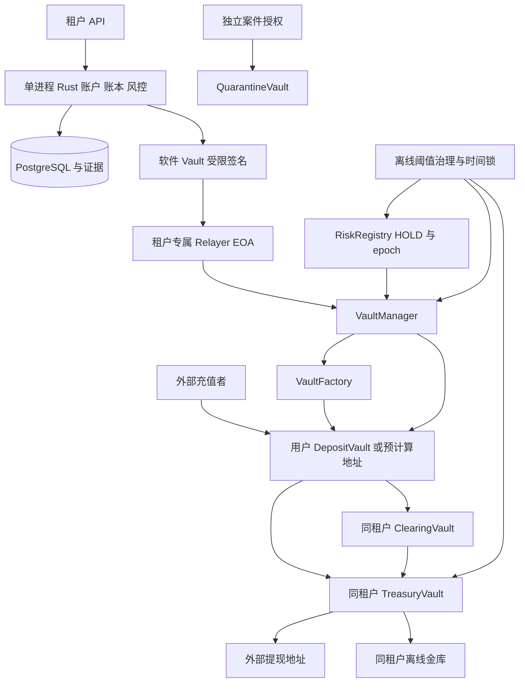

# 01 总体架构与生产决策

返回 [总览](README.md)。

## 1. 目标与适用范围

平台为第三方租户提供用户账户、充值地址、余额、冻解、提现和通知。平台托管链上资产，用户权益由双重记账记录。首期面向经逐链验证的 EVM 网络；不因为某链声称兼容 EVM 就默认具有相同 CREATE2、opcode、trace、最终性或费用语义。

每个 `(tenant, user, chain)` 默认一个长期 DepositVault；同时支持每充值订单一个地址。后者减少不同订单资金在同一地址混合，增加部署成本。已发行地址永不重新分给其他用户，订单过期/地址退役后仍持续监听。

地址属于合约控制对象，没有“用户合约私钥”。系统仍需 Relayer、归集授权、提现授权及治理签名密钥，因此不能宣称无私钥或不再需要密钥恢复。

## 2. 架构决策

| 决策 | C1.0 选择 | 原因与代价 |
|---|---|---|
| 用户地址 | CREATE2 + 标准 ERC-1167 Clone | 预计算免费，首次使用付部署费 |
| Clone 参数 | 固定租户 Factory，部署和少量 storage 初始化原子执行 | 易审计；immutable args 仅在另版实测后考虑 |
| 版本 | Factory、Implementation、Manager、资金池不可升级 | 新版新地址；旧版持续服务，缺陷未必能修复 |
| 租户隔离 | 每租户每链独立 Manager、Factory、RiskRegistry、PoolRegistry、Treasury | 部署成本随租户增长；缩小权限故障范围 |
| 代码复用 | 各租户部署同版源码的独立 Implementation，绑定各自 Factory | 不共用实例、资金和授权；相同源码漏洞仍可能全局影响 |
| 归集目标 | Vault 固定 Manager/poolId；路由由独立延迟治理控制 | 执行密钥不能改收款地址；治理掌握路由终极权力 |
| 收款路由 | 默认 Deposit → 同租户 Clearing → Treasury | Clearing 观察和二次授权增加一笔内部迁移 |
| 简化路由 | 经治理批准的低风险域可 Deposit → Treasury | 风险决策逐笔选择，不能由普通 Relayer 指定 |
| 风险命中 | 原址 HOLD，默认不移动 | 特殊处置走独立阈值授权路径 |
| 热资金流出 | EIP-712 订单授权 + 链上 requestId 去重 + 额度 | 不能以 Relayer 身份直接提走资金 |
| 应用 | 单 Rust 在线进程、PG job/Outbox | 与旧基线一致；同进程不能提供主机隔离 |
| 密钥 | 项目内加密软件 Vault；治理密钥离线分持 | 不要求 KMS/HSM/MPC；高额操作需人工离线共同授权 |
| 跨租户转账 | 本期不支持账内直接跨租户净额转账 | 独立物理池需要真实结算，不能借用另一租户资产 |

## 3. 资金与控制关系

Manager 编排归集，Factory 创建地址，Treasury 承担热钱包。三者协作实现用户设想中的“热钱包管理用户合约”，将部署、收集、出金权限拆开以便链上约束。

标准 ERC-20 归集由 DepositVault 调用 token.transfer，资产持有人就是调用者，无需 approve 或 transferFrom；最外层 Relayer 承担交易费用。原生币归集精确转出授权金额，也无需在 DepositVault 留 Gas 尾款。用户向平台充值的发送交易费仍由用户或其上游支付。

## 4. 安全主体与权限

| 主体 | 能力 | 泄露后的直接范围 |
|---|---|---|
| 租户业务 API | 本租户开户、提现申请、限定 Hold | 受余额、风控、审批、链上授权约束 |
| Relayer/Sweep Executor | 广播已授权操作、支付 Gas | 可耗尽自身 Gas、重放仍有效授权；不能修改授权经济参数 |
| RiskAuthorizer | 签发精确 Sweep/Settlement Permit | 可错误批准风险资金进入本租户池，不能正常授权任意外部提现 |
| WithdrawalAuthorizer | 本租户小额出金授权 | 可能在额度和热资产范围内盗提；是实质资金密钥 |
| Guardian | 立即增加 HOLD/暂停、撤销授权 epoch | 可造成拒绝服务；不能解冻、改路由或提币 |
| 离线审批签名者 | 高额提现和特殊处置共同签名 | 阈值失陷危及对应租户资金 |
| 离线治理阈值 | 延迟改角色、额度、路由、解除暂停 | 终极控制权；必须独立分持，不能全部放在线主机 |

建议初始治理 2/3 独立离线持有人、常规敏感变更至少 48 小时延迟；数值为待部署审批的默认提案。不同人共享一份解锁密码不构成链上阈值。采用成熟多签/时间锁实现，部署清单固定版本、owner、threshold、模块和 Guard；额外模块必须审计。

同进程软件 Vault 只能提供用途约束、正常代码访问控制和加密存储。应用整机失陷可能同时获得已解锁的归集、提现、Relayer 权限。链上每笔/每周期额度、单池热资金上限、独立离线治理及独立应急广播终端决定残余风险上界；不能把两个在线密钥称为独立双人防线。若业务不能接受此边界，需要另立 ADR 引入独立签名安全域。

## 5. 与旧设计的替换关系

| 旧模块 | 改动 |
|---|---|
| M03 Vault | 删除新地址 BIP39/BIP32 派生职责；新增 EIP-712 精确授权签名；保留少量随机平台私钥的封装、人工解锁和证据机制 |
| M04 地址 | root/index/scheme 改为 factory/salt/initCodeHash/版本；新模式按链独立地址，不承诺跨链同址 |
| M06 索引 | 同时监听未部署地址、合约地址、资金池及内部原生转账；新增风险待处理状态 |
| M07 执行 | EOA nonce 之外增加业务授权生命周期及链上消费状态 |
| M08 提现 | EOA 直接付款改为 Treasury.executeWithdrawal；必须处理授权撤销 |
| M09 归集 | 删除新合约地址补 Gas；增加懒部署、逐项 Permit、受限批处理 |
| M10 流动性 | 增加 Clearing、风险预留、待部署可回收性、Relayer 原生资本 |
| M12 对账 | 增加代码清单、授权消费、路由/epoch、来源与下游关联 |
| M01/M02/M05/M11/M13 | 继承租户身份、安全 HTTP、基础账本、通知、审计；扩展风险案件和链上控制观测 |

旧 EOA 地址如果已有真实用户，保留原私钥、监听和受控补 Gas 归集；不能把 EOA 原址变为指定 CREATE2 地址。当前合约端实现见 [06](20261010-06-solidity-implementation.md)；若尚未发行旧地址则无需构造迁移负担。

## 6. 明确限制

冻结不阻止第三方直接向 Vault/池发送资产；已混合 ERC-20 不存在按原充值交易选出特定币的接口。Clearing 是延迟风险扩散的缓冲池，不是风险清除器。发行方黑名单、底层 token 故障、Factory/不可变实现缺陷都可能造成不可恢复冻结，任何备份都不能自动修复链上代码或绕过发行方权限。

网络与资产清单、额度、风险来源、值班覆盖、容量、RPO/RTO 在上线配置中冻结；缺少这些输入时完成设计和验证环境，但不能签发生产充值地址。
