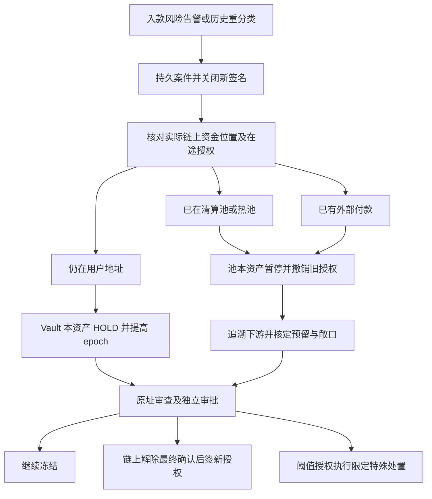

# 03 风险资金隔离与事故处置

返回 [总览](README.md)。本章落实在线讨论第二部分，覆盖风险资金尚在充值地址、已归集但未付款、已经向外付款三类情形。

## 0. 两种情况的最终方案

风险处置属于 P0 资金控制能力，须随第一版合约交付。平台不接收“只实现 sweepAll，以后补风控”的部署版本。

| 情况 | 立即控制 | 资产位置 | 后续允许的动作 |
|---|---|---|---|
| 风险资金尚未归集 | 用户受限入账/风险 Hold；链上锁定 Vault 本资产并撤销旧归集授权 | 默认留在原 DepositVault 或未部署地址 | 审查解除后重新授权；有明确处置依据时阈值签名转隔离池/指定目标 |
| 已进入 Clearing | 暂停该池本资产的结算、迁移及任何其他流出；回溯 lot 和在途结算 | 留在当前 Clearing；若已转出，追踪实际后继池 | 决定全额继续控制或批准缩小范围；不能因观察期结束自动解锁 |
| 已进入 Treasury | 暂停该池本资产全部普通流出、提升 epoch、撤销在途出金授权并建立预留 | 留在当前 Treasury | 核实范围后批准恢复剩余可用额度，或依法继续冻结/特殊处置 |
| 已向外付款 | 同时控制剩余资产与未决订单；建立敞口和资金去向证据 | 已付款部分不能由本平台合约撤回 | 按案件处理追偿、损失、运营注资和报告；不重复支付原订单 |

选定架构是：**原址先隔离，风险审核后才准归集；已混入池时先控制池的相关资产，再以证据和批准决定恢复范围**。Quarantine 是受限保管地址，转入它不会证明原池风险已消失。原始入款在归集前与归集后均持续监控。



## 1. 风险判断与控制对象

使用 `ALLOW / REVIEW / UNKNOWN / HOLD / BLOCK`，其中 BLOCK 是平台依据有效规则及人工审批形成的处置结论，不等同于第三方评分。每次决策保存提供方、规则/名单版本、评估时间、原始响应摘要、证据引用、人工判断及覆盖链高度。历史决策只追加，不覆盖。

处理级别另区分 `ALERT_REVIEW / MATERIAL_RISK_HOLD / LEGAL_HOLD / SECURITY_PAUSE`。普通关联提示先暂停相关新授权和待审查入账；经策略确认的重大风险或有效冻结要求才按本章扩大链上控制。security 表示私钥/合约控制问题，不能被风险解除流程清除。告警可信度、直接/间接关联、金额、范围和复核人都要保留；这些是本平台的处置决策，不能从单一评分推导法定结论。[FATF 风险指标资料](https://www.fatf-gafi.org/en/publications/Methodsandtrends/Virtual-assets-red-flag-indicators.html) 将这些特征作为发现可疑交易的依据。

KYT 是可替换的证据输入端口，可接第三方或经过批准的内部数据源；生产必须有覆盖目标网络/资产的有效来源、更新频率及责任人。该端口不改变单在线应用形态。不具备风险来源或上游故障时按 UNKNOWN，禁止自动转可用和签发新归集授权。人工例外必须形成有范围、有期限、有证据的案件批准，不能有全局 fail-open 开关。

| 控制层 | 作用域 | 作用 |
|---|---|---|
| 用户账务 Hold | tenant/user/asset/holdId | 禁止用户使用对应债权 |
| 归集 HOLD | chain/vault/token，必要时整个 vault | 阻断普通归集，包括未部署地址 |
| 资金池事件控制 | tenant/pool/token 或整个 pool | 阻断结算、提现、普通迁移和自动补仓 |
| 安全暂停 | 合约/权限域 | 密钥或代码事故时停止所有相关资产流出 |

这些控制需要分别持久化和观测，用户余额冻结不能替代资金池暂停。链下期望状态和链上已确认状态使用不同字段。

## 2. 场景 A：未归集时发现风险

例：同一个 Vault 收到 100 USDT 正常入款及 20 USDT 风险入款。默认 HOLD 整个 `(vault, USDT)`，120 均不进入普通归集；不能把“转出 100”描述成精确选中那笔正常充值。其他 token 是否冻结取决于案件范围；普通用户业务冻结不必阻断同租户正常资产位置迁移，但合规/风险冻结必须执行链上控制。

处置步骤：

1. 持久化风险事件和案件，事务内关闭相关新签名/调度 gate、提升本地 policy version，并冻结尚可冻结的用户额度。
2. 找到该 vault/token 的所有 Permit、Batch、部署和迁移任务。未签永久撤销；任何可能签名或已广播任务继续跟踪，不能因为数据库写 CANCELLED 就视为安全。
3. 由专用 Guardian 通道提交 RiskRegistry HOLD/epoch 提升。记录 `REQUESTED → BROADCAST → INCLUDED → FINAL`；只有链上生效后才能说该控制在链上执行。
4. 同步停止目标池接收新归集授权；严重风险且已有在途归集时先暂停目标池相关资产流出，追踪最终去向。
5. 未最终充值保留观测；最终充值记受限负债。已经入账的仅冻结可追回余额，已提现/内部转走的缺口建立敞口，禁止把用户可用余额改成负数。
6. 保留原址资金，等待审查。未部署地址无需为了 HOLD 部署合约，RiskRegistry 可以直接以预测地址为键阻断后续普通归集。

若同地址未审查新入款持续出现，普通全余额授权可能持续失效。标准解决方式是轮换**后续收款**地址、保持旧址 HOLD 并逐案处理。部分释放需证明数量、范围与处置依据，走独立 Disposition 授权，不放宽普通 SweepPermit 为无限余额或任意 amount。

### 2.1 已部署和未部署的合约分别怎样控制

未部署：`RiskRegistry.addHold(predictedVault, token, caseId)` 即可登记冻结，不依赖该地址存在代码。Factory 就算被许可主体提前部署，控制参数仍固定；其初始化不得转账。首次部署和普通归集虽然可在同一子交易完成，归集仍需查询当前 HOLD，不能以“刚部署”跳过风险检查。

已部署：Manager 和 DepositVault 两侧都复核 Registry。归集、资产恢复、改路由后迁移均不能用普通权限绕过 HOLD。Vault 只接受 Manager 的受限普通转账，特殊处置由独立 Controller 验证所有相关冻结原因与签名；Relayer 或 RiskAuthorizer 无权解除冻结。外部 token 直接打款不调用 Vault，系统不能承诺冻结后完全无法再充值。

已通过审批但尚未付款的用户提现同时停止新签名；若内层 WithdrawalPermit 已可能生成，则申请 requestId 撤销，保留原提现 Hold 直至最终未付款证明。不能为了创建风险 Hold 先释放一个可能付款的提现 Hold；原预留先保留，案件关联其金额和最后结果，未付款后才原子转换为风险 Hold。

### 2.2 正常入款与风险入款共处一址

ERC-20 接口给出账户余额及转账金额，没有按来源交易挑出余额的标准能力。[ERC-20 规范](https://eips.ethereum.org/EIPS/eip-20) 支持的是地址余额与转账；本方案据此规定混合来源时整地址本资产停止普通归集。

100 正常 + 20 风险的示例中，链下可分别记录正常用户负债 100 和受限负债 20，链上仍为同一笔 120 的可替代余额。审查若只允许控制 20，则须另有明确批准才能用特殊处置释放 100，并保存“数量释放”依据；不能宣称从链上选出了那笔正常资金。默认保守路径是 120 原址留存，正常用户是否由本租户其他已审查流动性支付另行受理和审批。

风险用户不能靠换地址继续业务；地址轮换仅服务已获准继续的后续收款，保留用户级限制和旧案件。高额/风险域优先每订单独立地址，减少跨订单混合；它仍不能阻止攻击者主动向该地址投递其他资产。

## 3. 场景 B：已进入 Clearing 或 Treasury

默认先暂停受影响池/资产的普通流出；涉及密钥、代码或多个资产时扩展为池级安全暂停。关闭新的结算、用户提现签名、自动补仓、转冷和跨池迁移；接收外部 token 无法保证阻断。已经存在的提现授权通过链上资产暂停和 epoch 撤销控制，跟踪抢先成交结果。

重建证据路径：

```text
原始入款事件及 blockHash
→ depositId → 风险决策版本
→ SweepPermit.operationId → 实际 SweepExecuted
→ Clearing lot → SettlementPermit → Treasury
→ 此后池内资金迁移、提现授权、最终付款与账务凭证
```

来源与下游关联属于审计追踪和敞口估算，使用明确披露的分摊方法，例如按时间序或比例分摊；不得把估算结果称为某个提现用户收到了特定来源的同一枚 token。所有实际转账边有金额、资产、来源/目标、交易/日志/trace 证据；合并和拆分关系保存在 movement links。

建立池资产风险预留 R、未知来款保留 U 和运营缓冲 S。链下同高度可调度量：

```text
spendable = max(0, finalizedBalance
                  - unresolvedOutflowsNotInSnapshot
                  - activePhysicalReservations
                  - riskReserve - unattributedReserve - safetyBuffer)
```

各扣减集合互斥，已反映在快照中的实际流出不再扣一次；结算时把在途预留转成“未被快照反映的实际流出”，不能中途释放形成可用窗口。全池/资产禁止流出是额外 gate，即使计算结果为正也不能支出。链上 restrictedReserve 是独立硬底线；不能把账务上冻结了 1,000 理解为已经完成全部风险隔离。

案件复核后，才决定继续池级暂停、缩小到明确金额预留、批准特殊处置或解除。风险预留增加/解除需要链下与链上观测一致；降低前先确认批准和执行版本。资金直接转入 Quarantine 不会自动使原池解除发行方或法律限制。

### 3.1 事故执行顺序与控制范围

1. 在主库原子建立 incident、关闭受影响池/资产的新签名 gate、冻结可追回用户负债、写紧急控制 job。业务批准和签名准入锁同一控制行，避免告警后旧任务继续获得许可。
2. Guardian 对实际所在池执行 `applyPoolAssetHold(pool, token, caseId, minimumReserve)`，同一链上事务添加原因、提高 epoch 并建立预留下限；池合约的普通流出全部查询它。
3. 找出所有在途 Sweep/Settlement/Withdrawal/转冷/迁移授权。原签名保存并继续跟踪；合约取消或 epoch 最终失效前，不能声称可付款金额已释放。
4. 回填到控制实际生效块，按 transactionIndex/logIndex/trace 顺序确认哪些资产已经转移；告警时的数据库位置仅是线索。
5. 对已经到达的下游**本租户控制地址**补控制，形成独立的 scoped incident。影响范围不明时保持相关池暂停；归属明确后不能自动冻结其他租户的账务余额。
6. 审查确认真实余额、各原因控制量、发行方限制及资金缺口。决定继续全池暂停，或先建立链上金额预留，再批准解除本案池级暂停。其他案件的暂停仍生效。

内部转冷、运维 rescue、治理迁移都是资产流出，同样受控制。不能只冻结 `executeWithdrawal` 却保留 `transferToCold` 或 `migrate` 无条件执行，也不能给上线前 token approve 留出转移资产的旁路。

### 3.2 量化示例与恢复条件

Treasury 持有 1,000,000 USDT，事后发现其中一笔 1,000 USDT 入款存在重大风险：先停止该池 USDT 普通流出，不能立刻只冻结 0.1% 并宣布余款安全。完成范围复核、确认允许剩余额度恢复后，才进入“继续持有风险预留、部分恢复业务”模式。

假设最终快照余额仍为 1,000,000，风险预留为 1,000，独立在途普通付款预留为 5,000，安全缓冲为 4,000，无其他未知出入款；新付款最多使用 990,000。链上普通付款后的余额不得低于 1,000 + 4,000，链下另扣 5,000；两层控制不能互相替代。若存在法律禁止转出或发行方冻结，则这一计算即使为正仍不能恢复。

已有风险资金全部或部分付出去时，待控制金额是案件认定的义务量，不能简单按当前余额比例将责任缩减。若应控制 1,000，但可控制余额只有 600，则 600 留存，400 作为控制缺口/资金敞口独立记录；不把原义务量改成 600，也不制造一个负数可用余额掩盖缺口。

### 3.3 服务连续性怎样实现

受影响池暂停期间，同租户未受限制的其他池可在其自身准入条件下继续服务；是否允许与旧池同用户的业务继续由案件范围决定。新开独立池须经过原有部署/治理审批，接收后续审核通过的新入款；旧池被控制资金不得为恢复业务自动搬入新池。

给新支付池补充流动性只能来自本租户获准动用的独立金库或明确运营注资。系统同时检查总担保资产与实时可支付资产，发行方冻结余额不得计为可支付量。换池不使旧授权失效：同一用户订单在新 Treasury 重签前，旧域必须已最终取消或证明未付款，禁止双池同时承诺支付。

## 4. 场景 C：归集后已经向外付款

确认告警时间、归集时间、各付款最终时间和剩余资产；若暂停与付款同区块，按链上顺序确定事实。停止尚未生效的授权并保全全部已付款证据，不向已成功订单自动退款或再次支付。

计算应控制金额、仍可冻结用户负债、仍在本租户控制的实际资产、资产不可动用部分和资金缺口。损失、待追偿及运营注资通过独立审批凭证处理，不能静默扣其他用户余额、调用另一租户金库补缺或制造账面流动性。受影响用户的账面债权仍存在，服务可用性需按真实资产状况展示。

对可能受影响的外部目标只生成调查线索，进一步报告、联络、冻结或追偿按运营方规则实施。链上合约不能撤回已支付到任意外部地址的资产。

## 5. 授权与冻结竞态

| 时间线 | 行为与结果 |
|---|---|
| T0 审查通过、签发 Permit | 保存完整事件集合、最终高度、expectedBalance、短有效期 |
| T1 新入款改变余额 | 普通归集余额等式失败，撤销旧操作后重新审查 |
| T2 风险升级、HOLD 尚未上链 | 本地停止签名；已外泄 Permit 仍可能有效 |
| T3 Sweep 先于 HOLD 执行 | 接受“已经归集”的事实，转场景 B，不回写虚假阻断成功 |
| T3 HOLD 先执行 | 风险校验拒绝 Sweep；该次消费回滚，旧 epoch 使它今后失效 |
| T4 HOLD 被浅重组移除 | 自动提高事故级别、重播控制交易、池继续暂停；不能提前宣布解除 |

短期限、重新模拟、最新事件复核、专用高优先级 Guardian Relayer、备用 RPC 和独立应急终端可以缩短窗口，无法保证交易排序。授权有效期建议以 5 分钟作为初始运营参数，按网络延迟评估；禁止超时后自动加长旧 Permit。

expectedBalance 能检测数额变化，不能验证来源恒定，也不能拦截日后风险情报变化。归集前未最终入款、恶意 dust 和强制原生转入都可能使余额检查失败。对持续 dust 不允许通过“忽略小额变化后 sweepAll”恢复自动流程；使用新地址接收后续业务，旧址进入案件路径。额度很小也不自动证明合法，风险信号也不自动导致全平台永久封禁。

## 6. Clearing 及高风险域

默认租户独立 Clearing 按结算批次/风险域分片，不让全部历史入款无限积聚在一个缓冲地址。进入 Clearing 需首次风险通过；lot 的观察期到达后，重新筛查且无延迟告警才能签 SettlementPermit。lot 转入 Treasury 后继续订阅原始交易的风险更新。

低风险直达 Treasury 是明确治理 route，逐笔 RiskAuthorizer 必须确认本次入款符合规则。不能只因为用户 VIP 或金额小就跳过。高额/敏感业务采用订单独立地址、专用 Clearing/支付池；已命中严重风险仍留原地址，不自动进入“高风险热池”。

收益是缩小事后事件控制范围；代价是更多部署、结算 Gas、等待和池间流动性碎片。池容量、存留时间、未归集敞口必须受限。Clear 状态表示某时刻按指定政策审查通过，不保证未来不会重分类。

## 7. 特殊处置和解除

案件状态：`OPEN → UNDER_REVIEW → CONTINUE_HOLD / RELEASE_APPROVED / DISPOSITION_APPROVED → EXECUTING → CLOSED`。案件关闭不删除历史风险事实。

解除需新风险判断、不同人员审批、范围/金额/资产/地址/版本绑定、链上解除最终确认，然后重新签授权。新 epoch 下旧签名永久失效。Disposition 必须明确合法依据、独立阈值签名、一次性 ID、目标登记、执行限额和效果证明；不自动原路退款，不由单个风险 API 回调触发转账。

发行方冻结：标记资产不可用，停止该资产自动转出，保存错误证据并进入外部协调流程。更换 Treasury 无法保证取回被冻结余额。平台安全暂停、发行方冻结、司法控制需要不同原因码，防止误用“解除平台暂停”宣称 token 已恢复。

### 7.1 特殊处置怎样避免成为解冻后门

将资金从 HOLD 地址转入 Quarantine 的许可须绑定 caseId、source、token、精确 amount、目标、适用处置理由、所有当前相关 HOLD 的集合摘要、scope epochs、被消耗的预留分配、deadline 和一次性 operationId。独立离线阈值批准该笔操作，普通归集/提现签名不被接受。

至少两项案件同时控制同一资产时，单个案件的批准只能解除它自己的限制。特殊处置若触及另一有效冻结，应先取得该限制要求的批准；不能用“存在一个有效处置签名”绕过所有 HOLD。合约检查签名所绑定的冻结集合和 epochs 与当前状态一致，新案件插入后旧处置签名失效。

处置转入平台 Quarantine 时，在同一链上事务建立目标控制和预留、消耗来源中被本次批准明确分配的预留，然后精确转账；任一步失败全部回滚。来源剩余资产必须仍覆盖其他有效预留和缓冲。目标是只保管、不支付的隔离域，不开放普通提现/结算；案件信息在链上只用不含身份信息的随机标识或摘要。

链下待最终确认后做内部资产位置迁移，保留用户受限负债和案件；隔离移动不减少用户负债、不确认损失、不自动解除原池事件。若合法处置要求外部退还/指定收款，另行批准对应负债或损失分录及收款权利，不套用内部迁移凭证。`SECURITY_PAUSE` 不被处置签名绕过。

## 8. 恶意直投与未知来款

Treasury/Clearing/Relayer 收到无平台 movement 对应的来款，登记 `UNATTRIBUTED_INBOUND`，最终时借记该地址托管资产、贷记待认领负债，不给任意用户加可用，不作为平台利润或可花运营资本。安全控制依据案件可信度和范围决定，避免攻击者用少量恶意转入无限扩展全局停机。

必须扫描所有控制地址的全部准入资产入出，而不是只扫描用户充值地址。保留交易金额、来源、重复投递模式和风险证据。是否返还、保留或转移均需明确批准；无法阻止被动收款是协议限制，不应被监控误判为系统主动接纳。

发行方控制不是理论风险：Circle 官方合约中的 `transfer` 校验发送者和接收者未被黑名单限制，并检查全局暂停。本平台的 Registry 不能解除 token 合约中的限制；每个实际上线资产仍须按部署代码和代理版本独立核验。[Circle FiatTokenV1 官方源码](https://github.com/circlefin/stablecoin-evm/blob/master/contracts/v1/FiatTokenV1.sol)

## 9. 必须落到合约的控制契约

### 9.1 按原因管理冻结，按版本撤销授权

每个作用域采用 `(target, scopeType, token)`；Vault/池全局作用域与资产作用域分别保存。Registry 固定租户身份，外部请求不能选择其他租户注册表。

```text
holdByCase[scope][caseId] = { active, reasonCode }
activeHoldCount[scope]
scopeEpoch[scope]
reserveAllocation[allocationId] = { caseId, pool, token, amount, version }
securityPaused[scope]
```

重复 `addHold(scope, caseId)` 幂等，不多增计数；第一次新增原因或后续扩大范围提升 epoch。`releaseHold` 只移除指定案件，经独立阈值审批，提升 epoch。普通移动允许条件为所有适用作用域 `activeHoldCount==0`、无 security pause、有效 Permit、版本匹配、合法路由及资金底线均成立。解除最后一个原因后仍要重签，旧 Permit 不恢复。

不能把 Registry 实现成可被任何审批覆盖的一个 bool。同一地址同时关联欺诈审查和司法控制时，解除欺诈审查不能放开司法控制。冻结入口立即生效无治理等待；解除/减少预留需要按原因所要求的批准，不强制等到普通角色变更的 48 小时窗口才开始应急控制。

### 9.2 普通流出统一检查矩阵

| 入口 | 原地址及本资产控制 | 来源池控制 | 目标池准入/控制 | 身份与授权 |
|---|---|---|---|---|
| Deposit → Clearing/Treasury | 必查 | 关联归集风险域必查 | 目标暂停普通入金时拒绝 | 精确 SweepPermit |
| Clearing → Treasury | lot 审查、来源暂停必查 | 必查 | 必查，源/目标 epochs 都绑定 | 精确 SettlementPermit |
| Treasury → 用户 | 不以原充值地址替代池检查 | 必查 | 收款人风险/准入规则 | 精确 WithdrawalPermit |
| Treasury → 冷金库 | 不适用 | 必查 | 同租户批准的金库 | 专用调拨批准、费用/限额 |
| 池迁移/资产恢复 | 若来自 Vault 必查 | 必查 | 同租户批准的恢复池 | 专用迁移批准，禁止普通权限绕过 |
| 任意源 → Quarantine | 核对全部 HOLD 及明确例外 | 核对全部 HOLD 及明确例外 | 目标先建立受限保管控制 | 独立 DispositionPermit，security 不例外 |

所有分支还须检查精确金额、一次性操作和当前代码/路由版本。未知调用 selector、token approve、通用 delegatecall 或可绕开 Registry 的资金入口不得出现在发行版。合约查询 Registry 异常时普通流出直接失败；链下查询失败时停止新签名。

### 9.3 风险预留与账务冻结分开

用户 Hold 属于负债重分类，池 reserve 是物理支付约束，二者不能互相相加当成两份真实资产。案件金额、实际能控制金额、未控制缺口分开保存。

同一原始入款被两个提供方重复报警，通过 `(sourceEventId, evidenceVersion)` 去重并连接至同一 rootExposureId；不同案件对同一义务量的交叠需显式 reserve allocations 处理，不能重复累计。一笔池余额中的不同入款风险才按各自义务分配求和。范围无法确定时先保持资产级暂停，不用未经批准的比例估算自行缩小冻结。

预留调整用绝对金额和 expectedVersion，不允许失败重试重复 `+=amount`；Guardian 仅可增加，减少或消费须独立批准。预留大于余额时可以登记完整义务量并保持暂停，另记缺口，不强行把预留上限压到现有余额；只有余额覆盖条件满足才可能恢复普通付款。

## 10. 链下事务与闭环验收

链下控制命令具有稳定 `controlId`、作用域、caseId、payloadHash、expectedVersion，同键不同载荷拒绝。采用一个数据库事务写案件、控制期望状态、签名 gate、账务冻结动作和紧急 Outbox；链调用在事务外执行，按原操作重播和跟踪。

控制状态单独记录：`LOCAL_GATED → SUBMITTED → INCLUDED → FINAL_ENFORCED`，异常为 `REORGED / FAILED / UNKNOWN`。多目标控制逐作用域维护状态，不能因一个 Vault HOLD 已确认就将整条资金链标成“已全部控制”。状态回退/浅重组时本地 gate 保持关闭；原证据追加保存，不覆写为成功。

上线需要演练下列场景，交付实际控制交易、授权消费、链余额、账务和案件的证据。这里是验收要求，本次文档更新未运行合约测试。

| 场景 | 必须达到的结果 |
|---|---|
| 预计算地址入风险资金 | 不自动归集，Registry HOLD 在部署后仍生效，外部提前部署不能改控制权 |
| 已部署 Vault 混入正常/风险同资产 | 整资产普通归集被拒绝，账务分开记，但不宣称物理按来源分币 |
| 签 Permit 后风险升级 | HOLD 先上链则拒绝旧 Permit；归集先执行则准确追踪目标并进入池事故 |
| 同批一个风险地址/其他正常地址 | 风险项回滚、其他项可成功；外层整体回滚时不能将子项记成功 |
| 风险从 Clearing 转到 Treasury 途中发现 | 两个池分别受控，最终按链顺序确定位置，不只冻结旧来源 |
| 多案件同时冻结 | 解除一个原因后另一个仍生效；特殊处置不得越过未获准原因 |
| 提现暂停后的转冷/rescue/migrate | 所有普通流出均拒绝，治理角色也不能通过普通迁移入口绕过 |
| 原生币/准入 token 风险控制 | address(0) 与 ERC-20 分别覆盖，不因 native 路径遗漏 HOLD |
| 已外付且控制资金不足 | 保留原义务量、可控量和缺口，不负余额、不跨租户垫付 |
| Quarantine 移动 | 阈值、全原因集合、预留移动与转账原子有效，负债继续受限 |
| 重复上游事件/任务重试 | 不多加 Hold、预留或账务效果，绝对量 CAS 抵御旧任务覆写 |
| 发行方冻结/控制交易浅重组 | 不假报恢复，仍停止普通签名和付款并升级告警 |
| 恶意向热池直投 | 建未知入款与证据，不自动入用户可用，不自动将整个系统永久停机 |

以“本地关 gate 延迟、Guardian 广播延迟、链包含延迟、最终确认延迟、控制覆盖率”分别记录应急能力。链出块/排序器停机可能使包含与最终确认无限延迟，不能承诺几秒内绝对冻结；等待期间必须报告剩余在途授权和可付款风险。
