# EVM 合约原理与时序图

日期：2026-10-11。本章从合约开发前的协议设计出发，定义职责、权限、状态和资金交互。图中的入口名称表达接口意图，参数阈值由部署配置和治理政策确定。

本章采用 **独立 Mermaid `sequenceDiagram`**：从上到下是调用顺序，横向是责任边界。后端只以签名者或 Relayer 参与提交授权，业务账本、API 和通知不展开。

[打开独立时序图册](sequences/index.html) · [全部源码与 SVG](sequences/README.md)

## 1. 协议的资金路径与核心约束

正常路径为 `DepositVault → ClearingVault → TreasuryVault → 外部收款人`。Treasury 可按固定路由转入 Cold；Cold 只能经逐笔离线批准回 Treasury。案件资金通过 `DispositionController` 从批准的来源转入 Quarantine；解除后只能受控回 Treasury，再按独立提现授权对外支付。治理可显式配置直归 Treasury 的路径，其含义是该路线不经过链上观察期，应作为独立风险决策审核。

每套资金合约绑定同一链、租户和治理域。租户分别持有资金、权限、风险状态与预算；可以复用经过核验的逻辑实现代码，但不能共享可被其他租户支配的余额。治理多签、业务签名者和 Relayer 的能力不同：多签批准高权限操作，业务签名者批准用途明确的资金请求，Relayer 只提交请求，合约依据当前链上状态作最后校验。

| 必须保持的约束 | 协议含义 |
|---|---|
| 当前控制优先于历史签名 | 有效签名还必须满足当前权限、HOLD、pause、预留、路由与预算 |
| 单笔原子提交 | 请求消费、lot、预留、限额、资产转移和成功事件一并成功或回滚 |
| 所有资金出口受控 | 普通出口查全资产与单资产限制；专项隔离也不能越过安全暂停 |
| 精确资产移动 | 源减 amount，目标加 amount；Native 与受支持 ERC20 分别执行 |
| 预留限制可支付余额 | 普通流出后余额覆盖 totalReserve，热池还覆盖 safetyFloor |
| 案件独立 | HOLD 和预留均按 caseId 管理；解除一案不清除其他案件 |
| 迁移不产生新支付能力 | 不重置租户预算，不缩短 lot 的 maturity，不清空风险或业务证据 |
| 地址身份连续 | 无代码地址可先被冻结，部署后仍按同一地址读取 Registry |

同质化资产进入资金池后只能按金额和权利约束流出，不能通过合约给每个代币单位贴来源标签。风险识别、来源证据和法律处置决定需要控制的案件及数量；链上负责执行批准的限制。未知资产、收费代币、变基代币及存在不受支持回调语义的资产，均需独立兼容性和风险审核。

## 2. 各合约的功能重点

下列是建议的合约职责划分。共有校验和工具可以复用为内部模块；不需要为了每个校验再部署一个合约。

| 合约 | 持有的状态 / 资产 | 核心功能与安全边界 | 主要时序图 |
|---|---|---|---|
| TenantAuthority | 租户标识、用途角色、Executor、资产白名单、signerEpoch / policyEpoch | 区分风险、结算、付款、调拨等签名用途；校验操作者；轮换和禁用使旧授权失效；不保管业务资金 | 00、02、13 |
| TenantTimelock | 治理队列、精确 payloadHash、延迟、执行/取消状态 | 管理扩大权限与政策放宽；拒绝提前、重复及内容替换执行；时间锁不能被普通资金签名绕过 | 00、13 |
| Council 多签合约 | 多签门限、治理审批状态 | 为高额付款、冷池回款、迁移和专项处置逐笔批准；批准绑定完整请求及控制快照；可采用 ERC1271 签名校验 | 02、07、08、11、12、13 |
| PoolRegistry | 池类型、租户绑定、代码身份、资产路由、共享预算、routeEpoch | 限制允许的源/目标；仅登记资金入口可消费预算；普通与受限路由分开；共享预算跨池/版本生效；登记不代替代码审计 | 00、03、06、07、08、13 |
| RiskRegistry | 按地址/资产 scope 的 HOLD、pause、epoch；按案件的绝对预留及 CAS version | 记录多案件风险；既能控制预测地址，也能控制已归集池；维护完整控制摘要；原子迁移预留；不自动判定入金风险 | 09、10、11、12、13 |
| VaultFactory | 固定实现、地址域、Vault 登记 | CREATE2 预测并部署 ERC1167 Clone；同事务初始化；限制部署调用来源；禁止通过可变实现改变既有地址行为 | 00、01、03 |
| DepositVault | 固定租户/Manager/Controller 绑定及用户地址余额 | 接收 Native / ERC20；只向允许的归集目标移动资金；普通出口限 Manager，专项出口限 Controller；无任意转账、approve 或升级能力 | 01、03、09、11 |
| VaultManager | 归集授权消费状态、Factory 与目标绑定 | 校验逐地址精确归集授权；编排懒部署、转账和 lot；有界批次通过受限子调用隔离单项失败；不拥有无限扫款权 | 03、04 |
| ClearingVault | 观察期资产、lot、released、maturity、outstanding | 仅基于真实到账登记 lot；普通结算只释放成熟剩余份额；迁移继承 maturity；专项处置退休 lot，直接入金不能侵占 outstanding | 05、06、10、11 |
| TreasuryVault | 热池余额、付款与调拨请求状态、safetyFloor | 精确外部付款；核验收款政策、必要共签、预留和共享预算；内部调拨走独立用途及登记路由；取消不撤回已付款资产 | 07、08、10、12 |
| ColdVault | 冷池托管余额、回款请求状态 | 限制在线敞口；仅逐笔在线授权加 Council 批准回指定 Treasury；无普通任意对外支付入口；保留案件预留 | 08、10、11 |
| DispositionController | 隔离/释放授权消费状态和固定治理绑定 | 编排 Council 批准的例外路径；检查完整双端控制摘要；迁移预留、处理 lot、调用源 dispose；拒绝任意外部目的地 | 11、12 |
| QuarantineVault | 全额受限的案件资金及固定 Controller 绑定 | Controller 隔离转入的全额登记受限；任何直接入金都不自动产生付款权；释放只能回指定 Treasury；多案件限制和剩余预留继续生效 | 11、12 |

内部公共模块应统一实现 Permit 编码与签名校验、请求状态机、当前风险断言、精确转账、执行锁和有界返回数据处理。`EntryContract`、`ItemSubcall`、`ContractSet`、`SourceVault`、`资产余额` 是图中的角色或抽象，不要求额外部署这些同名合约。

资产转移抽象包含两种路径：Native 通过 EVM 的带 value 调用移动余额，ERC20 通过代币合约转账。收款合约或代币回调可能执行外部代码，因此检查、状态消费、执行锁和双端余额差校验必须共同保护转账边界；转账成功返回值本身不足以证明目标已收到精确金额。

请求状态为 `Unused → Executed` 或 `Unused → Cancelled`；成功之后不能恢复成 Unused。请求 ID 的域规则必须明确到合约和用途。链上防重放防止同一许可重复执行，链外业务订单唯一性防止同一笔业务换新 ID 再次签名；二者共同约束经济业务重复。

## 3. 风险控制和专项处置的权限规则

| 操作 | 批准者 | 不可绕过的条件 |
|---|---|---|
| 普通归集、结算、提现与调拨 | 相应用途签名者；Executor 提交；敏感金额按政策另需 Council | 当前双端/源风险开放，精确金额，适用的路由和预算，请求未消费 |
| 冷池回热池 | 用途签名者 + Council，逐笔批准 | 固定 Treasury 目标，源预留底线及当前风险，共享预算 |
| 增加 HOLD、增加预留、设置安全暂停、禁用执行者、收紧额度 | Guardian 或有权限的治理 | 租户及资产 scope 正确；预留使用绝对量与 CAS，防止并发覆盖和重复累计 |
| 解除指定案件 HOLD、减少案件预留 | Council 或按政策经 Timelock 的治理；两类操作分别批准 | 不影响其他案件；变化提升相关控制版本；预留减少保留处置证据 |
| 解除 SECURITY_PAUSED、恢复执行权限、开放路由或放宽额度 | Timelock 延迟治理 | 精确治理参数及最小延迟；不自动清空 HOLD 或预留 |
| HOLD 下专项隔离 | Council 对全部当前约束及精确操作批准，Executor 提交 | 源/目标无安全暂停；仅转同租户 Quarantine；保留其他案件及安全底线 |
| Quarantine 受控释放 | Council 对解除后的新快照重新批准，Executor 提交 | 双端全部 HOLD / pause 均已解除；仅回同租户 Treasury；剩余预留有余额覆盖 |

`allAssets` 与单资产 scope 分开编码，原生币使用 `token=0` 的单资产 scope。每次执行同时检查全资产与当前资产 scope。`controlDigest` 应包含两类 scope 的 epoch、全部 HOLD 集合摘要/数量、安全暂停，以及资产 totalReserve；处置签名还绑定源案件 reserveVersion。批准一个案件的操作不能隐含允许忽略其他案件。

预留是链上出口约束，案件义务是处置证据中的责任金额，两者不能混为一谈。`totalReserve` 大于当前余额时表示该地址没有普通可支付余额，不应自动调低预留。需要隔离一部分时，必须明确可控制的金额、保留的其他案件预留及剩余缺口，不能把缺口转嫁给其他租户。

专项隔离例子：源该案预留 100，批准转出 100 并迁移预留 100，则源该案预留减为 0，Quarantine 增加预留 100 和 HOLD。如果源该案预留仅 40，却批准将 100 全部送入隔离，源只减记 40，目标仍对完整 100 建立预留和 HOLD。其他案件预留留在原地址，源剩余余额必须足够覆盖它们。

Quarantine 同样无法阻止第三方直接打入资产。这部分未归属余额不自动计入任何可释放案件金额；需要先通过证据及治理批准确定归属，建立对应案件预留与限制，再按独立受控释放流程处置。不能因为池中实际余额变大，就放大某份原有释放授权。

## 4. 独立时序图

每张图控制在一个主要业务主题内。彩色 `box` 表示职责，彩色 `rect` 表示执行阶段；橙色分支/注释说明约束。实线箭头是调用或动作，虚线是返回或确认，带叉箭头表示拒绝/失败；资产到账在标注的转移步骤发生。`break` 表示该条件下本次交互结束，`alt` 是互斥分支，`opt` 是可选步骤，`loop` 只用于有界批次或逐池操作。对链外参与者的事件箭头表达可观察结果，不表示合约主动调用后端。

批次图中出现单项隔离和外层回滚两个边界。其他涉及资金的单笔图均遵守整笔事务回滚语义；签名产生、交易提交、查询以及后续另外发起的治理动作不属于同一事务。图中的余额和版本读取仅是执行时快照，不能把签名时的读取当成未来执行的保证。

### 00. 租户隔离、部署与激活

每个租户、每条链拥有独立权限、风险状态和资金池；先形成不可变的绑定关系，再开放执行权限。

功能重点：

- 初始化不能被抢占，所有固定绑定必须在对外开放前核对。
- 登记合约类型、租户、资产路由和代码身份；登记动作不能替代代码审计。
- Factory 的新版本形成新地址域，旧地址继续由其原合约管理。

[SVG 放大预览](sequences/20261011-00-bootstrap.svg) · [Mermaid 源码](sequences/20261011-00-bootstrap.mmd) · [图册定位](sequences/index.html#20261011-00-bootstrap)

展开 Mermaid sequenceDiagram

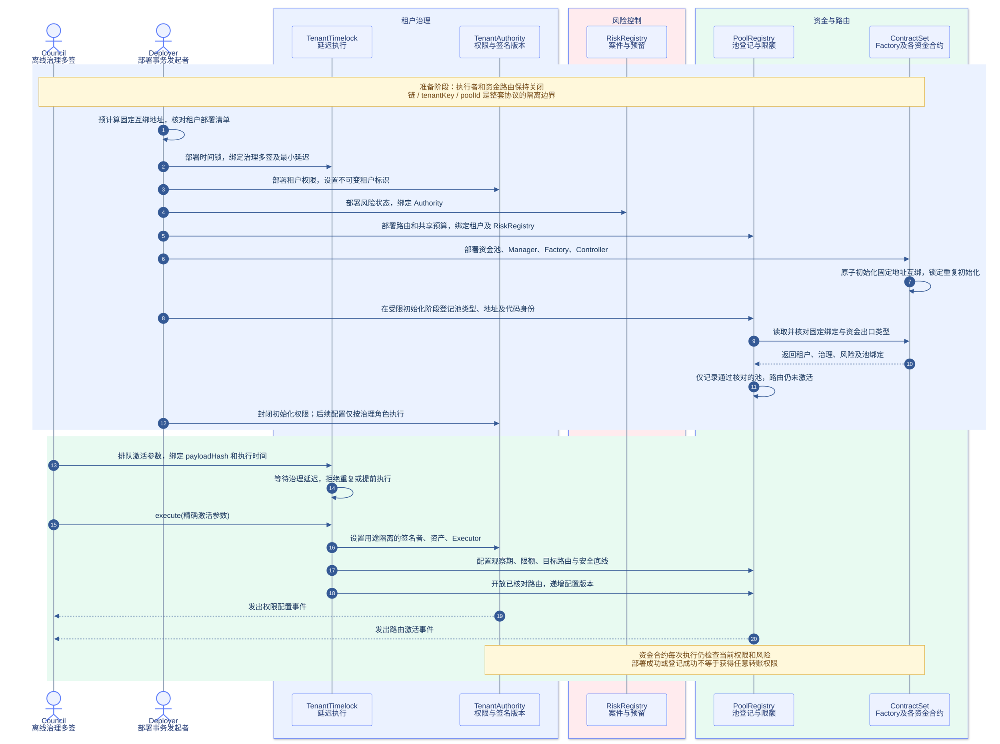

### 01. CREATE2 预测地址、预充值与原子部署

充值地址是固定代码和固定地址域的计算结果，用户地址无需独立私钥；收款能力与主动移动资金的权限分开。

功能重点：

- CREATE2 地址由 Factory、salt、initCodeHash 共同决定；Clone 的 initCode 固定实现地址。
- salt 绑定链、租户、用户标识和地址版本，不复用跨租户或跨版本的地址域。
- 未部署地址也能接收资产；部署不会清除已在 RiskRegistry 中登记的限制。

[SVG 放大预览](sequences/20261011-01-address.svg) · [Mermaid 源码](sequences/20261011-01-address.mmd) · [图册定位](sequences/index.html#20261011-01-address)

展开 Mermaid sequenceDiagram

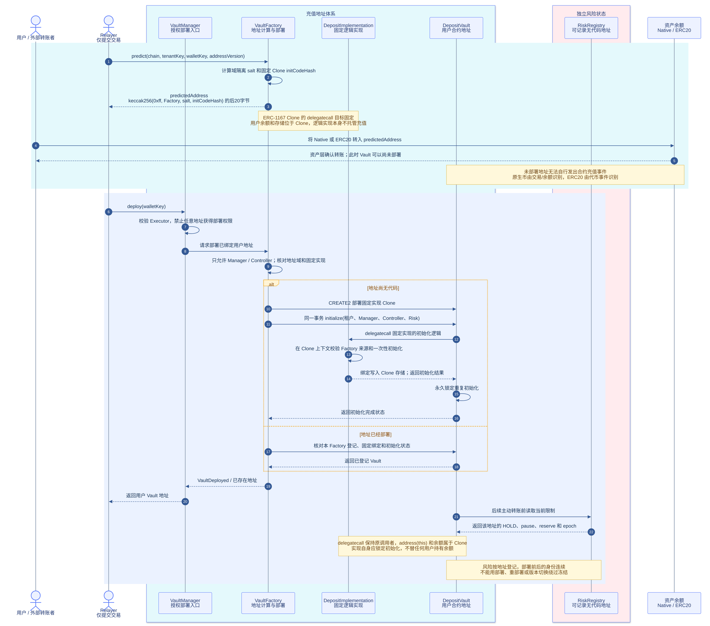

### 02. 资金授权、防重放与原子执行

执行者负责送交易，签名者批准具体业务，合约按当前链上状态作最终裁决；许可消费、预算和资金转移组成一个原子事务。

功能重点：

- EIP-712 Domain 绑定 chainId、校验合约和协议版本；业务结构体绑定租户、用途、资产、金额、目标、证据、有效期及版本。
- 签名有效不等于请求可执行；当前 HOLD、暂停、路由、额度和请求状态仍必须满足。
- 请求 ID 按合约及用途定义命名空间，业务订单在链外保持全局唯一；同一笔订单不能换 ID 重复授权。

[SVG 放大预览](sequences/20261011-02-authorization.svg) · [Mermaid 源码](sequences/20261011-02-authorization.mmd) · [图册定位](sequences/index.html#20261011-02-authorization)

展开 Mermaid sequenceDiagram

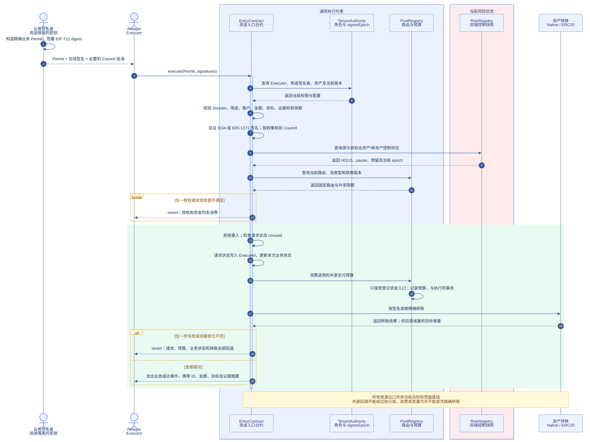

### 03. 单地址授权归集与风险二次检查

Manager 负责验证逐笔授权并编排交易，DepositVault 只执行有限的固定出口；Clearing 的 lot 在收到真实资产后登记。

功能重点：

- 采用全余额精确授权：amount = expectedBalance = 执行时余额；新入金导致旧授权失配，应重新评估并签署。
- Manager 和 Vault 都检查风险及目标绑定，不能只在链外风控或上游合约检查一次。
- 归集和 lot 登记同事务提交，避免资金已移动却没有对应的清算额度。

[SVG 放大预览](sequences/20261011-03-sweep.svg) · [Mermaid 源码](sequences/20261011-03-sweep.mmd) · [图册定位](sequences/index.html#20261011-03-sweep)

展开 Mermaid sequenceDiagram

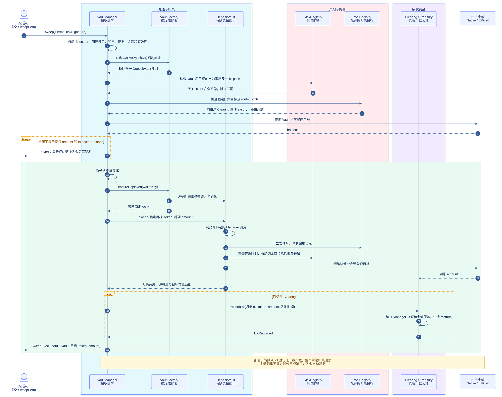

### 04. 批量归集的单项隔离与交易边界

批次是多份独立授权的容器，不能把多个地址合并成一份无限扫款授权；单项失败和外层失败采用不同恢复语义。

功能重点：

- 执行前限制项目数量、calldata、签名长度和单项 gas，并检查重复 ID。
- 子调用失败只撤销当前项；外层 OOG 或最终回滚仍撤销所有已成功项。
- 只以逐项成功事件和请求状态判断执行结果；未执行项保留原 ID 并重新检查有效期和当前版本。

[SVG 放大预览](sequences/20261011-04-batch.svg) · [Mermaid 源码](sequences/20261011-04-batch.mmd) · [图册定位](sequences/index.html#20261011-04-batch)

展开 Mermaid sequenceDiagram

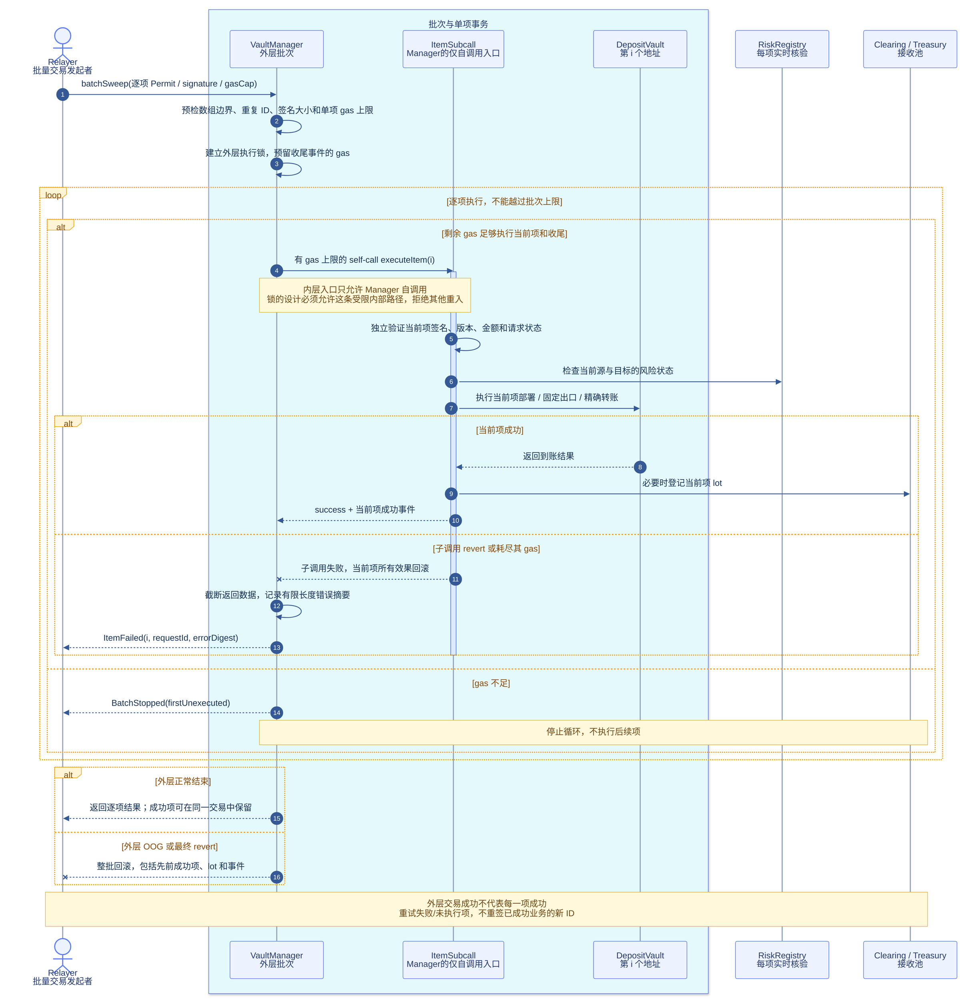

### 05. 观察期 lot、部分结算与余额覆盖

Clearing 将可结算权利记录为 lot，以余额覆盖 outstanding；观察期和逐 lot 释放共同约束普通资金出口。

功能重点：

- lot 由有效归集产生，记录资产、原始金额、已释放金额和 maturity；直接打入池的资产不自动生成 lot。
- 普通结算只使用成熟且尚未释放的 lot，签名同时绑定 lot 列表和逐项金额。
- 释放状态、outstanding 扣减和精确转账同事务变化，部分释放不会产生第二份权利。

[SVG 放大预览](sequences/20261011-05-clearing.svg) · [Mermaid 源码](sequences/20261011-05-clearing.mmd) · [图册定位](sequences/index.html#20261011-05-clearing)

展开 Mermaid sequenceDiagram

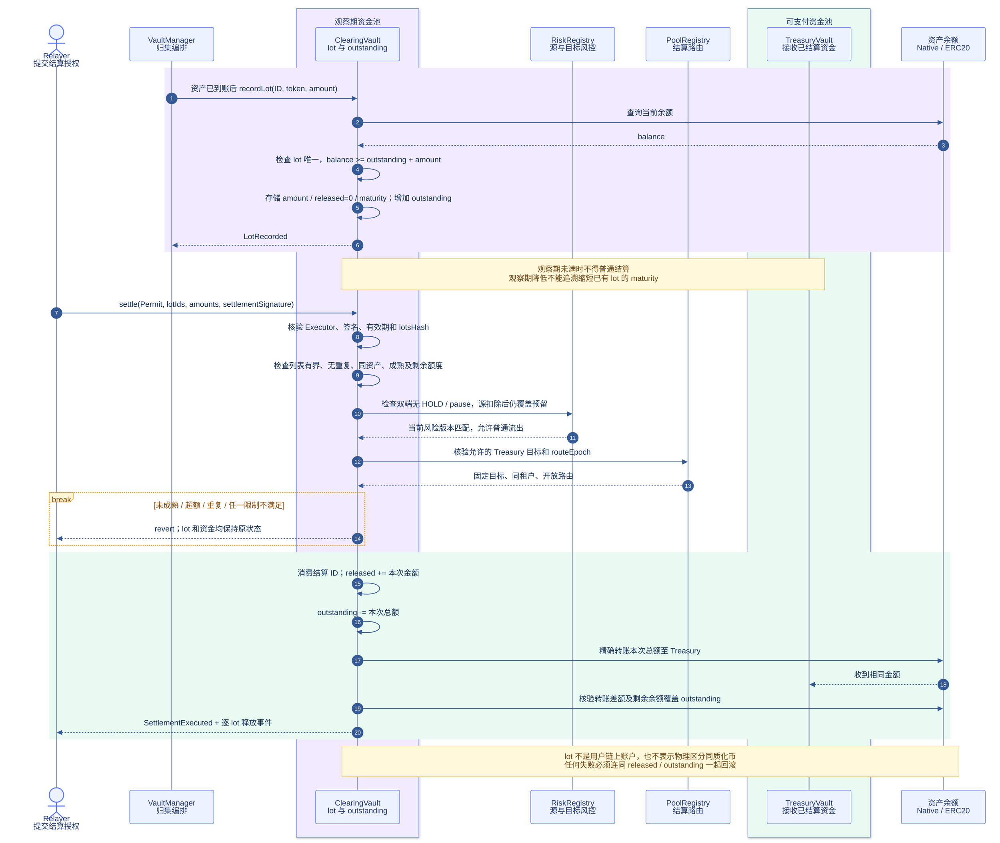

### 06. Clearing 迁移与观察期继承

迁移搬动保管位置和剩余 lot 权利，不制造已成熟状态；来源退休和目标导入必须一次提交。

功能重点：

- 迁移由离线治理批准，并绑定源、目标、lot 明细、金额和当前风险快照。
- 只迁移尚未释放的份额，目标 lot 继承原 maturity，并记录原池和原 lot 来源。
- 目标导入入口只接受登记的同租户 Clearing，复核资产到账和迁移 ID。

[SVG 放大预览](sequences/20261011-06-lot-migration.svg) · [Mermaid 源码](sequences/20261011-06-lot-migration.mmd) · [图册定位](sequences/index.html#20261011-06-lot-migration)

展开 Mermaid sequenceDiagram

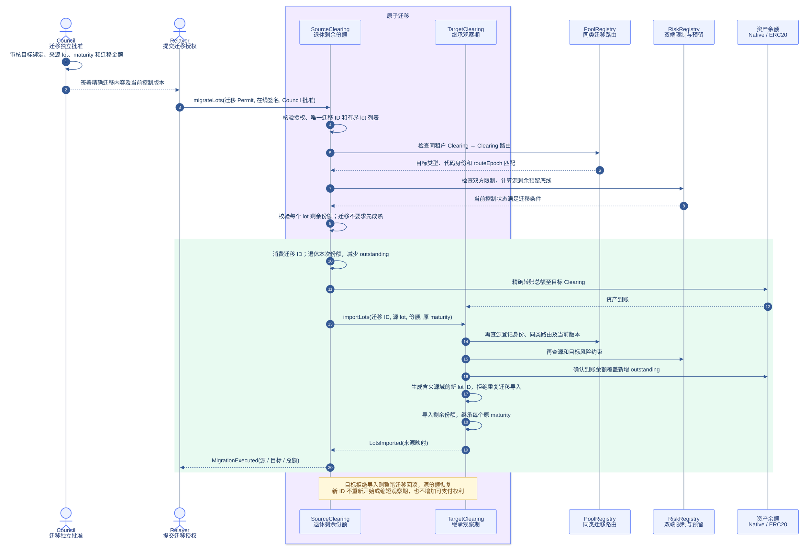

### 07. Treasury 提现、共享限额与取消竞争

Treasury 是普通对外付款的唯一热池入口；链上按确切收款对象、预留底线和共享预算限制签名者的支付能力。

功能重点：

- 外部提现、内部调拨使用不同授权用途；内部资产移动必须走登记路由。
- balance - amount 必须覆盖案件总预留与安全底线；无 HOLD 也不等于余额可以全部支付。
- 取消和付款以链上顺序裁决，已执行不能撤销；暂停和版本变化也能阻断仍有效的旧签名。

[SVG 放大预览](sequences/20261011-07-withdrawal.svg) · [Mermaid 源码](sequences/20261011-07-withdrawal.mmd) · [图册定位](sequences/index.html#20261011-07-withdrawal)

展开 Mermaid sequenceDiagram

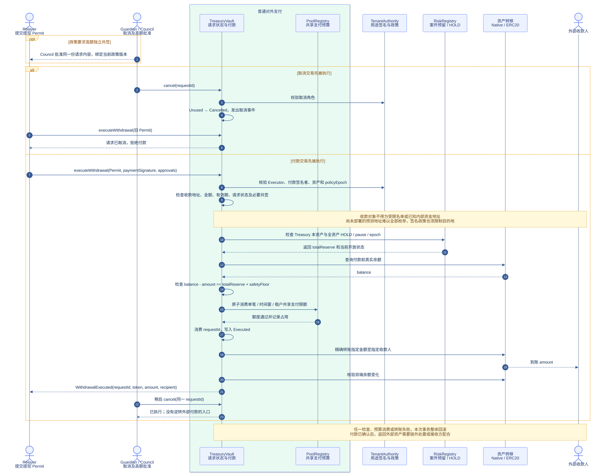

### 08. 热池转冷、离线批准回款与迁移预算

ColdVault 降低在线可支配余额，只接受固定托管路由，回热池逐笔需要离线批准；同租户总敞口不会因切换池而重置。

功能重点：

- 转冷和回款仍是资产移动，必须遵守当前风险、源预留底线和目标绑定。
- 冷池不能直接向任意外部地址付款；回热后仍需独立的普通提现授权。
- 共享限额由租户级 Registry 保存，新增 Treasury、迁移或改路由不能重置计数。

[SVG 放大预览](sequences/20261011-08-cold.svg) · [Mermaid 源码](sequences/20261011-08-cold.mmd) · [图册定位](sequences/index.html#20261011-08-cold)

展开 Mermaid sequenceDiagram

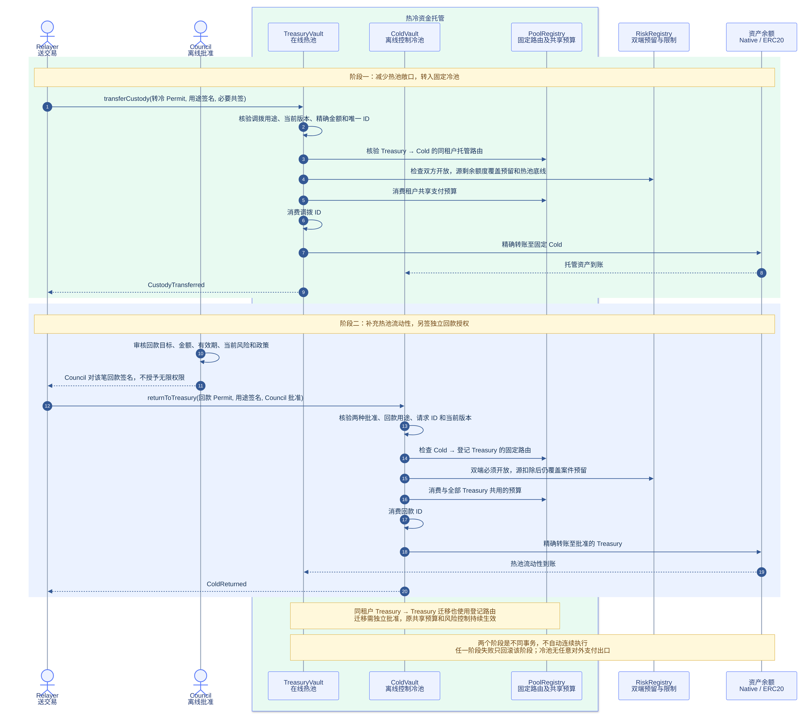

### 09. 风险入金未归集：原地址冻结与旧授权撤销

风险状态位于独立 Registry，可先于 Vault 部署生效；冻结提升版本，使冻结之前签发的归集许可失效。

功能重点：

- HOLD 按案件登记，scope 分全资产与单资产；解除一个案件不能解除其他案件。
- 第三方转入、Vault 部署和请求取消都不能替代当前风险检查。
- 原生币 token=0 的单资产 scope 与 allAssets scope 必须不同；冻结并不阻止继续收款。

[SVG 放大预览](sequences/20261011-09-risk-before.svg) · [Mermaid 源码](sequences/20261011-09-risk-before.mmd) · [图册定位](sequences/index.html#20261011-09-risk-before)

展开 Mermaid sequenceDiagram

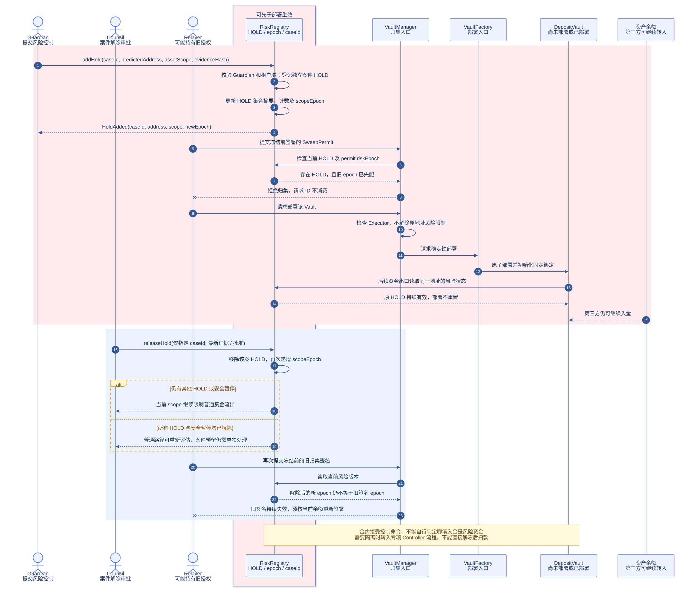

### 10. 风险入金已归集：逐池控制、多案件预留与缺口

归集后必须控制实际持有资产的每个池；链上维护限制与可执行余额，来源证据和案件义务决定隔离金额。

功能重点：

- 冻结原 Vault 不会自动冻结 Clearing、Treasury、Cold 或正在排队的许可。
- 在受影响池按资产建立 HOLD 与案件预留，多案件预留求和；减少预留和解除 HOLD 是两个不同动作。
- 已外付资产没有链上撤回能力；案件义务、可控金额与缺口分开记录，不能让别的租户补足。

[SVG 放大预览](sequences/20261011-10-risk-after.svg) · [Mermaid 源码](sequences/20261011-10-risk-after.mmd) · [图册定位](sequences/index.html#20261011-10-risk-after)

展开 Mermaid sequenceDiagram

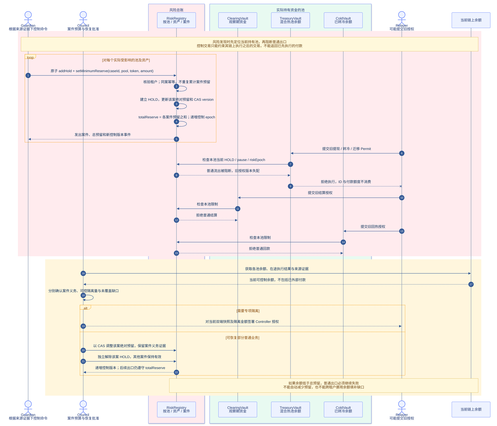

### 11. 专项隔离：批准快照、预留迁移与 lot 退休

DispositionController 为案件处置提供受限的例外资金路径，必须由离线批准精确内容；Quarantine 对转入的全部金额建立限制。

功能重点：

- 批准绑定源与目标完整控制摘要、案件、金额、证据、预留版本、路由及有效期；状态变化撤销旧批准。
- HOLD 例外只允许批准的受限隔离路径，安全暂停始终阻断；其他案件预留不能被消耗。
- Clearing 中的登记 lot 随转出退休；无 lot 的直接入金只能使用 balance - outstanding。

[SVG 放大预览](sequences/20261011-11-disposition.svg) · [Mermaid 源码](sequences/20261011-11-disposition.mmd) · [图册定位](sequences/index.html#20261011-11-disposition)

展开 Mermaid sequenceDiagram

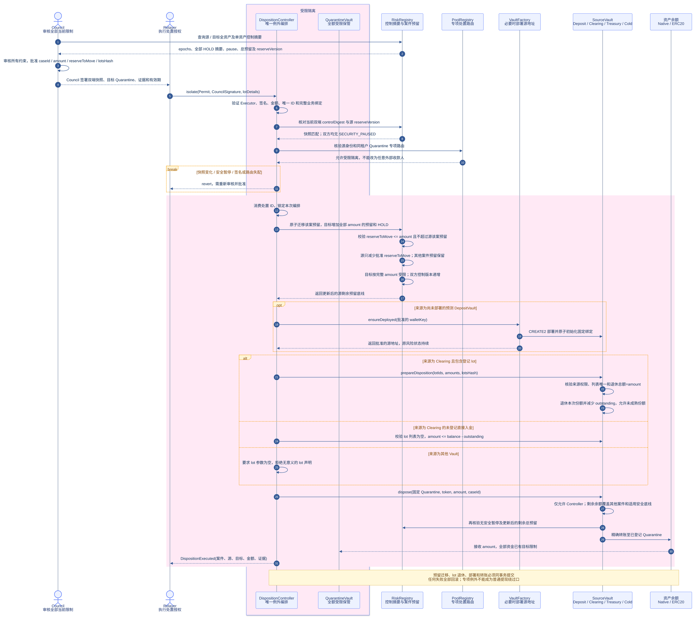

### 12. Quarantine 解控、受控释放与后续独立支付

隔离解除需要案件解除和资金释放两组明确动作；Quarantine 只有回指定 Treasury 的受控出口，没有普通外部支付权限。

功能重点：

- 解除一个 HOLD 不会清除其他案件或安全暂停，也不会自动减记案件预留。
- 释放签名在解除之后按最新快照签发，不能复用隔离授权或解除前签名。
- 部分释放同步减记该案预留，剩余金额继续受限；回热池和外部提现不是同一笔业务。

[SVG 放大预览](sequences/20261011-12-release.svg) · [Mermaid 源码](sequences/20261011-12-release.mmd) · [图册定位](sequences/index.html#20261011-12-release)

展开 Mermaid sequenceDiagram

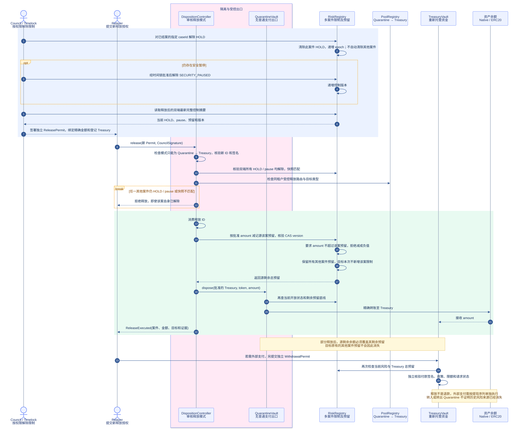

### 13. 紧急收紧、延迟恢复与固定合约版本迁移

紧急角色可以快速降低资金流出的能力；扩大权限、放宽政策和版本切换由离线治理及延迟执行约束。

功能重点：

- 暂停路由不等于暂停所有外部付款；阻断提现必须控制资金池风险或执行者权限。
- HOLD 解除、预留减少和安全暂停解除按各自权限执行，不能笼统地称为一键恢复。
- 固定代码采用新版本部署与显式资产迁移，地址、请求状态和风险限制保持可追溯。

[SVG 放大预览](sequences/20261011-13-governance.svg) · [Mermaid 源码](sequences/20261011-13-governance.mmd) · [图册定位](sequences/index.html#20261011-13-governance)

展开 Mermaid sequenceDiagram

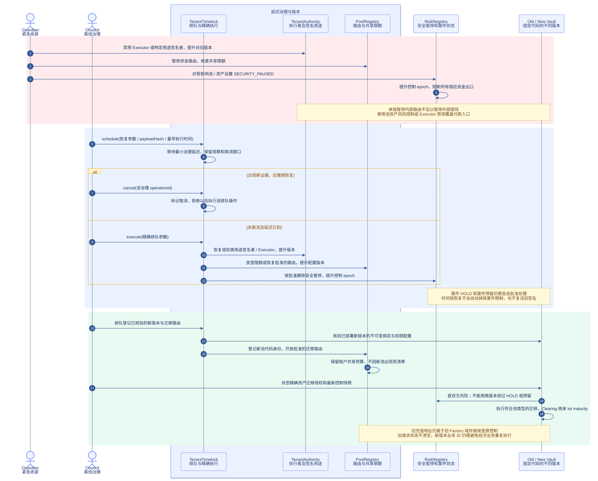

## 5. 开发时应确认的协议决策

- 为每种授权确定独立 typeHash、必填字段、请求 ID 域规则和签名有效期；跨链、跨租户、跨合约和跨用途不能重放。
- 明确治理最小延迟、批次项数/gas/返回数据上限、观察期、共签阈值和共享预算时间窗。参数变化不能追溯放宽已有 lot 或复活旧签名。
- 明确各类资金出口支持的资产语义、Native 与 ERC20 的精确余额校验，以及 ERC1271/资产回调期间的执行锁。
- 明确预留迁移、部分释放、Clearing 无 lot 直接入金、多个案件同时控制和余额不足时的失败条件；专项处置不得消耗其他案件的可控资金。
- 明确部署初始化、固定互绑、新版本迁移、旧地址持续接收资金和未知资产的处理边界，并保持事件与状态可核对。
- 验收应覆盖权限越界、签名重放、版本竞争、取消先后、逐项/外层失败、lot 重复消费、多案解除、安全暂停及预留底线。

本章说明协议原理和设计约束。合约不能自行识别风险来源、阻止第三方入金或撤回已经外部支付的资产；这些边界需要在产品及案件处置流程中持续保留。
