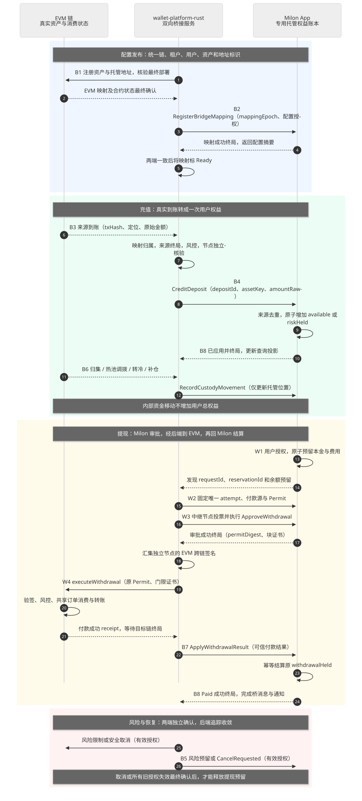
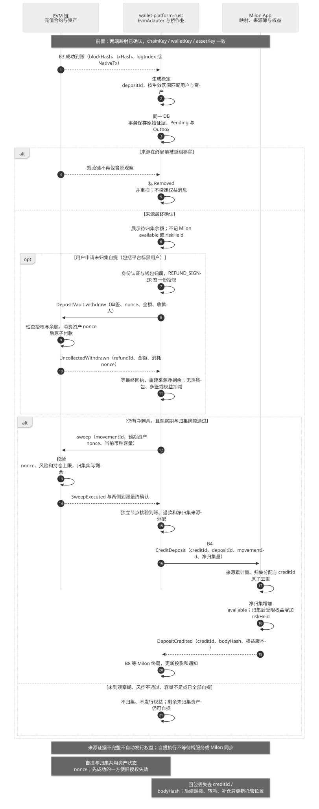
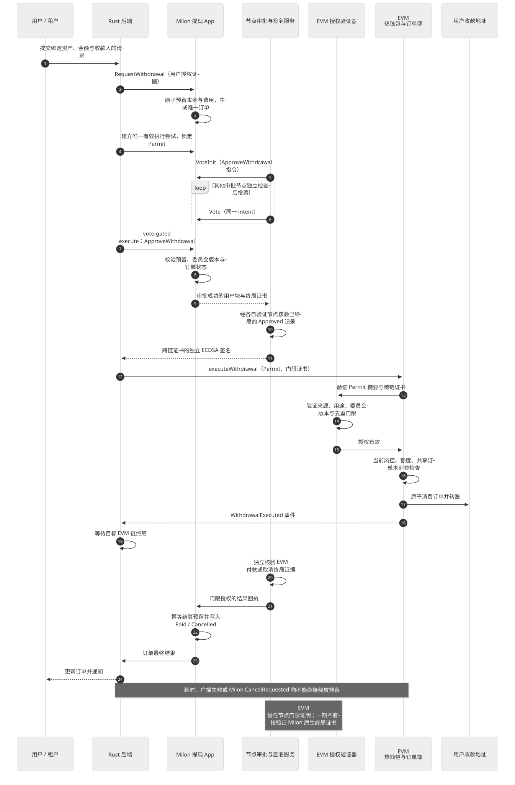
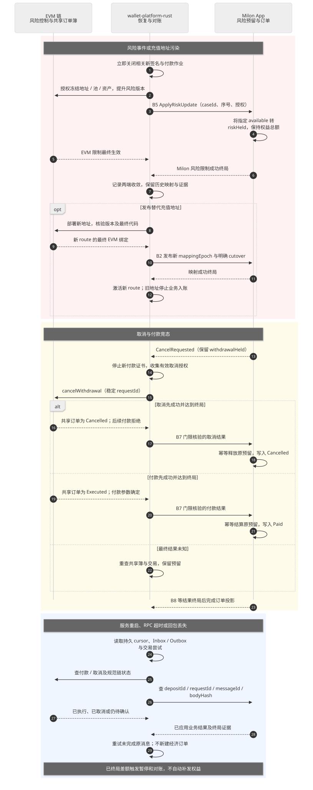

# EVM、wallet-platform-rust 与 Milon App 数据映射及桥接设计

日期：2026-10-11。状态：设计协议与流程图，尚未实现桥接服务和新的链上入口。

本方案落实[需求](需求.md)中的三段流程，承接[多签提现设计](20261011-milon-multisig-evm-withdrawal-design.md)。用户已选择专用托管权益账本：EVM 保存真实托管资产，Milon App 保存对应权益、风险预留、提现预留和最终订单，`wallet-platform-rust` 作为双向桥接服务。以下新接口名称均为拟新增能力。

## 1. 三段如何打通

```text
充值：EVM 最终到账 → Rust 解析、映射、独立节点核验和中继 → Milon 记入权益
提现：Milon 预留并多签批准 → Rust 收集终局证书与桥签名并中继 → EVM 验签付款
回执：EVM 付款/取消终局 → Rust 收集可信结果并中继 → Milon 结算或释放预留
同步：Rust 等 Milon 业务执行终局 → 更新查询视图、完成桥消息并通知用户
```

跨链业务写入经过后端桥接模块。验证节点保留独立读链、审批和签名能力，私钥留在各节点；后端负责传输材料、汇集签名、提交两条链的交易。后端签名不能单独新增用户权益、批准付款或确认取消。每个目标端只接受自身验证通过的业务授权。

| 端 | 权威数据 | 对另外两端的接口 |
|---|---|---|
| EVM | 实际到账、托管位置、风险控制、付款/取消消费状态 | RPC/日志/最终状态读取；Factory、HotVault、风险及订单簿的受控调用 |
| wallet-platform-rust | 映射查询、原始证据、桥作业、交易尝试、Inbox/Outbox 和对账差异 | EvmAdapter、MilonAdapter、AttestationCoordinator；查询与用户通知 |
| Milon App | 用户权益、余额预留、链上审批、映射版本、已应用来源和最终订单 | 现有单一 invoke 协议下的拟新增 App 指令、视图、交易回执与终局证书 |

后端 PostgreSQL 维护 Milon 权益的查询投影；对余额的业务写入在 Milon App 原子完成，投影不能作为第二套独立可扣减的权威余额。EVM 归集、热钱包轮换、转冷与补仓改变托管位置，不增加或减少用户总权益。



总图：[Mermaid](20261011-cross-chain-overview.mmd) · [SVG](20261011-cross-chain-overview.svg)。下文三段的流程号对应图中 B1–B8 与 W1–W4；流程号是图示定位，跨链消息类型由第 7 节的 kind 枚举定义。

## 2. 统一数据标识

### 2.1 链、租户、用户、钱包与资产

约定 `H = Keccak-256`；所有 `H(abi.encode(...))` 的字段顺序、位宽及类型按本文的协议清单封存，不能改用字符串拼接、JSON 或 Postcard 字节直接求同一摘要。域常量使用固定 bytes32；链 ID 统一用 uint256 编码，Milon 的 u64 链 ID 零扩展。

```text
chainKey  = H(abi.encode(CHAIN_V1, namespace, chainId, genesisHash))
tenantKey = H(abi.encode(TENANT_V1, platformNamespace, tenantIdHash))
userKey   = H(abi.encode(USER_V1, tenantKey, tenantUserIdHash))
walletKey = H(abi.encode(WALLET_V1, tenantKey, userKey, logicalWalletId))
assetKey  = H(abi.encode(ASSET_V1, evmChainKey, assetKind, tokenAddress))
```

`namespace、platformNamespace、tenantIdHash、tenantUserIdHash、logicalWalletId` 均为固定 bytes32；`assetKind` 为固定 uint8 枚举，Native=0、ERC20=1；地址为 20 字节。tenant/user 业务标识由注册时保存的规范化映射提供，hash 不能代替身份验证。

| 数据 | EVM 对应项 | Rust 对应项 | Milon 对应资源/字段 |
|---|---|---|---|
| 链实例 | chainId、genesis hash、指定部署 | `chain_instances`、chainKey | `BridgeChain`；来源链与目标链身份 |
| 租户 | TenantAuthority.tenantKey | `tenants.tenant_key` | `BridgeTenant.tenantKey` |
| 用户 | DepositVault 不直接保存用户公钥；由 walletKey 绑定 | tenantKey + userKey + 已验证身份绑定 | `WalletOwnerBinding`；权益归属及用户授权账户/证明 |
| 逻辑钱包 | Factory 的 walletKey | walletKey 的固定用户归属 | `WalletBinding.walletKey` |
| 充值地址 | factory、vault、部署版本 | `deposit_routes`：chainKey/walletKey/generation/mappingEpoch | `DepositRoute`：地址、映射摘要、生命周期与生效区间 |
| 资产 | 原生币或指定 ERC20 合约 | assetKey、decimals、转账语义、assetEpoch | `CustodyAsset`；该链资产独立的权益计量单位 |
| 权益余额 | EVM 中实际资产，不是逐用户余额 | 按 Milon 终局更新的查询投影 | `CustodyBalance(tenantKey,userKey,assetKey)` |
| 托管池 | PoolRegistry、HotVault、冷钱包公开地址 | `custody_locations` 与已知内部地址集合 | `CustodyLocation` 或经授权的托管位置摘要 |
| 审批与桥委员会 | verifier、签名者地址、bridgeEpoch | 版本化公钥映射与签名材料 | 固定多签 owner、committeeEpoch 与配置摘要 |

同名 USDT 或同一地址在不同链上不自动映射为同一 assetKey；不同租户也不共享用户余额。若以后做多来源可替换资产，另建经批准的资产组及来源储备分配规则，不改变一期的逐链计量方式。

充值地址与 Milon 账户分别承担收款和授权作用，两者没有私钥派生关系。不得将 EVM 地址文本当作 Milon 用户身份；同为 20 字节也不意味着算法或地址语义一致。

### 2.2 充值、提现与交易尝试

```text
depositId  = H(abi.encode(DEPOSIT_V1, evmChainKey, txHash, locatorKind, locatorIndex))
requestId  = H(abi.encode(WITHDRAW_V1, bridgeId, milonChainKey, appId, tenantKey, userKey, userNonce))
attemptId  = H(abi.encode(ATTEMPT_V1, requestId, attemptSequence))
movementId = H(abi.encode(MOVE_V1, bridgeId, evmChainKey, operationId))
```

`bridgeId、txHash、operationId` 为 bytes32；`appId` 是按注册表分配的 uint8；`locatorKind` 为 uint8、`locatorIndex、attemptSequence` 为 uint64；用户 nonce 为 uint256。`locatorKind=Log` 时 locatorIndex 为 receipt 的全局 logIndex；一期无原生币事件的直接顶层转账使用 `locatorKind=NativeTx、locatorIndex=0`。内部调用、强制到账等另走证据审查，不能猜测为用户充值。

| 标识 | 保持稳定的范围 | 去重规则 |
|---|---|---|
| depositId | 同一来源到账；即使 tx 在重组后重新包含 | Milon 在全局来源簿只允许记权益一次，不因映射版本或目标用户不同再次入账 |
| requestId | 同一用户经济订单 | Milon 订单唯一；EVM 所有付款源共享消费/取消状态 |
| attemptId | 一次固定付款参数的审批尝试 | 换 Permit、付款源、风险版本或期限时新建，沿用原 requestId |
| EVM txHash | 一次广播交易 | 提高 Gas 或替换 nonce 可产生新 hash，不能产生新 requestId |
| Milon txHash | 一次提交 App 指令的交易 | RPC 超时先查业务状态；重提不新增 depositId/requestId |
| movementId | 一次归集/调拨/转冷 | 内部资产移动的独立业务键，不作为充值权益来源 |

blockHash 用于证明来源观察所属分支，保存在证据中，不加入 depositId；后端观察唯一键可以包含 blockHash。两端还需按业务键去重，不能只依赖某条 RPC 交易 hash。

## 3. 金额映射与权益守恒

采用专用权益账本，`amountRaw` 保持 EVM 原始最小单位、范围 `0..2^256−1`。EVM 用 uint256；Rust 与 Milon 资源使用支持 checked 运算的 256 位数值，跨链字段以 32 字节大端表达。PostgreSQL 可用带整数和范围约束的 NUMERIC(78,0)；JSON 查询金额使用十进制字符串，禁止浮点金额和隐式 u64 截断。

decimals 是注册后封存的显示元数据；资产注册同时验证其转账语义、代码/升级策略与真实收款证据。ERC-20 decimals 是可选方法，不能在缺失时自行猜测，也不能仅凭 symbol 决定映射。[ERC-20 标准](https://eips.ethereum.org/EIPS/eip-20)

Milon 现有 [Token App](../../../app-milon/Milon/app/src/token/mod.rs) 的金额为 u64，且元数据校验 decimals 在 0–9 范围；因此本方案新增 `CustodyBalance` 资源，保留原始精度。若未来另发可交易 Token，需要单独设计发行与锁定协议，本次不创建映射 Token。

例：USDT 原始金额 `12345678`、decimals=6，在 EVM、Rust、Milon 三段均保存 `12345678`，显示 12.345678。ETH 原始金额 `1000000000000000001`、decimals=18，三段均保留原值。

每个租户、每个 assetKey 单独核算：

```text
用户权益 = available + withdrawalHeld + riskHeld
总权益   = 已授权充值 + 经授权的其他权益来源 − 最终外部付款本金
```

总权益包含平台费用权益账户；提现服务费从用户权益转给平台账户，不额外发行或销毁本金。充值待审、未知来源和未确认外部转账不计入总权益。归集、跨热钱包调拨、转冷、冷钱包补仓、风险冻结和预留转换对总权益净变化为 0。

以 100 USDT 权益、提现本金 40 USDT 和费用 1 USDT 为例：初始 available=100；受理后 available=59、withdrawalHeld=41；最终付款后用户 available=59、withdrawalHeld=0，平台费用权益=1，总权益=60，对应托管资产支出 40。若安全取消，原 41 回到 available 或原风险预留，总权益仍为 100。

Milon 的 available 不等于某个 HotVault 的余额。审批时同时检查用户可用权益、EVM 健康流动性及本金预留；风险或冻结资产不能因为存在账面权益就由其他租户垫付。Gas 从平台独立 Gas 账户支付；若要向用户收费，费用必须进入明确授权与守恒核算。

## 4. 映射配置发布与地址轮换

### 4.1 配置发布屏障（B1/B2）

1. 后端生成不可变配置快照：桥实例、两条链、租户、用户授权绑定、资产、托管地址、委员会和 mappingEpoch。
2. 按治理流程确认 EVM 注册及 Factory/HotVault 绑定；读取最终部署代码、chainId、salt/预测地址和权限。
3. 后端携授权向 Milon 提交 `RegisterBridgeMapping`，App 校验配置摘要、权限及递增版本；等待业务交易终局。
4. 后端查询两端的配置摘要及生效点，全部一致后标 Ready，才能向用户发放新地址、为新配置记权益或发起付款。

数据库存在一行记录不代表配置生效。两端任一未终局、配置不一致或桥版本撤销，则保持 Disabled/Preparing 并重试查询。独立签名节点也核对当前配置，不接收后端临时指定的任意来源/资产/用户关系。

当前 [VaultFactory](../../contracts/src/deposit/VaultFactory.sol) 的版本属于 Factory，不是每个用户可独立递增的 generation。新版 per-user 地址轮换需要新的 Factory 接口或版本化 Factory 部署；绑定必须保存 factory + factoryVersion + generation，不能仅按钱包版本号推测 CREATE2 地址。已有地址与历史订单绑定永久保留。

### 4.2 地址退役与新地址生效

后端先关旧地址业务入口并提交 EVM 风险冻结；再把相同 walletKey/userKey 下的新地址映射发布到 Milon，确认两端后激活新 route。Cutover 必须使用最终 EVM 区块与确定的事件位置，不能只用后端本机时间。

旧地址的已入账权益与用户身份保留，历史充值不因轮换重新入账。Cutover 后到旧地址的充值按原需求停止业务入账，仅保留审计与异常处置；停止业务监听不等于删除历史归属。轮换前已观察但未入账的来源，按固定生效区间和案件结果处理，不能套用新映射改换用户。

## 5. EVM 充值 → Rust 桥 → Milon 权益（B3–B6）



充值图：[Mermaid](20261011-cross-chain-deposit-sequence.mmd) · [SVG](20261011-cross-chain-deposit-sequence.svg)。

1. EvmAdapter 保存原始成功 receipt、日志、blockHash、金额和到账地址；ERC-20 核验注册 token 的 Transfer 来源及真实资产语义。
2. 地址/资产/租户映射匹配生效区间；同一 PostgreSQL 事务写入 source observation、deposit 记录和 Outbox。
3. 未终局来源只在后端 Pending；经过目标链终局、来源风控和受理规则后，组织 `DepositCredit` 证据。
4. 后端协调独立节点核验同一来源及归属，汇集门限授权，再向 Milon 提交 `CreditDeposit`。
5. Milon 检查来源簿、mappingEpoch、assetEpoch、消息授权和金额；一次性增加 available 或 riskHeld，返回 DepositCredited。
6. 后端等待该业务交易成功并终局，查询 depositId 的已应用结果，更新权益投影和用户通知。

原生币的现有 DepositVault receive 没有充值事件：一期若接入旧合约，仅核验成功直接顶层转账的确切 value；新版推荐新增标准原生到账事件，以日志定位。每次到账只选择一种主证据定位，不能把同一次原生到账同时按事件和 tx 记两次。强制转入、内部调用和没有可靠到账证据的余额增加先归类 Unknown，不自动生成权益。

DepositRoute 配置固定 nativeEvidenceMode（NativeTx 或 NativeLog）及对应代码/生效区间，App 与签名节点同时检查。不能在事件模式漏扫后退回顶层 tx 再入账；升级记录也不能改变历史到账的主定位。

观察期与归集状态分别保存：入款初审通过可先记 available，允许原需求中的未归集提现；观察期约束后续 sweep。未通过初审的金额留 Pending 或经授权记 riskHeld，不能以“等待观察期”为由默认可提。观察期结束前恶化时，关闭签名入口并同步两端风险状态。

归集的 SweepExecuted、热钱包 TreasuryTransferred、冷钱包补仓等走 `CustodyMovement`。已知内部地址集合包含已发行充值地址、所有池和公开冷地址；对冷地址等无标准出金事件的移动，需要同时绑定付款证据和目的到账证据。它们更新资产位置与对账，不触发 CreditDeposit。

## 6. Milon 提现 → Rust 桥 → EVM 付款 → Milon 结算（W1–W4、B7/B8）



提现图：[Mermaid](20261011-milon-withdrawal-sequence.mmd) · [SVG](20261011-milon-withdrawal-sequence.svg)。

- W1：用户授权请求经后端或直接在 Milon 提交；App 根据同一 tenantKey/userKey/assetKey 检查权益，原子预留本金与费用，写入 requestId。后端通过 MilonAdapter 发现并持久化该订单。
- W2：后端选择付款源并冻结唯一 attempt 与 Permit。`sourceKind=HotVault` 为普通提现；未归集提现为 `sourceKind=DepositVault`，须关联清洁来源及余额锁定，与 sweep 共用资产预留屏障。修改付款源需要旧授权失效证明和重新审批。
- W3：独立节点签署 Milon 业务投票交易，后端代为提交 `VoteInit/Vote`，然后中继 vote-gated execute；只在 ApproveWithdrawal 成功终局后汇集 EVM 跨链签名。
- W4：后端向批准的付款合约提交原 Permit 及证书；EVM 验签、检查风险/额度/资金底线，共享订单簿消费 requestId 后原子转账。
- B7：后端核验 EVM 最终付款或取消，并向独立节点收集结果授权，提交 `ApplyWithdrawalResult`。
- B8：Milon 幂等结算原预留；后端等该结果终局后才将最终状态投影为 Paid/Cancelled 并通知用户。

所有付款源共用同一 WithdrawalBook。DepositVault 未归集提现目前是拟新增入口，现有 DepositVault 只有 sweep/dispose；不能假设现有合约已支持安全的用户退款。归集和未归集付款不能只在数据库中互斥，签名节点、资产预留与 EVM 执行条件都须覆盖同一余额并发。

窗口到期、版本变化或换池前证明所有旧 attempt 不可执行且未付款；活跃 requestId 禁止换目标 EVM 链。取消与付款在 EVM 上争夺同一订单状态；Milon CancelRequested、后台超时或一次 revert 均不能释放 withdrawalHeld。

## 7. 桥消息契约与两端幂等

所有桥消息采用统一逻辑信封，方向为 `EvmToMilon` 或 `MilonToEvm`：

```text
BridgeEnvelope {
  protocolVersion: u16,
  bridgeId: bytes32,
  direction: u8,
  kind: u8,
  sourceChainKey: bytes32,
  destinationChainKey: bytes32,
  destinationAppOrVerifier: bytes32,
  operationId: bytes32,
  actionSequence: u64,
  mappingEpoch: u64,
  assetEpoch: u64,
  committeeEpoch: u64,
  bridgeEpoch: u64,
  bodyHash: bytes32
}
```

destinationAppOrVerifier 使用注册时封存的 32 字节标识，包含 Milon App 标识或按约定零扩展的 EVM verifier 地址；它不直接参与用户身份映射。新版本变更格式时递增 protocolVersion。

kind 枚举封存为 Mapping=1、DepositCredit=2、RiskUpdate=3、CustodyMovement=4、WithdrawalRequest=5、WithdrawalApproval=6、WithdrawalResult=7、AppliedReceipt=8；其他值一期拒绝。risk 状态解除与取消有独立正文 action，不得将同一授权混作充值、批准或结果回执。

`messageId = H(abi.encode(BRIDGE_MSG_V1, 上述全部静态字段))`。重试同一消息保留 messageId；更换证书包装或同成员重新签名不改变 bodyHash。目标端同时保存业务唯一键、阶段状态和已接受 bodyHash；相同业务阶段的冲突正文必须拒绝，不能因新 messageId 绕过幂等。

| 消息 | 方向/入口 | bodyHash 绑定的主要内容 | 业务幂等键 |
|---|---|---|---|
| B1/B2 BridgeMapping | Rust 协调两端；RegisterBridgeMapping | 链身份、租户/用户绑定、资产、地址、配置摘要及生效区间 | mapping scope + mappingEpoch |
| B3/B4 DepositCredit | EVM → Milon；CreditDeposit | depositId、来源定位与 blockHash、walletKey、userKey、assetKey、原始金额、初审证据与入账类别 | depositId，独立于配置版本 |
| B5 RiskUpdate | 两端；ApplyRiskUpdate / EVM 风险入口 | riskCaseId、范围、限制类别、授权序号、版本、生效证据 | riskCaseId + actionSequence |
| B6 CustodyMovement | EVM → Milon；RecordCustodyMovement | movementId、来源/目的地址、资产、金额及双侧确认依据 | movementId |
| W1 WithdrawalRequest | 用户 → Milon；RequestWithdrawal | requestId、用户 nonce、身份授权、本金/费用、资产与目标链/收款人 | tenantKey + userKey + nonce；requestId |
| W2/W3 WithdrawalApproval | Milon → EVM；executeWithdrawal | requestId、attemptId、Permit digest、sourceKind、映射/风险版本、成功审批定位 | requestId；attempt/permit digest |
| W4/B7 WithdrawalResult | EVM → Milon；ApplyWithdrawalResult | requestId、attemptId、结果、付款参数、最终 receipt/共享簿状态、所有旧授权失效依据 | requestId + 最终结果 |
| B8 AppliedReceipt | Milon → Rust 的读取回执 | messageId、operationId、应用状态、bodyHash、业务交易与终局定位 | messageId + 成功应用结果 |

目标端校验 chainKey、bridgeId、App/verifier、协议/配置/委员会版本、用途和授权，重算正文摘要，不接收后端 `verified=true` 作为证明。EVM 付款保持现有 EIP-712 Permit 与证书语义；本信封用于三段关联，不能将其 JSON 编码替代原 Permit digest。[EIP-712](https://eips.ethereum.org/EIPS/eip-712)

## 8. wallet-platform-rust 桥服务内部流程

建议职责模块：EvmAdapter、MilonAdapter、MappingRegistry、BridgeCoordinator、AttestationCoordinator、TransactionExecutor、Reconciler。它们属于同一后端服务的模块，授权密钥由各独立验证节点持有。

| 持久记录 | 内容与约束 |
|---|---|
| chain_instances / asset_mappings / deposit_routes | 版本化链、资产、地址映射；保留历史生效区间和 bodyHash |
| source_observations | 原始 blockHash、receipt/log、定位、finality 状态；保留被重组分支 |
| bridge_messages | messageId、方向、业务键、正文、授权材料引用和当前阶段；业务冲突拒绝 |
| bridge_inbox / bridge_outbox | source 观察与待投递任务；唯一键、可恢复 worker lease、重试/错误 |
| withdrawal_attempts | 原 requestId 下每个 Permit、截止时间、付款源和失效证据 |
| transaction_attempts | 两条链的签名/广播/替换记录；独立 nonce lane；不能以 txHash 替代业务键 |
| milon_balance_projection / custody_positions | 终局权益查询视图与 EVM 资产位置；cursor 包含高度和 blockHash |
| reconciliation_cases | 未确认到账、差额、授权冲突和终局异常；禁止以补发权益自动抹平 |

每次来源落库与 Outbox 建立处于同一 PostgreSQL 事务。网络提交在提交事务后执行；先保存可恢复交易尝试和业务键，再广播。Worker 超时接管前先查目标端 messageId/业务状态，避免误认为失败而重新执行。

桥作业状态统一为：Observed → SourceFinalized → Authorized → Submitted → TargetApplied → TargetFinalized → Completed。实际阶段可等待条件，不能凭后端跳过；Completed 要求目标端业务成功且终局。两条链和数据库采用至少一次投递，加目标端业务幂等实现一次记账，不能声称存在跨链原子事务。

EVM finality 由逐链 FinalityPolicy 配置。Ethereum 的 JSON-RPC 支持 safe/finalized 区块标签，但其他 EVM 链、L2 的最终性规则需单独配置，不能统一写成“确认 N 块即终局”。[Ethereum JSON-RPC](https://ethereum.org/developers/docs/apis/json-rpc/)

Milon 使用包含成功业务交易的用户块终局证书及可信成员集；节点自己验证交易执行和状态。RPC 的 ready、交易可查询、某条事件文本或单一 state_hash 均不是完整业务终局证明。

## 9. 风险、取消与故障恢复



恢复图：[Mermaid](20261011-cross-chain-recovery-sequence.mmd) · [SVG](20261011-cross-chain-recovery-sequence.svg)。

| 情况 | 后端动作 | Milon/EVM 结果 |
|---|---|---|
| EVM 在终局前重组 | 标观察 Removed，重扫规范分支，不投递 CreditDeposit | Milon 不生成权益；tx 重新包含仍用同一 depositId |
| CreditDeposit 已应用但 RPC 回包丢失 | 先查 depositId/bodyHash；已成功就等终局并补投影 | 不重复增加权益 |
| Milon 审批未终局或失败 | 保留预留与订单，等待/安全取消 | 不签发新的 EVM 放款证书 |
| EVM 付款回包丢失 | 查询共享 WithdrawalBook、receipt 和最终状态 | 已付款则只补回执；未知则保留预留 |
| 请求取消 | 关闭后端新授权；中继取消授权至 EVM | 取消先终局才释放；付款抢先则结算 Paid |
| 地址污染/风险事件 | 后端立即关签名 gate，独立通道提交 EVM 限制和 Milon riskHeld 更新 | 两端最终控制分别追踪，未一致前禁新出金 |
| 解除风险 | 使用独立 Release 授权、递增序号和新 epoch，等待两端终局 | 历史冻结消息不可乱序撤销新状态；旧 Permit 不恢复有效 |
| 桥节点/后端重启 | 按持久 cursor、Inbox/Outbox 重扫；查目标应用状态 | 不补造订单，不重复记账，不释放未知付款预留 |
| 配置或成员不一致 | 停止新权益写入/付款授权，核验映射发布屏障 | 已发授权仍依赖 EVM 撤销/暂停实际生效 |
| 深度终局异常或账实差额 | 暂停相关资产和桥授权，建立 reconciliation case | 不靠重放已记账充值或删除用户权益自动修复 |

后端停止运行影响消息推进；已经发出的 EVM 有效证书仍可能被执行。撤销必须在 EVM 落地；Milon 与 PostgreSQL 的“已取消”标记不能单独形成付款屏障。

## 10. 一笔业务在三端的完整对应示例

以下 T1/U7/W7/A1/D1/Q9 是便于阅读的符号别名，实际写入使用第 2 节规定的完整规范标识。A1 是某一指定 EVM 链的 USDT 资产，decimals=6，mappingEpoch=3。

| 阶段 | EVM | wallet-platform-rust | Milon App |
|---|---|---|---|
| 注册 | T1 的充值地址 Vault7、资产合约与热钱包 Hot2 已最终确认 | T1/U7/W7/A1 的映射摘要与两端确认，状态 Ready | 相同映射、用户授权绑定和 assetKey 已注册 |
| 充值 | txA 的 logIndex=5 向 Vault7 转入 100000000 | 生成 D1，保存 txA/5/blockHash 与来源证据，提交原 D1 消息 | CreditDeposit(D1) 一次生效，available=100000000 |
| 归集 | 操作 S1 将本金转入 Hot2 | 内部地址分类，保存 movementId 与位置变化 | 可用权益仍为 100000000，不再次 CreditDeposit |
| 请求提现 | 暂无付款 | 查询并中继同一 Q9，请求本金 40000000、费用 1000000 | Q9 原子预留 41000000；available=59000000 |
| 多签批准 | 只接受绑定 Hot2 的 Permit 和有效委员会证书 | Q9/attempt1/permitDigest 完整关联，等待 Milon Approved 终局 | 保存同一 Q9/attempt1；审批目标链、收款人、本金和费用 |
| 实际付款 | 原子消费 Q9，向指定外部地址付 40000000，产生 txP 付款事件 | 等 txP 终局，收集结果授权，中继 Q9 的结果 | 尚未收到可信结果时仍保留 withdrawalHeld=41000000 |
| 完成闭环 | 托管资产支出 40000000，Hot2 当前余额按实际核算 | Milon 结果终局后投影 Paid；保留 D1、S1、Q9、txA、txP 的关系 | Q9=Paid、withdrawalHeld=0、用户权益=59000000、平台费用权益=1000000 |

重放 txA 来源不能生成 D2 再记一笔权益；付款 txP 重新广播不能生成 Q10；换成另一 HotVault 也不能再次消费 Q9。费用不从 EVM 重复扣一次，也不重新发行一份权益。

## 11. 设计衔接与实现边界

本次统一了三段的数据契约、图中消息号、链上权威与后台作业状态，并明确专用权益账本。当前仓库有 EVM Solidity 合约；Milon 在相邻仓库，现有多签/Token 能力可复用但新权益账本尚未实现；当前工作区没有 wallet-platform-rust 源码。

实现按以下依赖推进：封存 ID/金额/信封 → Milon 映射注册与权益账本 → EVM 共享订单簿及验签/付款源约束 → Rust 双链 Adapter 与 Inbox/Outbox → 节点核验与签名 → 终局对账及恢复。全套接口需有共同 ABI/IDL 清单和摘要向量，之后再开展实现验收。

本次交付是可按消息契约衔接的设计流程，不代表两条链已部署或 Rust 桥已运行。SVG/Mermaid、相对链接与 Markdown 结构须检查；不生成 PNG。
