# Milon 链多签与 EVM 安全提现设计

日期：2026-10-11。状态：设计建议，基于本地 Milon 与当前 EVM 合约源码核对，尚未实现。

本方案补充[原始需求](需求.md)，聚焦已经归集到 EVM 热钱包的资产如何经 Milon 审批后提现。`HotVault` 是新版设计名称；当前 Solidity 实现中对应的出金入口为 `TreasuryVault.executeWithdrawal`。两套名称不代表当前已经实现了新版动态热钱包池。

## 1. 设计结论与安全边界

采用以下路径：

```text
用户请求 → Milon 提现业务 App → Milon 账户多签审批并执行
        → 审批所在用户块终局 → 节点独立签发跨链授权证书
        → wallet-platform-rust 中继 → EVM 合约验签并付款
        → EVM 终局 → 可信结果回执 → Milon 结算预留
```

Milon 已经实现 MIP-25 链上多签。需要新增的是提现业务 App、节点跨链签名服务和 EVM 授权验证器，无需另写一套通用多签引擎。按当前 Milon 仓库形态，提现“合约”应落成 Rust 原生链上应用，使用 `#[app]`、`#[entry]`、`#[resource]`；本次查看的应用入口没有通用 Solidity 合约部署接口。

后端负责请求编排、材料收集、支付 Gas 和结果追踪。付款权由 EVM 合约验证的门限授权控制，后端持有的 Relayer 密钥不应拥有单独批准提现的权限。

一期采用委员会跨链证明：EVM 相信指定节点的门限签名，签名节点承诺自己核验了 Milon 上的终局审批。EVM 不直接验证 Milon 原生 QC。达到门限的跨链签名密钥若被攻陷，攻击者仍可能伪造审批，因此部署隔离、限额、暂停和治理约束是此方案的安全边界。若要求 EVM 自行证明 Milon 审批确实发生，需要另一条路线：Milon 轻客户端和应用状态/执行结果证明。

## 2. 现有代码能复用什么

### 2.1 Milon

本地源码根目录：`/Users/egal/snqu_ws/milon-labs/app-milon/Milon`。

| 能力 | 代码依据 | 对提现的意义 |
|---|---|---|
| 加权多签账户 | [account/mod.rs](../../../app-milon/Milon/app/src/account/mod.rs)、[signers.rs](../../../app-milon/Milon/app/src/account/signers.rs) | 账户保存签名者、公钥、权重与 threshold；可创建审批委员会账户 |
| 链上异步投票 | [account/vote.rs](../../../app-milon/Milon/app/src/account/vote.rs)、[MIP-25](../../../app-milon/Milon/docs/mips/MIP-25-account-vote.md) | 首票携带待执行业务指令，续票累积签名者位图 |
| 投票门控执行 | [account/verify.rs](../../../app-milon/Milon/app/src/account/verify.rs) | 达标后才能执行业务指令；执行前消费 intent |
| 用户块终局证书 | [cert/types.rs](../../../app-milon/Milon/sync/src/cert/types.rs)、[cert/verify.rs](../../../app-milon/Milon/sync/src/cert/verify.rs)、[CONSENSUS.md](../../../app-milon/Milon/docs/CONSENSUS.md) | 等待包含成功审批的用户块终局，不能只观察投票 ready |
| 原生应用注册 | [app/src/lib.rs](../../../app-milon/Milon/app/src/lib.rs) | 提现功能按原生 App 接入；应用编号需从注册表选择未占用值 |
| secp256k1 签名基础 | [secretkey.rs](../../../app-milon/Milon/crates/crypto/src/secretkey.rs) | 可评估复用密码学基础；EIP-712 编码和跨链服务仍需新增 |

MIP-25 的完整动作是 `VoteInit → Vote → vote-gated execute`。`get_vote(...).ready = true` 只说明当前投票权重达到门槛；必须再执行 `ApproveWithdrawal`，确认业务执行成功，并等其所在块终局，才能向 EVM 授权。

需要注意现有限制：

- 同一 owner 有 64 个 intent 登记槽，槽号来自 intent hash 的低 6 位。两个活跃 intent 即使总数远低于 64，也可能碰撞，收到 `VoteIndexFull`；后端需预检并排队。
- 投票登记有效期为 24 小时；首票 proposal 总字节上限为 1024。该期限是 Milon 投票期限，与 EVM Permit 的付款期限不同。
- Proposal 存在首票交易历史里，通过 `source_tx_hash` 拉取；需保证投票期间材料仍可查询。
- 当前 ready 按实时账户成员和权重计算，没有为提现冻结委员会快照。更换成员或阈值可能改变在途投票意义，业务层必须处理。
- 消费 intent 防止一次登记被重复执行，但可以重新登记同一 hash；提现 App 仍需持久订单状态，不能仅靠 intent 消费防重复付款。

Milon 的槽提议使用 BLS 聚合，用户块 `BlockCert / QuorumCert` 保存 FN-DSA 签名。它们的消息域与 EVM 提现不同；即便某目标链具备 BLS 预编译，也不能直接把槽证书当作某笔提现成功执行的证明。

### 2.2 当前 EVM 合约

| 现有入口 | 已实现的保护 | 本方案新增要求 |
|---|---|---|
| [TreasuryVault.executeWithdrawal](../../contracts/src/pools/TreasuryVault.sol) | EIP-712、授权验签、租户/池绑定、风险版本、额度、余额底线、重入保护、先消费再转账 | 接入 Milon 跨链授权；共享提现订单消费簿 |
| [TenantAuthority.verify](../../contracts/src/control/TenantAuthority.sol) | `SignatureChecker` 同时支持 EOA 与 ERC-1271；signerEpoch 校验 | 将 WITHDRAWAL_SIGNER 配置为跨链委员会验签合约 |
| [OperationBook](../../contracts/src/common/OperationBook.sol) | 本合约内执行/取消 tombstone | 当前状态按 Vault 分开，需补齐同部署内跨热钱包的唯一性 |
| [TenantComponent](../../contracts/src/common/TenantComponent.sol) | Relayer 白名单、资产白名单、Permit 时间窗不超过 1 小时 | 与 Milon 投票延迟协调；到期后重新审批执行尝试 |
| [ExactTransfer](../../contracts/src/common/ExactTransfer.sol) | ERC-20 安全转账及精确余额变化检查 | 继续限定支持的资产语义；不默认支持扣税或 rebase 代币 |

当前 `approvalDigest != 0` 检查不证明 Milon 审批真实存在。它只有被纳入签名材料、由正确的验证器校验，才具备授权意义。现有高额提现的独立 Council 联签要求继续适用，不能用同一在线节点委员会代替这一独立控制。

## 3. 明确三种节点动作

| 动作 | 谁执行 | 签名对象 | 证明什么 |
|---|---|---|---|
| 共识验证 | Milon 当前共识验证者 | 槽提议、验签票、块头 | Milon 链执行与终局 |
| 提现业务多签 | 指定审批委员会账户的成员 | Milon `VoteInit / Vote` 或被授权业务指令 | 同意具体提现请求与执行参数 |
| 跨链授权签名 | 指定跨链委员会成员的独立服务 | EIP-712 跨链证书 | 已核验该提现审批成功且终局，可以按绑定 Permit 放款 |

这些角色可由同一批节点运营方承担，但权限、密钥和签名域需要分离。共识节点仅验证交易合法，不会自动核实数据库中的用户余额或外部风控结果。业务审批节点应自行获取可信材料并决定是否投票；外部风控调用放在节点服务中，链上 App 只执行确定性校验。

若要求“验证节点们审批”，应明确选定全部验证者还是专门子集，并将其 Milon 业务公钥登记进委员会账户。推荐每个委员会版本使用固定账户与固定成员；新版本另建账户，旧版本停止建立新执行尝试并处理完在途订单。不能把任意多签账户的通过结果作为平台授权。

等权提现委员会建议 `q = floor(2N / 3) + 1`，例如 4 人需 3 人、7 人需 5 人；按 `N ≥ 3f+1` 和最多 f 个 Byzantine 成员定义威胁模型。加权模式需要分别分析权重集中程度和阈值，不能直接套人数结论。

当前 Milon `block_quorum()` 按配置计算 `ceil(N × num / den)`，文档默认比例为 2/3；该终局机制与提现委员会门限是两个独立问题。其节点规模、容错假设和终局安全应单独确认，不能因为存在 QC 就宣称本方案已经完成共识安全验证。

跨链委员会保存 `milonValidatorId → Milon 审批公钥 → EVM bridgeSignerAddress` 的版本化映射，并验证 EVM 密钥持有证明。审批与跨链成员应按同一批准策略对应；即使采用不同子集，也必须把这一额外信任假设登记进策略。

## 4. Milon 提现业务 App

### 4.1 余额和用户授权从哪里来

要让节点独立判断“此用户确实有余额可提”，仅查询 `wallet-platform-rust` 数据库不够。建议新增提现权益账本资源，或接入现有业务账本的可验证状态：记录租户、用户、EVM 资产映射、可用余额、提现预留、风险预留和版本。

这里的余额是对 EVM 托管资产的提取权益，不默认等同于 MIL 原生币或 Milon 已有 Token。充值、交易结算、内部转账等改变余额的操作都必须纳入该账本；否则只做充值映射仍无法保证提现额度正确。EVM 充值入账需由独立验证节点核验终局和充值事件，再以门限授权记账，按 `chainId + txHash + logIndex` 去重。

若一期只保留 PostgreSQL 权威账本，需要增加可验证的账本承诺/余额证明，或明确依赖受信账本签名者的授权。后者会让安全性继续依赖该签名者；多个节点读取同一个后端 API 不会消除这种依赖。

提现请求也必须有独立可验证的用户授权。用户有 Milon 账户时可使用其账户授权；托管用户则需约定身份绑定和请求签名方式，绑定租户、用户、资产、金额、费用、收款地址、用户 nonce 与期限。不能让后端一个通用平台签名替代全部用户意愿校验。

`RequestWithdrawal` 在同一链上事务中完成用户授权校验、幂等检查和本金加费用预留。不能先批准，再异步冻结余额。金额使用资产最小单位的整数，明确 uint256 边界，不使用浮点 USD 估值来记提现本金。

### 4.2 建议资源与指令

下表是拟新增接口，当前源码尚无这些提现业务入口。

| 资源 | 核心内容 |
|---|---|
| `WithdrawalRequest` | requestId、tenantKey、userKey、用户 nonce、资产、付款金额、费用、收款人、reservationId、业务状态 |
| `WithdrawalAttempt` | requestId、attempt 序号、固定目标链与 HotVault、完整 Permit 或可验证定长字段、permitDigest、审批版本、期限 |
| `WithdrawalCommittee` | 固定 Milon owner、成员配置摘要、桥签名集版本、审批策略、是否允许新尝试 |
| `WithdrawalReservation` | 本金与费用预留、来源账本版本、是否已结算；与订单一一对应 |
| `WithdrawalResult` | 目标链、交易/区块/日志位置、付款或取消类型、可信回执摘要 |

建议入口：

1. `RequestWithdrawal`：核验用户授权并原子预留，生成稳定 requestId。
2. `PrepareWithdrawalAttempt`：固定目标钱包、Permit、风险/策略/签名版本与付款时间窗；同一订单只允许一个可执行尝试。
3. `ApproveWithdrawal`：由指定委员会 owner 授权；检查订单、预留、Permit 摘要、委员会配置和期限，写入 Approved。
4. `RequestCancelWithdrawal`：进入 CancelRequested 并停止新授权，保留预留。
5. `ApplyWithdrawalResult`：核验门限结果证明，幂等应用 Paid 或安全取消结果。
6. `PrepareReattempt`：先证明所有旧付款授权已不可执行且未付款，再保留原预留、建立新的执行尝试。

`ApproveWithdrawal` 使用正常 `Signer` 授权语义，由 MIP-25 提供链上投票门控；不能把“任意一个审批成员”类型用于最终批准入口。普通 bundled threshold 多签也可能满足正常 Signer，若产品要求必须经过链上异步投票，业务入口还要验证该授权确实来自被消费的 vote intent，而不能仅靠客户端约定。

订单状态和预留属于业务 App。账户多签模块仅提供账户授权，不管理用户余额、EVM 地址、付款幂等、撤销竞态或提现回执。

### 4.3 多签的具体执行过程

```text
1. 建立唯一执行尝试，冻结 ApproveWithdrawal 的业务参数。
2. 首个审批成员发送 VoteInit(owner, intentHash, VoteProposal)。
3. 其他成员拉取首票 proposal，核验 intent hash、用户授权与账本预留后发送 Vote。
4. 达到门限后，Relayer 提交包含原业务指令的 vote-gated execute。
5. ApproveWithdrawal 校验当前有效的尝试和预留，成功写入 Approved。
6. 等待该成功业务交易所在用户块的终局，再签发跨链证书。
```

本次读取的 vote 源码通过 `get_block_timestamp()` 判断期限；时间语义以当前实现为准，业务协议分别明确 Milon 毫秒时间和 EVM 秒时间。执行 attempt 绑定具体委员会配置摘要；最终批准时再次核对。委员会账户材料改变后，旧 attempt 不得借助实时 threshold 变化继续审批。

24 小时投票期不允许突破现有 EVM 的 1 小时 Permit 时间窗。自动节点审批应在短时间内完成；若需要长时间人工审核，可先审批不带付款窗的业务请求，随后对具体付款 attempt 再授权。过期、池切换或风险版本更新都需要新 attempt，不能让后端自行修改已批准参数。

## 5. 把 Milon 结果转成 EVM 能验的凭证

### 5.1 节点先验证终局，再签证书

每个节点运行独立跨链签名服务，使用独立 secp256k1 密钥，不将私钥交给 `wallet-platform-rust`，也不复用共识密钥。

签名服务从自己的 Milon 验证节点取得成功交易、执行结果和业务状态，核验对应用户块的完整终局证书及可信 epoch 链。必须检查交易成功、业务状态为 Approved、Permit 完全匹配、预留仍存在、委员会版本有效、未进入禁止出证状态。

`verify_quorum_cert(set, cert)` 接收调用方提供的 set，不能拿后端提供的任意成员表验过签就认为来源可信。需要从受信创世锚点验证换届链、绑定 cert 的 validator_set_id，并重新计算块头 hash、核对高度/state_hash 等字段。自身全节点执行得到的业务状态是一期主要依据；只拿 QC 加一段 RPC 返回的事件文本，不足以证明该事件真的属于证书。

Milon 的全库 LtHash 状态承诺不等同于现成的 Merkle 叶子包含证明。后续轻客户端方案需明确应用资源/回执证明结构，而不能直接设想把 `state_hash + eventHash` 交给 EVM 就可完成验证。

节点持续保存审批块、原始业务材料和 QC。现有证书热窗及稀疏历史保留策略可能使任意老高度的完整 QC 不再可查，不能等几天后才尝试收集这些材料。

### 5.2 统一 Permit 与证书摘要

先固定提现业务上下文，再生成完整 EVM `WithdrawalPermit`；Milon 业务指令绑定完整 Permit 的 digest。`approvalDigest` 可以绑定用户授权、预留和审批策略等预先确定的上下文，但不能包含尚未产生的批准块 hash，避免循环依赖。

现有 Permit 保持绑定 `requestId、tenantKey、poolId、token、to、amount、approvalDigest、poolEpoch、poolAssetEpoch、policyEpoch、signerEpoch、validAfter、deadline`；EIP-712 domain 绑定目标 EVM chainId 和具体付款 Vault 地址。Milon attempt 额外保存目标地址及来源 App/链身份，不把 source identity 隐含在数据库配置中。

建议跨链证书使用另一份固定 EIP-712 类型：

```text
WithdrawalAttestation {
  permitDigest,
  sourceChainId,
  sourceGenesisHash,
  withdrawalAppId,
  committeeId,
  committeeEpoch,
  approvedHeight,
  approvedBlockHash,
  approvedTxHash,
  bridgeEpoch,
  action
}
```

该证书的 domain 绑定目标 EVM chainId、跨链验签器地址及协议版本，`action` 固定为提现批准。节点针对完整证书摘要签名；验签器检查其中的 permitDigest 等于 HotVault 重新计算的 Permit digest，同时核对固定来源和当前有效桥委员会。approvedHeight/blockHash/txHash 提供一致的源链定位；其真实性在一期由门限签名者证明。

多份签名必须签同一证书，不能混用不同批准块或版本。签名恢复出委员会地址后去重计权；建议按地址严格递增提交并限制数量/材料长度。使用经审查的 ECDSA 验签实现检查 low-s、合法 v、零地址和非成员，避免自己写宽松恢复逻辑。[OpenZeppelin 密码学工具](https://docs.openzeppelin.com/contracts/5.x/api/utils/cryptography)提供对应基础能力。

Rust、Milon 与 Solidity 必须共享一致的 EIP-712 字段顺序、位宽和摘要向量。Milon 现有哈希协议以自己的域和序列化为准，不能把 Postcard/BLAKE3 摘要直接当成 Keccak/EIP-712 摘要。现有 secp256k1 签名函数对非 32 字节消息会先做 BLAKE3；跨链签名应传入已经正确计算的 32 字节 EIP-712 digest，并明确 v 的编码约定。

### 5.3 用 ERC-1271 接入现有权限系统

新增 `MilonWithdrawalVerifier`，将其地址配置到当前 `TenantAuthority.WITHDRAWAL_SIGNER`。调用链为：

```text
TreasuryVault.executeWithdrawal(Permit, certificateBytes, councilAuthorization)
  → TreasuryVault.hashWithdrawal(Permit)
  → TenantAuthority.verify(WITHDRAWAL_SIGNER, signerEpoch, permitDigest, certificateBytes)
  → MilonWithdrawalVerifier.isValidSignature(permitDigest, certificateBytes)
```

验证器解码证书，检查 sourceChainId/genesis/App、用途、委员会版本、桥版本和门限签名，验证成功返回 ERC-1271 的标准值。这样现有出金入口可接入门限授权；全局订单消费簿和跨链取消仍需要额外实现。

ERC-1271 验签为只读操作，不能在 `isValidSignature` 内消费提现订单。订单消费放在 HotVault 调用的共享状态合约中，与实际转账处于同一 EVM 事务。[ERC-1271 标准](https://eips.ethereum.org/EIPS/eip-1271)明确了只读验签约束。

## 6. EVM 安全执行要求

每次付款必须依次满足：

1. 目标合约是登记且有效的本租户热钱包；Relayer 权限有效。
2. 从 calldata 重算 Permit digest，验证来源明确的跨链门限证书。
3. 核对固定租户、池、资产、金额、收款人；未被篡改、未过期。
4. 核对当前 signer/policy/risk/bridge/committee 版本及暂停状态，旧版本不得因解冻或恢复而重新生效。
5. 检查收款人限制、资产白名单、单笔/累计限额、余额底线和当前风险预留。
6. 原子消费共享订单状态，再执行转账；转账失败则订单消费和额度一起回滚。
7. 记录 requestId、付款参数、permitDigest/证书引用，供确定性对账。

不要开放 Relayer 任意调用、任意 token approve 或绕过门限的直接外部付款入口。治理和紧急处置拥有各自信任边界；不能宣称委员会可以约束有权替换验签器的治理方。敏感改动采用延时治理，Guardian 可暂停/撤销但不可自行放款。

### 6.1 防止跨热钱包重复付款

现有 `OperationBook` 按单个 Vault 保存状态。相同 requestId 换一个 Vault 再签 Permit，现有本地状态无法自动阻止第二次付款。

新增每个租户、每条 EVM 链所有热钱包共享的 `WithdrawalBook`，key 至少包含来源链/genesis、提现 App 和稳定 requestId。消费只允许登记的热钱包，订单绑定首次有效的经济参数；`Unused → Executed / Cancelled` 不可逆。不能把 Vault 地址、attempt 序号或 Permit digest 当作经济订单的唯一 key。

EIP-712 domain 会阻止旧签名直接在另一个 Vault 重放；共享订单簿进一步阻止同一经济订单重新签成另一份 Permit 后再次付款。[EIP-712](https://eips.ethereum.org/EIPS/eip-712)本身不提供消费状态或自动防重放。

跨不同 EVM 链不能靠一个共享合约去重。一期订单创建时固定目标链，禁止同一活跃 requestId 跨链换目标。迁移热钱包合约或更换订单簿时，必须保留历史消费状态和禁付状态。

### 6.2 委员会换届与紧急撤销

Milon consensus epoch、审批 committeeEpoch、EVM bridgeEpoch、TenantAuthority signerEpoch 的含义不同，分别登记并校验。不要把 Milon 共识换届自动等同于 EVM 验签器换届。

一期通过 Milon 固定委员会配置和 EVM 延时治理协调桥成员安装，并由节点核验两边配置一致后才签新证书。后续若允许旧委员会签名安装新委员会，需要绑定新成员集合、阈值、生效点与版本、禁止回滚，并单独审查密钥失陷恢复流程。

紧急撤销必须在 EVM 真正生效：暂停验签器/付款路径或提升 bridgeEpoch，让旧证书失效。只有 Milon 停止审批，无法阻止已经签出的 EVM 授权继续付款。当前 `PoolRegistry.routesPaused` 不暂停直接对外提现，应使用正确的出金暂停控制。

## 7. 取消、重试与结果回执


时序图：[SVG](20261011-milon-withdrawal-sequence.svg) · [Mermaid 源码](20261011-milon-withdrawal-sequence.mmd)。



状态图：[SVG](20261011-milon-withdrawal-state.svg) · [Mermaid 源码](20261011-milon-withdrawal-state.mmd)。图中 Certified / Submitted 是跨链作业阶段，除非收到可信链上回执，不应由后端单方面改变链上最终账本状态。

### 7.1 成功闭环

后端拿到 txHash 后记录 Submitted，等待目标链规定的终局。节点独立核验正确链、登记 Vault、成功 receipt、准确的 WithdrawalExecuted 事件、requestId、资产、金额与收款人，并查询共享订单状态。结果回执还要绑定 reservation/permitDigest、blockHash、txHash、logIndex 和结果用途。

一期回执由独立结果验证委员会门限授权，Milon App 核对成员版本和来源并幂等应用；以后可替换为 EVM 轻客户端证明。普通后台调用不能直接把订单标 Paid 或释放预留。回执可以复用固定委员会账户的链上多签，但要区别付款授权和结果证明的业务用途。

Paid 后将用户预留结算为已付款，并按审批时确定的规则处理费用。回执重复不重复扣款；回执延迟不再次发送不同订单。Milon 共识暂停时允许保留预留，待恢复后继续结算，不能假设两条链存在原子事务。

### 7.2 安全取消

`CancelRequested` 仅表示申请取消。节点停止出新付款证书，后端/独立应急服务向 EVM 共享订单簿提交取消授权或通过已有治理/Guardian 取消路径完成禁付。

取消与付款由 EVM 的订单状态决定先后：付款先成功则按 Paid 结算；取消先成功则后续付款拒绝。确认取消交易及共享 Cancelled 状态达到 EVM 终局，再提交可信回执到 Milon，才能释放预留。新增桥签名取消入口需使用独立 Cancel 消息类型，绑定同一订单 key，不能让普通 Relayer 任意取消。

如果采用“授权全部过期且未付款”作为安全取消依据，须由节点验证所有历史 attempt 的付款窗都已不可执行、共享订单未消费，并在目标链最终状态上确认；不能以本机时钟超过 deadline 或 RPC 查不到交易作为依据。目标链时间和终局规则必须纳入判断。

### 7.3 重试与换池

广播超时、交易 dropped、nonce 冲突或节点重启时先查询 EVM 订单和交易状态；未知结果保留预留。对同一笔授权可重发或替换 Gas，但不得更改付款语义。一个 revert 只说明那次交易未付款，不证明其授权以后不会付款。

换池、修改 Permit 时间窗或风险版本时，先证明所有旧 attempt 未付款且已不可执行，保留原 requestId 和余额预留，再建立新 attempt、重新多签。可用所有旧授权过期或永久版本撤销来建立这一屏障；若已经在共享簿中永久 Cancelled，该 requestId 不能复用，重新受理需新订单和新的用户授权。

收款人、资产、金额或目标链等经济参数变更也应安全结束旧订单，再生成新 requestId；不得为“重试”绕过原订单的取消屏障。

## 8. 组件责任与实施顺序

| 组件 | 需要实现的内容 |
|---|---|
| Milon 提现 App | 用户授权、权益账本/余额证明接入、原子预留、订单/attempt 状态机、绑定委员会的批准、可信回执与幂等结算 |
| 节点审批服务 | 独立核验用户意愿、账本、风控、目标钱包、Permit；发起/续投 Milon 多签 |
| 节点跨链签名服务 | 终局与审批核验、固定 EIP-712 编码、独立密钥管理、证书材料归档、拒绝任意 digest 签名 |
| EVM 合约 | ERC-1271 跨链验证器、桥配置治理、共享 WithdrawalBook、取消授权、现有风险/额度控制接入 |
| wallet-platform-rust | 幂等订单、Outbox、投票槽调度、签名收集、Gas/nonce 管理、EVM 终局监听、结果回执与恢复 |

建议先固定用户授权/余额权威、委员会成员与故障模型，再封存跨链消息 ABI 和状态机；然后实现 Milon App 与 EVM 验签/订单簿，最后接入节点服务和 Rust 后端。现有仓库未包含 wallet-platform-rust 实现，本方案没有假设它已有多签或安全签名能力。

后续实现验收至少覆盖：错误来源链/App、参数篡改、重复签名、非成员、错误 epoch、未终局出证、审批失败、余额并发预留、跨 Vault 重签同一订单、取消付款竞态、旧授权恢复、交易重组、签名材料不可查询和重复回执。本文本次只完成设计与图表检查，没有运行 Rust/Foundry 实现测试。

## 9. 落地前仍需定稿的业务选择

- 用户在 Milon 上拥有自签账户，还是使用托管身份授权证明。
- 余额以 Milon 权益账本为权威，还是使用可验证 PostgreSQL 账本承诺；充值和交易余额变化如何同步。
- 全部共识验证节点审批，还是固定提现子委员会；一期人数、权重、阈值和换届规则。
- 实际 EVM 目标链及其终局规则、支持的资产语义和提现收费方式。

原需求中的“用户提取未归集余额”属于 DepositVault 的独立出金路线。本方案聚焦热钱包提款；若保留前者，需要将同一用户预留、Milon 审批和跨钱包唯一性约束扩展到充值合约，明确与热钱包提款如何互斥。冷钱包私钥也不参与用户热钱包提款，只在既定离线流程中处理补仓。
