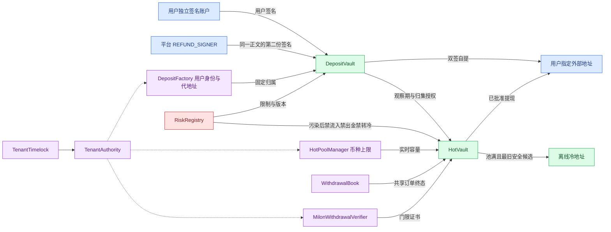

# EVM v2 合约实现与后端对接

日期：2026-10-12。实现目录：[contracts](../../contracts/README.md)。本次以 docs-v2 业务为基础，并采用[最新提现约定](../提现.md)：未归集提现采用**用户签名 + 平台 REFUND_SIGNER 签名**，允许用户指定外部地址，不实施原路返回判断。本文覆盖早期文档的单签自提描述。

## 1. 组件和固定绑定

一个部署对应一个租户和一条 EVM 链实例。租户之间不共用余额、配置、Factory 或订单簿。真实资产在 EVM，已归集权益在 Milon，后端只维护投影和桥作业。



Factory、Manager、Book 和 Verifier 在 Authority 中一次性绑定，并检查租户与交叉组件关系。不能更换共享 Book 来消除已消费订单。Factory 和 HotPoolManager 用固定实现的 EIP-1167 + CREATE2 部署不可升级克隆；generation 按每个 walletKey 独立递增。

## 2. 权限模型

| 身份 | 允许的业务 | 不具备的独立能力 |
|---|---|---|
| 用户 EOA / ERC-1271 | 确认身份绑定；签自提；批准自己的签名地址轮换 | 单方面完成平台托管自提、热池付款 |
| REFUND_SIGNER | 认证用户和钱包归属后，共签同一 RefundPermit；共签用户密钥轮换 | 平台单签自提、自动归集、热池付款 |
| SWEEP_SIGNER | 核验来源、净剩余、观察时间与目标池后签归集 | 外部用户付款 |
| TRANSFER_SIGNER | 签同租户热转热或容量回收转冷 | 改为任意外部目标 |
| COUNCIL_SIGNER | 达到策略门槛的独立大额联签，支持 ERC-1271 | 替代正常业务签名或跨链证书 |
| 跨链委员会 | 至少四名独立 EOA，等权门限严格大于 2N/3；签付款或取消的独立类型证书 | 绕过 EVM 风险、出金预算或共享订单 |
| Relayer | 支付 Gas、中继已批准的原始材料、创建受限数量热池 | 修改金额/收款人、任意 call/approve、单独批准提款 |
| Operator | 身份登记、充值地址轮换、清零后旧地址退役 | 单方更换已有用户签名地址、带余额正常退役 |
| 风控操作员 / Guardian | 收紧风险、增加资产预留；Guardian 还可全局暂停、撤销桥授权、取消未付款订单 | 解除风险、提高上限或转移资金 |
| 延时治理 | 角色、资产、上限、策略、委员会、冷地址、恢复和异常处置 | 绕过等待期直接调用治理接口 |

平台用途签名角色彼此分离，不能兼任中继/运营/风控角色或当前桥成员。治理的提案 Council 与大额 COUNCIL_SIGNER 可以使用适当的独立多签账户，部署时须明确其控制关系。双签依赖用户真实独立控制签名能力；平台保管用户私钥会削弱这一保护。

## 3. 用户身份与充值地址

### 3.1 首次登记

后端完成平台身份认证，解析确定的 tenantKey/userKey/logicalWalletId。用户独立签名账户签署 `WalletBinding`，Factory domain 为 `DepositFactory`、version=`2`、目标 EVM chainId 和该 Factory 地址。Operator 提交：

```text
DepositFactory.createWallet(WalletBinding, userAuthorization) -> DepositVault
```

同一 userKey 首次登记签名地址并从 epoch=1 开始。后续建立其他逻辑钱包必须保持该身份，不允许通过新钱包覆盖现有用户签名者。首次平台身份与 userKey 的真实性仍依赖平台注册流程；用户签名证明其确认绑定及密钥持有。

`walletKey = H(abi.encode(WALLET_V1, tenantKey, userKey, logicalWalletId))`。地址 salt 绑定 tenantKey、chainKey、Factory version、walletKey、generation。平台地址发放前必须核验两链映射和部署代码都已最终生效，不能只凭数据库配置。

### 3.2 签名身份轮换

```text
rotateUserSigner(rotation, oldUserSignature, newKeyProof, platformSignature)
```

旧用户、新密钥持有证明、平台签名全部绑定同一个 `UserSignerRotation`。当前用户地址与预期用户 epoch 必须匹配；新地址不能等于平台退款签名者。成功后用户 epoch 递增，使该用户全部充值地址的旧自提授权失效。

本版本没有单方管理员恢复入口。用户失去当前签名能力时不能直接重置，需要后续单独设计经用户预先授权的恢复机制；平台拒签也会阻止自提。这是双签控制的可用性边界。

### 3.3 地址污染、轮换和退役

1. 风险入口限制旧地址的归集，保持 ACTIVE 双签自提。
2. Operator 调用 `rotateWallet(walletKey, expectedGeneration, reason)`，旧地址永久 `sweepsDisabled=true`，新代地址继承用户签名身份。
3. 后端按新映射的最终生效区间发布新地址。旧地址仍可自提其实际未归集余额，不迁移资金、不重复生成权益。
4. `retireVault` 只接受已轮换的历史地址，检查原生币及所有登记 ERC20 的余额为零。调用方不能传一份遗漏币种的检查列表。
5. 发行方冻结等导致无法清零时，只有延时治理能通过 `retireWithResidual` 明确确认案件后退役。
6. Retired 后禁止自提和归集，晚到账不作业务入账。延时治理可经 `disposeRetired` 移至专用外部处置地址；此事件不构成净归集，不发行权益。

无法枚举任意未登记 ERC20；正常退役覆盖所有支持资产，未知资产由审计和退役处置处理。已退役充值地址和历史冷地址都永久保留内部托管身份。

## 4. 未归集双签自提

### 4.1 API 与签名步骤

HTTP API 属于后端，本仓库提供链上入口和 ABI：

1. 用户认证后请求该钱包的未归集提现，给出 token、原始整数金额、外部收款地址。
2. 后端从最终状态读取 Factory 用户归属、userSigner/userSignerEpoch、DepositVault 余额及 `assetStateNonce[token]`、Authority 的 REFUND_SIGNER epoch。
3. 构造 `RefundPermit`，返回给用户显示钱包、网络、金额、收款人和期限。不能只请求用户签不可解释的裸 hash。
4. 用户签署 domain=`DepositVault`、version=`2` 的 EIP-712 正文。后端验证当前绑定用户的 EOA/ERC-1271 签名和平台身份。
5. 独立 REFUND_SIGNER 服务校验同一业务请求、完整正文和用户签名，再签完全相同的 digest。服务不接收任意 digest 作为签名请求。
6. 任意 Gas 中继者调用 `DepositVault.withdraw(permit, userAuthorization, platformAuthorization)`；签名绑定全部付款参数，中继者无法篡改。
7. 合约核验用户与平台是两个不同签名地址、金额、余额、nonce、用户版本、平台版本及期限，先递增 nonce 再付款。转账失败全部回滚。
8. 后端等待 `UncollectedWithdrawn` 和链上最终状态，按 refundId 幂等记录回执及来源净剩余，不调用 Milon 提现预留，不生成新权益。

两种 EVM 签名地址都支持 EOA/ ERC-1271。用户 EOA 只用于授权，可以不持有 Gas 币，也不用于派生充值地址。ERC-1271 用户账户的自身升级/恢复策略必须由用户控制，不能被平台单方面接管。

### 4.2 RefundPermit 绑定

| 字段 | 校验 |
|---|---|
| tenantKey/userKey/walletKey | 必须与目标合约和 Factory 固定归属一致 |
| assetKey/token | 匹配当前登记资产，金额使用该币种最小单位 |
| recipient/amount | 外部收款地址与金额不可修改，无原路返回判断 |
| assetStateNonce | 充值合约的同币种自提和归集共用一次性状态序号 |
| userSignerEpoch | 匹配 Factory 用户身份版本 |
| refundSignerEpoch | 匹配独立平台自提授权者版本 |
| validAfter/deadline | 当前 EVM 秒时间在窗口内，整份授权窗口不超过一小时 |

风控黑名单、观察期和热池暂停不封锁 ACTIVE 双签自提。Retired 生命周期、没有用户或平台签名、无余额、重放，以及代币自身冻结均会拒绝。拒绝平台已知托管地址作为外部自提目标，防止绕开受控热池入金上限。

## 5. 观察期与净归集

后端重建真实到账、已自提金额和剩余来源，专用 SWEEP_SIGNER 在独立校验后签发 `SweepPermit`。每批最多 32 条 `SourceAllocation`，严格按 depositId 递增，包含 amount、observedAt、sourceRiskEpoch；总分配恰好等于本次归集金额。

合约对每条来源检查 `observedAt + observationWindow <= block.timestamp` 和来源风险版本，还校验充值地址、用户、目标热池风险快照、当前资产/映射/上限/策略/权限版本。归集受该资产风险数量预留约束。

`expectedBalance` 必须匹配实际余额，`assetStateNonce` 必须未消费。先执行的自提或归集改变余额和 nonce，另一份旧授权失效；新到账也使旧余额快照失效。后端必须重新核验并重签剩余净额，不能把已自提部分计入 Milon。

转账通过单次受限同步回调完成：

```text
DepositVault.sweep
  → 校验授权/来源，消费 nonce 与全局 operationId
  → HotVault.acceptDeposit
      → 检查目标容量，回调 DepositVault.releaseSweep
      → 源合约只释放当前指定币种和金额一次
      → 检查真实入账与当前持仓上限
  → SweepSourceAllocated + SweepExecuted
```

任何一步失败都会回滚资金、nonce 和操作消费。只有 `SweepExecuted` 达到终局并由独立入账节点验证真实来源、退款扣除和净分配后，才能生成 Milon `CreditDeposit`。热转热、转冷、冷补仓和退役处置不再次发行用户权益。

合约没有读取任意历史 receipt 的能力。来源真实性与 observedAt 由 SWEEP_SIGNER 声明；每个 depositId 的累计权益与退款/归集额度守恒由 Milon 入账端、独立节点和来源账核验。单看一次 Solidity 时间检查不等同于已经证明原始到账或源链终局。强制原生币转入、未知 token、内部托管转入不得自动当作用户新充值。

## 6. 热池容量、调拨、转冷和补仓

### 6.1 币种配置

`registerAsset(token, decimals)` 注册固定资产身份；`setAssetCap(token, maximumRaw, enabled, expectedCapVersion)` 管理每池对应币种上限。未配置、禁用或上限为零时，不允许新增受控转入。

上限更新由 Timelock 执行，并递增 capVersion；下调至现有持仓以下允许生效，但保持资产和权益不变，只停止新增受控入金。出金预算、底线、Council 门槛通过 `setOutflowPolicy` 单独配置。改策略不清除已花费的日/滚动预算。

每次受控归集、热转热和冷补仓都检查实际余额及目标资产上限，并在转账后重新检查。外部直接转账无法拦截，可以形成超额；只告警与停止受控流入，不自动把未知或污染资产搬进冷钱包。

后台管理 API 可将 `GET` 映射到 `assetConfig/assetCap`，将带 expected_cap_version 的 `PUT` 形成治理操作。普通 Relayer 不可提高限额。API 返回 Pending 作业，只有配置事件和状态最终确认后才更新 Effective 值。

### 6.2 池选择与最旧回收

1. `findCapacity(token, amount)` 在创建序列中寻找能接收整笔金额的健康池。
2. 找不到且池数低于 20/50 时，Relayer 创建新池，重新生成绑定目标池的归集授权。
3. 池数已满、目标币种无健康空位时，`oldestRecyclable(token, amount)` 只选择最旧、持有该币种、风险正常且底线/预留/预算足以安全释放缺口的池。
4. `sweepToCold` 要求 requiredCapacity 非零，源必须是实时最旧合格候选，金额恰好等于缺口，目标和 coldAddressEpoch 匹配当前离线冷地址。
5. 没有候选、资金被冻结、预算不足或金额超过单池上限时继续排队，不能清空其他币种或强行超额。

热转热使用独立 TRANSFER_SIGNER 的 `MovementPermit`、相同币种状态 nonce、来源/目标风险版本、当前余额与容量。大额调拨/转冷也受 Council 与共享出金预算约束。operationId 在所有充值地址和热池间共享去重。

### 6.3 冷钱包

合约仅保存当前和历史公开冷地址。转冷无需冷私钥；交易由 Relayer 中继已授权 Permit。`fundFromCold` 只接受当前冷地址主动签的补仓交易，原生币 msg.value 精确匹配，ERC20 由冷地址在线下批准该热钱包拉取。补仓同样检查风险与上限，不生成新权益。

## 7. 污染资金的两阶段处理

| 阶段 | 链上措施 | 用户/桥接处理 |
|---|---|---|
| 已到账尚未归集 | 限制充值地址/用户/来源风险，拒绝归集；必要时创建新代地址 | ACTIVE 余额仍可双签自提至指定外部地址，不生成 Milon 权益 |
| 地址需要正式退役 | 正常路径全部支持资产清零；残留路径需延时治理确认 | Retired 后停止自提与业务入账，晚到账走异常审计和专用处置 |
| 已进入某个热池 | 限制 `vaultScope(hot)`，拒绝受控流入、所有外部付款、内部调拨和转冷 | 停新证书、追溯归集来源，向 Milon 同步 riskHeld；不能让其他租户垫付 |
| 仅需保留某币种数量预留 | `increaseReserve(vault, token, raw, expectedEpoch, caseId)` | 出金可用量扣除预留，用户总权益不因此被删除 |
| 风险解除 | Timelock `release` 并递增风险 epoch，重新核验和签发新 Permit | 旧风险事件不能乱序覆盖新状态，旧付款授权不复活 |
| 已转入冷地址后发现污染 | 禁止向该冷地址继续受控转入或由其补仓 | 历史转账不能撤销，需离线隔离、案件核验及后续处置 |

ERC20 资产具有同质性，合约不能从混合余额中凭空识别并“抽出原来的坏币”。v2 在归集前以充值地址隔离，在归集后冻结受影响托管池，来源和金额追踪由链下证据与 Milon 风险权益配合。代币发行方的冻结仍受代币代码约束。

## 8. Milon 审批付款与共享订单

`HotVault.executeWithdrawal(permit, certificate, councilAuthorization)` 只接受已登记中继。

1. 检查固定租户、池、用户、资产、金额、外部收款人、映射、资产、风险、策略、Authority、signerEpoch 和一小时内时间窗。
2. 本 HotVault 重算完整 Permit digest，交给固定 Verifier 的 ERC-1271 接口。
3. Verifier 检查固定 sourceChainId/sourceGenesisHash/withdrawalAppId、committeeId/epoch、bridgeEpoch、用途和成功审批定位，恢复成员签名并严格按地址递增去重。
4. 节点必须对同一份证书签名；达到等权门限后，大额付款再要求独立 Council 对同一 Permit 批准。
5. 核验余额底线、风险预留、单笔/UTC 日/保守滚动预算。
6. 在共享 WithdrawalBook 消费稳定 requestId，再付款。失败会回滚消费、预算和状态 nonce。
7. `WithdrawalExecuted` 包含 requestId、userKey、token、收款人、金额、Permit digest 和证书 hash，供结果节点独立核验和向 Milon 中继终局回执。

滚动预算包括当前及之前 24 个小时桶，因此可保守限制约 24–25 小时；不会在 UTC 午夜使最近 24 小时预算意外清零。每个热池各自按币种计预算，不是租户总出金预算。

经济订单键绑定 bridgeId、来源链 ID、genesis、App、tenantKey、requestId，不包含付款池、attempt 或 Permit digest。相同 requestId 换另一热池重新签名仍不能再次付款。不同 EVM 链不能靠本簿互相去重；Milon 必须固定每个活跃订单的目标链。

一期的证明信任是门限委员会，不是 EVM 内的 Milon 轻客户端。成员必须独立核验成功 ApproveWithdrawal、预留、用户授权、策略及可信来源终局，不能拿后台 `verified=true` 或投票 ready 出证。

## 9. 取消、撤销与重试

`WithdrawalBook.cancel` 使用独立 `CancelPermit` 和 `CancellationAttestation`（action=2），付款批准证书不能替代。取消和付款争夺同一状态：

```text
Unused → Executed：付款先成功，后来取消拒绝，Milon 按 Paid 结算
Unused → Cancelled：取消先成功，任何热池后续付款拒绝，禁付终局后才释放预留
```

Guardian 可在桥暂停时用带 reason 的 `cancelByGuardian` 禁付未付款订单，没有借此转账的能力。已 Executed/Cancelled 的 requestId 永远不可重新使用。

委员会换届、桥暂停/恢复与 revoke 都递增 bridgeEpoch；Authority 另有 withdrawalSignerEpoch 紧急撤销。风险解除也递增对应 epoch，旧证书/旧 Permit 不会恢复。

广播超时、revert、过期或 Gas 替换时先查共享簿、规范链 receipt 与终局状态。单次 revert 不证明一份授权以后不可执行，未知结果不能释放 Milon 预留。换池/期限/策略前由独立节点证明旧 attempt 未付款且不可执行，再对相同 requestId 发新 attempt；经济参数改变应安全结束旧订单后另建用户请求。

## 10. ABI、版本与事件消费

接口交付：[eip712.json](../../contracts/interfaces/eip712.json)、[vectors.json](../../contracts/interfaces/vectors.json)、[ABI](../../contracts/interfaces/abi)。domain version 全部为字符串 `2`，名称分别为 DepositFactory、DepositVault、HotVault、MilonWithdrawalVerifier、WithdrawalBook。chainId 使用执行 EVM 链 ID，verifyingContract 使用实际调用克隆地址或实际组件地址。

所有原始数量保留 uint256，JSON/API 使用十进制字符串；用户/平台 EOA 签名为 65 字节 r/s/v，v=27/28、low-s。ERC-1271 的签名内容由相应智能账户规范定义；不能强制将其解释成 EOA 65 字节。委员会仅支持独立 EOA 标准签名。

跨链证书编码为 `abi.encode(Attestation, bytes[])`，正文由目标合约重算；不能把 JSON、Postcard 或 Milon 的 BLAKE3 digest 当作 EIP-712。SourceAllocation 数组哈希按每条规范 structHash 拼接后 Keccak，数组顺序不能调整。

后端观察主事件：NativeDeposited、WalletCreated/WalletRotated、UserSignerRotated、UncollectedWithdrawn、SweepSourceAllocated/SweepExecuted、CustodyMovement、RiskUpdated、AssetCapUpdated、WithdrawalExecuted、OrderCancelled。为每条记录保存 txHash/blockHash/logIndex，按逐链 FinalityPolicy 等终局后才写有效投影；重扫与至少一次投递按业务标识幂等。

## 11. 部署与验证入口

具体配置、工具链和命令见 [contracts/README](../../contracts/README.md)。DeployTenant 校验目标链、nonce，输出仅公开清单。PrepareActivation 生成真实批次 calldata 并先本地模拟全部操作；Council 提案、等待两天、执行原批次后才解锁。

测试覆盖双签缺失/混用/篡改、EOA/ERC-1271、密钥轮换和地址换代、退役与异常处置、自提/归集先后竞态、逐来源观察期、实际余额变更、按币种容量与并发上限、20/50 池数量、最旧健康池转冷、冷补仓、委员用途/来源/门限/epoch、跨池去重、取消竞态、原生/代币失败回滚、单笔/日/滚动预算、安全底线、风险冻结和解除、真实 Timelock 激活、跨语言摘要向量及随机交错本金守恒。

本地验收结果：8 个 Foundry 测试套件、72 项测试全部通过，其中 3 项 fuzz 各执行 256 组输入；随机交错守恒测试每组执行 16 步资金操作。Solidity 0.8.28 构建无警告，格式检查通过。9 个业务合约的运行代码均小于 24,576 字节，部署 initcode 均小于 49,152 字节；最大运行代码为 HotVault 的 21,238 字节。Markdown 链接/代码块和中文 Mermaid 渲染已检查。

本仓库实现 EVM 端。Rust HTTP API/桥服务、Milon 权益 App、独立节点的来源和终局核验及签名服务需要按以上 ABI 和约定对接；本地 Solidity 测试不代替两链实际终局和完整生产联调。
