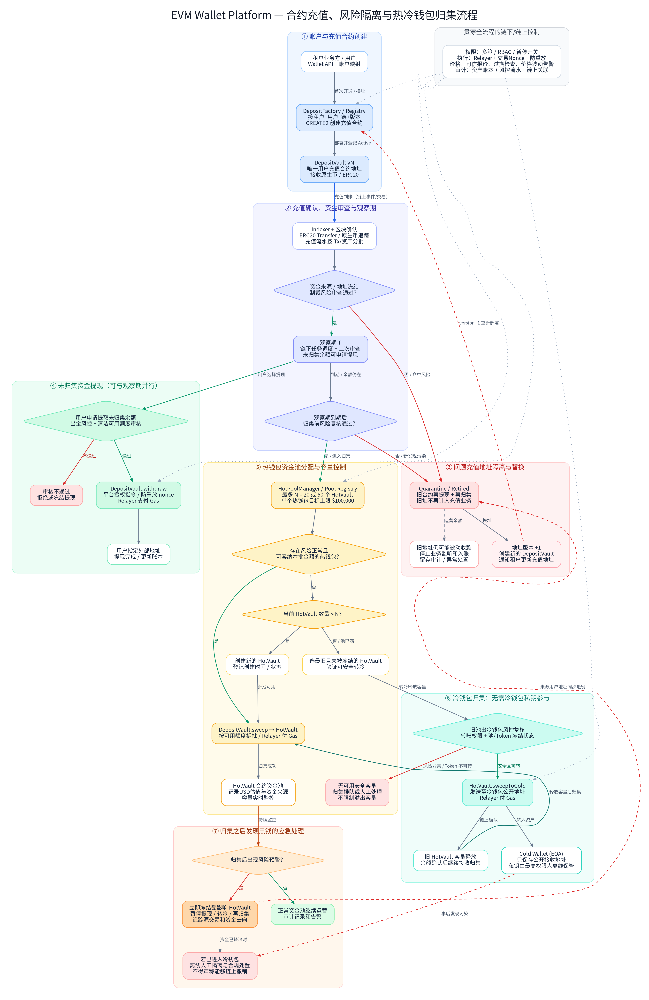

# EVM-Chain端

-EVM链Wallet-platform设计需求：1.
用户的充值地址不是传统的助记词派生地址，而是使用充值管理合约为每个用户创建的唯一充值合约（这个合约支持充值，充值的币不立马归集而是有一短时间的观察期，观察期间充值地址没有问题才归集到热钱包，未归集的币是支持用户自己提现的），这个合约地址如果被“黑钱”污染或者是被冻结了可以生成一个新的合约地址，旧的合约如果还收到充值则不管（不再支持用户的提现，后端服务也不再监听这个地址）；2.
热钱包资金池也是有资金池管理合约生成的：资金池管理合约可以生成上限为20或50的热钱包合约，每个热钱包合约最多支持10万USD的归集，如果归集时这几十个热钱包都达到了上限，则将最旧的那个热钱包合约中的币转入冷钱包（这个冷钱包的私钥由最高权限人掌控，不会出现在合约和系统任何一个地方）中。根据我的这些需求描述，生成一份设计流程图

# EVM Wallet Platform — 智能合约钱包架构与业务流程图

根据你的需求，建议采用 双 Factory 合约 + 用户独立充值合约 + 热钱包合约池 + 离线冷钱包 的架构。

核心设计原则：

- 充值隔离： 每个租户用户拥有独立充值合约地址，污染后通过版本升级生成新地址，旧地址退出业务。
- 观察期： 充值不立即归集，先进行区块确认、资金来源风控和观察期管理；通过风控的未归集资产允许用户申请提现。
- 热钱包池： 最多创建 20 或 50 个热钱包合约，每个合约持有的资产总价值不超过 100,000 USD。
- 冷钱包归集： 热钱包池满额时，优先将最旧且风险正常的热钱包资金转至冷钱包，释放容量。
- 风险隔离： 区分归集前和归集后发现黑钱，避免问题资产继续进入其他资金池。

整个设计中，合约负责资产控制和权限校验，链下 Wallet Platform 负责链上监听、风控、观察期调度和交易发起。

## 完整设计流程图

高清 PNG · SVG 矢量图 · Mermaid 可编辑源码

可编辑源码：[evm_wallet_platform_flow.mmd](evm_wallet_platform_flow.mmd)

## 需要重点明确的设计细节

1\. 充值地址退役并不等于链上地址失效

建议使用 `DepositFactory + CREATE2 + version` 为同一个用户生成新的唯一充值合约。

[image](https://www.google.com/s2/favicons?domain=https://eips.ethereum.org\&sz=32)

Ethereum Improvement Proposals

&#x20;旧合约进入 `Retired` 状态后，禁止提现和归集，后端停止业务入账监听。但是，不能阻止别人直接向旧地址转入
ERC20，因此必须保留异常资金处置方案。

2\. 观察期内提现必须受到风控约束

用户可以申请提现未归集余额，但只能使用已经通过资金来源审查的可用余额。不能允许风险待确认的资金通过用户提现绕过观察期，否则整个污染隔离机制将失效。

3\. 热钱包 100,000 USD 上限不是天然的链上硬限制

可以在受控的归集操作中实施额度校验，但外部仍能向 HotVault 直接转账，而且代币价格变化也会导致估值超过上限。因此需要链下估值监控、归集额度预留和异常超额处理。

4\. 冷钱包私钥完全不需要参与归集

`HotVault` 合约只需知道冷钱包的公开地址，归集交易由授权 Relayer 发起并支付 Gas。冷钱包只接收资金，私钥不进入 Wallet
Platform、热钱包合约或充值合约。

建议使用多签、分级权限和紧急暂停能力控制敏感操作。

[image](https://www.google.com/s2/favicons?domain=https://docs.openzeppelin.com\&sz=32)

OpenZeppelin Docs

5\. 归集后发现黑钱是必须重点控制的风险

一旦污染资金进入某个 HotVault，应停止该热钱包后续出金和转冷操作，并追踪受影响资金。如果已经归集到冷钱包，则只能通过离线隔离和合规处置处理，无法撤销已经确认的链上转账。

这套方案中，最值得进一步细化的是 DepositVault、DepositFactory、HotVault、HotPoolManager
四种合约的接口、权限模型与资金状态机。这将决定观察期、用户提现和污染资金隔离能否真正由合约强制执行，而不是仅依赖后端数据库状态。

## Milon 链审批与 EVM 提现补充需求

提现在 Milon 链发起，由指定验证节点组成的提现审批委员会完成链上多签。审批交易成功执行并取得 Milon
用户块终局证书后，节点独立核验审批记录，使用各自独立的跨链签名密钥为同一提现授权出具签名。`wallet-platform-rust` 收集签名并支付
EVM Gas，调用指定热钱包合约；EVM 合约自行验证门限签名、订单唯一性、授权有效期、风险状态和资金限额，再向已审批的收款地址付款。

Milon 已有 MIP-25 账户多签，因此复用 `VoteInit / Vote / vote-gated execute`，新增提现业务 App 管理订单、余额预留、审批和结果回执。后端的
RPC 查询结果不能直接替代 EVM 合约验签；Milon 共识签名也不能直接当成 EVM 提现签名。

完整方案、代码依据和异常恢复规则见 [Milon 链多签与 EVM 安全提现设计](20261011-milon-multisig-evm-withdrawal-design.md)。

# Milon端

- EVM两的 流程图可行，现在重点需要结合
  Milon链（/Users/egal/snqu_ws/milon-labs/app-milon/Milon）来完成提现：提现的多签需要在milon链发起，然后验证节点们验证通过了拿到结果后，通过
  wallet-platform-rust 后端 调用 热钱包池合约执行提。需要重点考虑在milon
  链端是怎么实现链上多签，还有怎么在EVM合约中怎么安全的执行提现，在milon链端是不是需要编写提现相关的多签合约？

需要在 Milon 链新增提现业务 App，通用多签机制可以直接复用现有 MIP-25。 我已核对代码，并将方案写入提现设计文档 (
docs-v2/evm-wallet-platform-contract-design/20261011-milon-multisig-evm-withdrawal-design.md)。

建议流程为：

1. Milon 受理并预留余额：保存唯一订单，绑定用户、资产、金额、费用和收款地址。
2. 节点链上审批：通过 VoteInit → Vote → vote-gated execute 执行 ApproveWithdrawal。投票 ready 后，还要确认业务执行成功及所在块终局。
3. 节点签发跨链凭证：各节点独立核验审批记录，用独立 ECDSA 密钥签署同一份提现证书。
4. Rust 后端提交交易：收集签名、支付 Gas，调用指定热钱包。
5. EVM 自行验签付款：验证门限、参数、期限、委员会版本、风险状态和限额，消费订单后转账。
6. 结果回到 Milon：EVM 付款最终确认后，通过可信回执结算余额预留。

当前 EVM 的 TenantAuthority 已支持 ERC-1271，可以接入新增的 MilonWithdrawalVerifier，让热钱包验证节点门限证书。ERC-1271
标准 (https://eips.ethereum.org/EIPS/eip-1271)

安全上需要特别补齐三点：

- 余额依据：节点必须独立验证用户授权和余额；多个节点查询同一个后端数据库，仍然依赖该后端。
- 跨钱包去重：所有热钱包共享订单消费簿，防止换池后同一订单再次付款。
- 取消屏障：Milon 请求取消后保留余额预留，等 EVM 禁付最终生效才能释放。

一期方案的信任边界是跨链签名委员会。若要求 EVM 直接证明 Milon 审批真实存在，还需实现 Milon 轻客户端及业务状态证明。

已补充需求文档和两张流程图，仅保留 Mermaid、SVG，本次生成的 PNG 已移除。图表渲染与链接检查通过；目前完成的是设计，尚未实现链上代码。

