# EVM 彩色泳道图

日期：2026-10-11。合约基准：`23b031f`。后端 API、签名任务、索引和账本为接入设计，尚未实现。

[打开可缩放图册](index.html) · [流程与 API 说明](../20261011-07-evm-flowcharts-and-api.md) · [全部 12 图可编辑画布](20261011-evm-wallet-all-flows.excalidraw) · [原方块图](../flows/README.md)

## 阅读方法

纵向按阶段推进；泳道表示责任方。蓝色为 API，紫色为后端与签名，绿色为合约，青色为索引/账本，红色为风险控制，橙色为判断或待确认。节点只写短动作；精确参数、边界条件和失败恢复写在图外。

每张图均由 Mermaid flowchart 经 Excalidraw MCP 转换，并重排为固定职责泳道。Mermaid 源码与 SVG 的节点、判断、边保持一致；各 Mermaid 渲染器对子图的自动布局可能不同。固定列的阅读效果以 SVG 和 Excalidraw 为准。

## 图目录

| 图 | 内容 | 源码与编辑 |
|---|---|---|
| [00 · EVM 钱包业务全景](20261011-00-overview.svg) | 常规资金路径 Deposit→Clearing→Treasury，冷热调度另见 09；合约不会自动识别风险来源。 | [Mermaid](20261011-00-overview.mmd) · [Excalidraw](20261011-00-overview.excalidraw) |
| [01 · 地址发行与预充值准备](20261011-01-address-issuance.svg) | 接口：POST /v1/wallets/{id}/addresses，chain、mode=USER/ORDER 和订单键；GET 查询已发行/历史地址。 | [Mermaid](20261011-01-address-issuance.mmd) · [Excalidraw](20261011-01-address-issuance.excalidraw) |
| [02 · 充值入账与授权归集](20261011-02-deposit-sweep.svg) | 合约：VaultManager.sweep / batchDeployAndSweep；单项内部消费 ID→Factory.deployVault→DepositVault.sweep→Clearing.recordLot。 | [Mermaid](20261011-02-deposit-sweep.mmd) · [Excalidraw](20261011-02-deposit-sweep.excalidraw) |
| [03 · 观察期结算与 lot 释放](20261011-03-clearing-settlement.svg) | 普通结算入口 ClearingVault.settle，目标 Treasury；lot 数组 1—50 项且无重复，累计 released≤amount。 | [Mermaid](20261011-03-clearing-settlement.mmd) · [Excalidraw](20261011-03-clearing-settlement.excalidraw) |
| [04 · 提现受理与最终付款](20261011-04-withdrawal.svg) | 受理事务一次写入幂等、商户订单唯一、P+F 用户 Hold、额度预留和 Outbox。 | [Mermaid](20261011-04-withdrawal.mmd) · [Excalidraw](20261011-04-withdrawal.excalidraw) |
| [05 · 取消竞争与安全释放 Hold](20261011-05-cancellation.svg) | 接口 POST /v1/withdrawals/{id}/cancel；API 受理不等于链上取消成功。取消者为 Guardian/Council/Timelock，普通暂停仍可取消。 | [Mermaid](20261011-05-cancellation.mmd) · [Excalidraw](20261011-05-cancellation.excalidraw) |
| [06 · 风险资金未归集：原址控制](20261011-06-risk-before-sweep.svg) | 真实签名：RiskRegistry.addHold(vault, token, false, caseId)，全资产控制另用 allAssets=true；地址无代码也可冻结。 | [Mermaid](20261011-06-risk-before-sweep.mmd) · [Excalidraw](20261011-06-risk-before-sweep.excalidraw) |
| [07 · 风险资金已归集：逐池控制与缺口](20261011-07-risk-after-sweep.svg) | 控制对象是实际持有资产的 Clearing/Treasury/Cold；冻结原 Vault 不会自动冻结下游。 | [Mermaid](20261011-07-risk-after-sweep.mmd) · [Excalidraw](20261011-07-risk-after-sweep.excalidraw) |
| [08 · 受限隔离与 Quarantine 释放](20261011-08-disposition.svg) | 入口 executeDisposition；Council 审核全部相关案件，合约验证签名与完整控制快照，不能解释链下法律事实。 | [Mermaid](20261011-08-disposition.mmd) · [Excalidraw](20261011-08-disposition.excalidraw) |
| [09 · 转冷与每笔离线批准回款](20261011-09-cold-custody.svg) | Treasury.transferCustody(kind=Rebalance) 高于阈值另需 Council；Cold.returnToTreasury 任何金额都必须 TRANSFER_SIGNER+Council。 | [Mermaid](20261011-09-cold-custody.mmd) · [Excalidraw](20261011-09-cold-custody.excalidraw) |
| [10 · 部署激活、时间锁与版本迁移](20261011-10-governance.svg) | DeployTenant 固定 11 笔 CREATE；manifest planned 需真实链核验。PrepareActivation 生成 16+token数 项提案，不广播。 | [Mermaid](20261011-10-governance.mmd) · [Excalidraw](20261011-10-governance.excalidraw) |
| [11 · 最终链事件、账本通知与恢复](20261011-11-events-recovery.svg) | 事件至少包含 SweepExecuted、LotRecorded/LotReleased、SettlementExecuted、WithdrawalExecuted、DispositionExecuted、控制/预留事件；交叉核验 operationStatus/requestStatus。 | [Mermaid](20261011-11-events-recovery.mmd) · [Excalidraw](20261011-11-events-recovery.excalidraw) |

## 00 · EVM 钱包业务全景

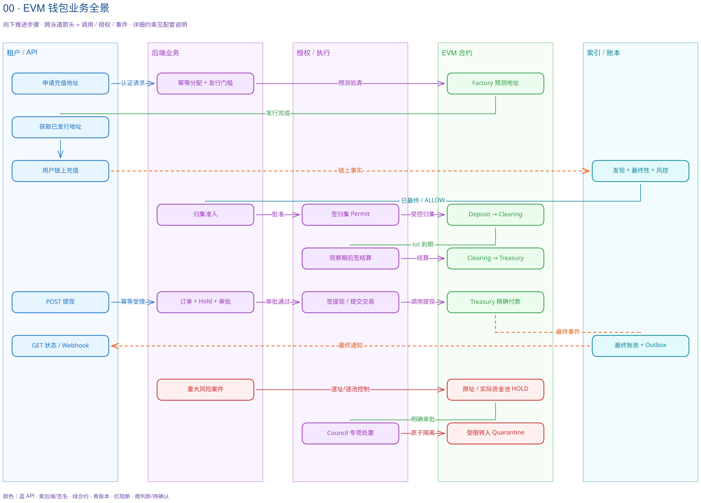

### 图外重点

- 常规资金路径 Deposit→Clearing→Treasury，冷热调度另见 09；合约不会自动识别风险来源。
- 充值可用入账不等待物理归集；所有内部资产迁移都不重复增加用户负债。
- 图 06/07 专门区分未归集和已归集风险；图 08 说明受限隔离及释放。

Mermaid flowchart 源码与彩色预览

```mermaid
%%{init: {"theme":"base","flowchart":{"curve":"linear"},"themeVariables":{"lineColor":"#1971c2","edgeLabelBackground":"#ffffff"}}}%%
flowchart LR
  subgraph API["租户 / API"]
    direction TB
    issue["申请充值地址"]
    address["获取已发行地址"]
    fund["用户链上充值"]
    withdraw["POST 提现"]
    notice["GET 状态 / Webhook"]
  end
  subgraph APP["后端业务"]
    direction TB
    allocate["幂等分配 + 发行门槛"]
    authorize["归集准入"]
    order["订单 + Hold + 审批"]
    incident["重大风险案件"]
  end
  subgraph AUTH["授权 / 执行"]
    direction TB
    sweepSign["签归集 Permit"]
    settleSign["观察期后签结算"]
    paySign["签提现 / 提交交易"]
    disposition["Council 专项处置"]
  end
  subgraph EVM["EVM 合约"]
    direction TB
    predict["Factory 预测地址"]
    move["Deposit → Clearing"]
    settle["Clearing → Treasury"]
    pay["Treasury 精确付款"]
    hold["原址 / 实际资金池 HOLD"]
    quarantine["受限转入 Quarantine"]
  end
  subgraph BOOK["索引 / 账本"]
    direction TB
    observe["发现 + 最终性 + 风控"]
    record["最终账务 + Outbox"]
  end
  issue -->|认证请求| allocate
  allocate -->|预测验真| predict
  predict -->|发行完成| address
  address --> fund
  fund -.->|链上事实| observe
  observe -->|已最终 / ALLOW| authorize
  authorize -->|批准| sweepSign
  sweepSign -->|受控归集| move
  move -->|lot 到期| settleSign
  settleSign -->|结算| settle
  withdraw -->|幂等受理| order
  order -->|审批通过| paySign
  paySign -->|调用提现| pay
  pay -.->|最终事件| record
  record -.->|最终通知| notice
  incident -->|逐址/逐池控制| hold
  hold -->|明确审批| disposition
  disposition -->|原子隔离| quarantine
  classDef api fill:#e7f5ff,stroke:#1971c2,color:#1971c2;
  class issue,address,fund,withdraw,notice api;
  style API fill:#e7f5ff,stroke:#1971c2,fill-opacity:0.25,stroke-width:1px
  classDef app fill:#f3e8ff,stroke:#9c36b5,color:#9c36b5;
  class allocate,authorize,order,incident app;
  style APP fill:#f3e8ff,stroke:#9c36b5,fill-opacity:0.25,stroke-width:1px
  classDef auth fill:#f3e8ff,stroke:#9c36b5,color:#9c36b5;
  class sweepSign,settleSign,paySign,disposition auth;
  style AUTH fill:#f3e8ff,stroke:#9c36b5,fill-opacity:0.25,stroke-width:1px
  classDef evm fill:#ebfbee,stroke:#2f9e44,color:#2f9e44;
  class predict,move,settle,pay,hold,quarantine evm;
  style EVM fill:#ebfbee,stroke:#2f9e44,fill-opacity:0.25,stroke-width:1px
  classDef book fill:#e3fafc,stroke:#0c8599,color:#0c8599;
  class observe,record book;
  style BOOK fill:#e3fafc,stroke:#0c8599,fill-opacity:0.25,stroke-width:1px
  classDef blocked fill:#fff0f0,stroke:#c92a2a,color:#c92a2a;
  class incident,hold,quarantine blocked;
  linkStyle 0 stroke:#1971c2,color:#1971c2,stroke-width:2px;
  linkStyle 1 stroke:#9c36b5,color:#9c36b5,stroke-width:2px;
  linkStyle 2 stroke:#2f9e44,color:#2f9e44,stroke-width:2px;
  linkStyle 3 stroke:#1971c2,color:#1971c2,stroke-width:2px;
  linkStyle 4 stroke:#e8590c,color:#e8590c,stroke-width:2px;
  linkStyle 5 stroke:#0c8599,color:#0c8599,stroke-width:2px;
  linkStyle 6 stroke:#9c36b5,color:#9c36b5,stroke-width:2px;
  linkStyle 7 stroke:#9c36b5,color:#9c36b5,stroke-width:2px;
  linkStyle 8 stroke:#2f9e44,color:#2f9e44,stroke-width:2px;
  linkStyle 9 stroke:#9c36b5,color:#9c36b5,stroke-width:2px;
  linkStyle 10 stroke:#1971c2,color:#1971c2,stroke-width:2px;
  linkStyle 11 stroke:#9c36b5,color:#9c36b5,stroke-width:2px;
  linkStyle 12 stroke:#9c36b5,color:#9c36b5,stroke-width:2px;
  linkStyle 13 stroke:#e8590c,color:#e8590c,stroke-width:2px;
  linkStyle 14 stroke:#e8590c,color:#e8590c,stroke-width:2px;
  linkStyle 15 stroke:#c92a2a,color:#c92a2a,stroke-width:2px;
  linkStyle 16 stroke:#2f9e44,color:#2f9e44,stroke-width:2px;
  linkStyle 17 stroke:#c92a2a,color:#c92a2a,stroke-width:2px;
```

## 01 · 地址发行与预充值准备

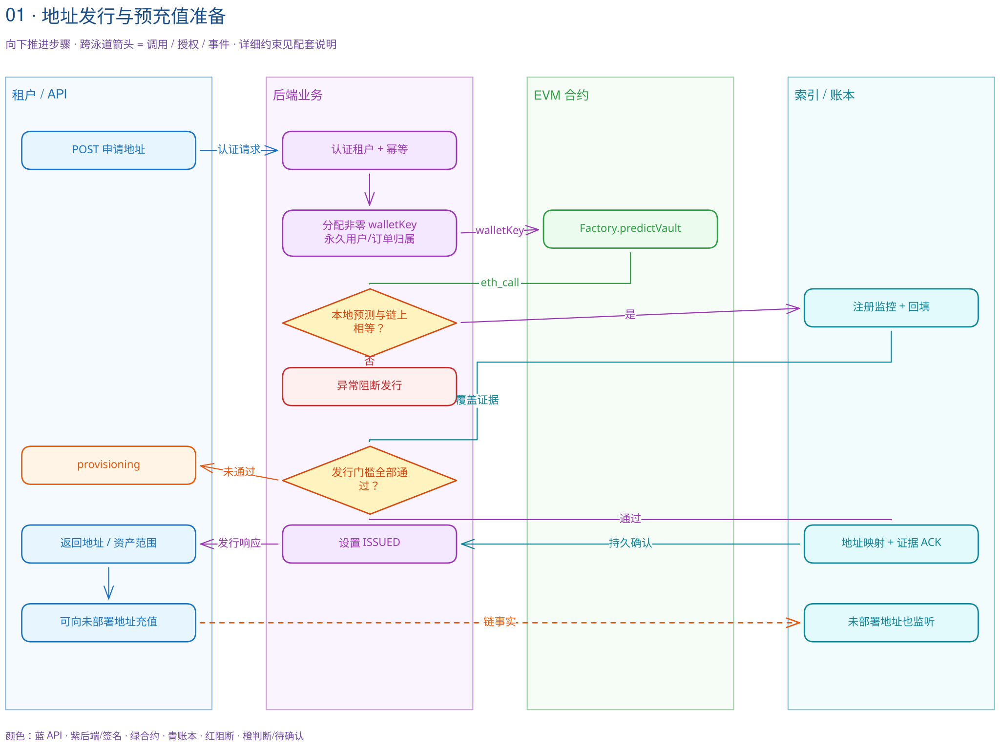

### 图外重点

- 接口：POST /v1/wallets/{id}/addresses，chain、mode=USER/ORDER 和订单键；GET 查询已发行/历史地址。
- 发行门槛包括固定代码/getter、角色/资产/路由、监听覆盖、预充值部署演练和证据持久化。
- issuance、deployment、risk 为独立状态；API 租户不能自选 salt、Factory、路由或 Treasury。
- walletKey 非密钥；旧地址永不重绑用户/订单，地址材料必须持久保存。

Mermaid flowchart 源码与彩色预览

```mermaid
%%{init: {"theme":"base","flowchart":{"curve":"linear"},"themeVariables":{"lineColor":"#1971c2","edgeLabelBackground":"#ffffff"}}}%%
flowchart LR
  subgraph API["租户 / API"]
    direction TB
    req["POST 申请地址"]
    pending["provisioning"]
    return["返回地址 / 资产范围"]
    deposit["可向未部署地址充值"]
  end
  subgraph APP["后端业务"]
    direction TB
    check["认证租户 + 幂等"]
    allocate["分配非零 walletKey<br>永久用户/订单归属"]
    verify{"本地预测与链上相等？"}
    bad["异常阻断发行"]
    gate{"发行门槛全部通过？"}
    issued["设置 ISSUED"]
  end
  subgraph EVM["EVM 合约"]
    direction TB
    predict["Factory.predictVault"]
  end
  subgraph BOOK["索引 / 账本"]
    direction TB
    watch["注册监控 + 回填"]
    persist["地址映射 + 证据 ACK"]
    observe["未部署地址也监听"]
  end
  req -->|认证请求| check
  check --> allocate
  allocate -->|walletKey| predict
  predict -->|eth_call| verify
  verify -->|否| bad
  verify -->|是| watch
  watch -->|覆盖证据| gate
  gate -->|未通过| pending
  gate -->|通过| persist
  persist -->|持久确认| issued
  issued -->|发行响应| return
  return --> deposit
  deposit -.->|链事实| observe
  classDef api fill:#e7f5ff,stroke:#1971c2,color:#1971c2;
  class req,pending,return,deposit api;
  style API fill:#e7f5ff,stroke:#1971c2,fill-opacity:0.25,stroke-width:1px
  classDef app fill:#f3e8ff,stroke:#9c36b5,color:#9c36b5;
  class check,allocate,verify,bad,gate,issued app;
  style APP fill:#f3e8ff,stroke:#9c36b5,fill-opacity:0.25,stroke-width:1px
  classDef evm fill:#ebfbee,stroke:#2f9e44,color:#2f9e44;
  class predict evm;
  style EVM fill:#ebfbee,stroke:#2f9e44,fill-opacity:0.25,stroke-width:1px
  classDef book fill:#e3fafc,stroke:#0c8599,color:#0c8599;
  class watch,persist,observe book;
  style BOOK fill:#e3fafc,stroke:#0c8599,fill-opacity:0.25,stroke-width:1px
  classDef blocked fill:#fff0f0,stroke:#c92a2a,color:#c92a2a;
  class bad blocked;
  classDef decision fill:#fff3bf,stroke:#d9480f,color:#d9480f;
  class verify,gate decision;
  classDef pending fill:#fff4e6,stroke:#e8590c,color:#e8590c;
  class pending pending;
  linkStyle 0 stroke:#1971c2,color:#1971c2,stroke-width:2px;
  linkStyle 1 stroke:#9c36b5,color:#9c36b5,stroke-width:2px;
  linkStyle 2 stroke:#9c36b5,color:#9c36b5,stroke-width:2px;
  linkStyle 3 stroke:#2f9e44,color:#2f9e44,stroke-width:2px;
  linkStyle 4 stroke:#c92a2a,color:#c92a2a,stroke-width:2px;
  linkStyle 5 stroke:#9c36b5,color:#9c36b5,stroke-width:2px;
  linkStyle 6 stroke:#0c8599,color:#0c8599,stroke-width:2px;
  linkStyle 7 stroke:#e8590c,color:#e8590c,stroke-width:2px;
  linkStyle 8 stroke:#9c36b5,color:#9c36b5,stroke-width:2px;
  linkStyle 9 stroke:#0c8599,color:#0c8599,stroke-width:2px;
  linkStyle 10 stroke:#9c36b5,color:#9c36b5,stroke-width:2px;
  linkStyle 11 stroke:#1971c2,color:#1971c2,stroke-width:2px;
  linkStyle 12 stroke:#e8590c,color:#e8590c,stroke-width:2px;
```

## 02 · 充值入账与授权归集

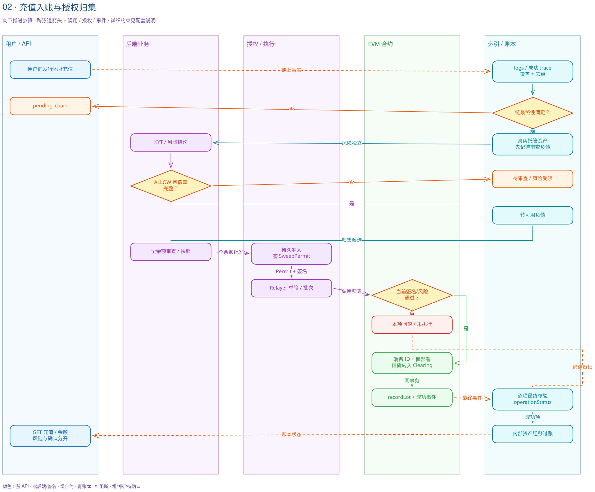

### 图外重点

- 合约：VaultManager.sweep / batchDeployAndSweep；单项内部消费 ID→Factory.deployVault→DepositVault.sweep→Clearing.recordLot。
- amount=expectedBalance=实时全部余额；后端需证明全部余额最终确认且 ALLOW，粉尘/新增入款触发重新审查。
- 批次最多 50 项，每项 gas 100000—2000000、签名≤4096 字节、总 calldata≤131072 字节；重复 operationId 拒绝。
- ItemFailed 仅回滚该项；BatchStopped 后未执行项续排；外层 revert/OOG 回滚整个批次，Gas 仍为运营成本。
- 内部归集只改变托管资产位置；旧 Permit 在失败后可能有效，不能当作永久取消。

Mermaid flowchart 源码与彩色预览

```mermaid
%%{init: {"theme":"base","flowchart":{"curve":"linear"},"themeVariables":{"lineColor":"#1971c2","edgeLabelBackground":"#ffffff"}}}%%
flowchart LR
  subgraph API["租户 / API"]
    direction TB
    send["用户向发行地址充值"]
    pending["pending_chain"]
    notify["GET 充值 / 余额<br>风险与确认分开"]
  end
  subgraph APP["后端业务"]
    direction TB
    risk["KYT / 风险结论"]
    allow{"ALLOW 且覆盖完整？"}
    balance["全余额审查 / 快照"]
  end
  subgraph AUTH["授权 / 执行"]
    direction TB
    signature["持久准入<br>签 SweepPermit"]
    batch["Relayer 单笔 / 批次"]
  end
  subgraph EVM["EVM 合约"]
    direction TB
    verify{"当前签名/风险通过？"}
    revert["本项回滚 / 未执行"]
    move["消费 ID + 懒部署<br>精确转入 Clearing"]
    lot["recordLot + 成功事件"]
  end
  subgraph BOOK["索引 / 账本"]
    direction TB
    discover["logs / 成功 trace<br>覆盖 + 去重"]
    final{"链最终性满足？"}
    restricted["真实托管资产<br>先记待审查负债"]
    hold["待审查 / 风险受限"]
    available["转可用负债"]
    confirm["逐项最终核验<br>operationStatus"]
    migration["内部资产迁移过账"]
  end
  send -.->|链上事实| discover
  discover --> final
  final -->|否| pending
  final -->|是| restricted
  restricted -->|风险独立| risk
  risk --> allow
  allow -->|否| hold
  allow -->|是| available
  available -->|归集候选| balance
  balance -->|全余额批准| signature
  signature -->|Permit + 签名| batch
  batch -->|调用归集| verify
  verify -->|否| revert
  verify -->|是| move
  move -->|同事务| lot
  lot -.->|最终事件| confirm
  revert -.->|跟踪重试| confirm
  confirm -->|成功项| migration
  migration -.->|账本状态| notify
  classDef api fill:#e7f5ff,stroke:#1971c2,color:#1971c2;
  class send,pending,notify api;
  style API fill:#e7f5ff,stroke:#1971c2,fill-opacity:0.25,stroke-width:1px
  classDef app fill:#f3e8ff,stroke:#9c36b5,color:#9c36b5;
  class risk,allow,balance app;
  style APP fill:#f3e8ff,stroke:#9c36b5,fill-opacity:0.25,stroke-width:1px
  classDef auth fill:#f3e8ff,stroke:#9c36b5,color:#9c36b5;
  class signature,batch auth;
  style AUTH fill:#f3e8ff,stroke:#9c36b5,fill-opacity:0.25,stroke-width:1px
  classDef evm fill:#ebfbee,stroke:#2f9e44,color:#2f9e44;
  class verify,revert,move,lot evm;
  style EVM fill:#ebfbee,stroke:#2f9e44,fill-opacity:0.25,stroke-width:1px
  classDef book fill:#e3fafc,stroke:#0c8599,color:#0c8599;
  class discover,final,restricted,hold,available,confirm,migration book;
  style BOOK fill:#e3fafc,stroke:#0c8599,fill-opacity:0.25,stroke-width:1px
  classDef blocked fill:#fff0f0,stroke:#c92a2a,color:#c92a2a;
  class revert blocked;
  classDef decision fill:#fff3bf,stroke:#d9480f,color:#d9480f;
  class final,allow,verify decision;
  classDef pending fill:#fff4e6,stroke:#e8590c,color:#e8590c;
  class pending,hold pending;
  linkStyle 0 stroke:#e8590c,color:#e8590c,stroke-width:2px;
  linkStyle 1 stroke:#0c8599,color:#0c8599,stroke-width:2px;
  linkStyle 2 stroke:#e8590c,color:#e8590c,stroke-width:2px;
  linkStyle 3 stroke:#0c8599,color:#0c8599,stroke-width:2px;
  linkStyle 4 stroke:#0c8599,color:#0c8599,stroke-width:2px;
  linkStyle 5 stroke:#9c36b5,color:#9c36b5,stroke-width:2px;
  linkStyle 6 stroke:#e8590c,color:#e8590c,stroke-width:2px;
  linkStyle 7 stroke:#9c36b5,color:#9c36b5,stroke-width:2px;
  linkStyle 8 stroke:#0c8599,color:#0c8599,stroke-width:2px;
  linkStyle 9 stroke:#9c36b5,color:#9c36b5,stroke-width:2px;
  linkStyle 10 stroke:#9c36b5,color:#9c36b5,stroke-width:2px;
  linkStyle 11 stroke:#9c36b5,color:#9c36b5,stroke-width:2px;
  linkStyle 12 stroke:#c92a2a,color:#c92a2a,stroke-width:2px;
  linkStyle 13 stroke:#2f9e44,color:#2f9e44,stroke-width:2px;
  linkStyle 14 stroke:#2f9e44,color:#2f9e44,stroke-width:2px;
  linkStyle 15 stroke:#e8590c,color:#e8590c,stroke-width:2px;
  linkStyle 16 stroke:#e8590c,color:#e8590c,stroke-width:2px;
  linkStyle 17 stroke:#0c8599,color:#0c8599,stroke-width:2px;
  linkStyle 18 stroke:#e8590c,color:#e8590c,stroke-width:2px;
```

## 03 · 观察期结算与 lot 释放

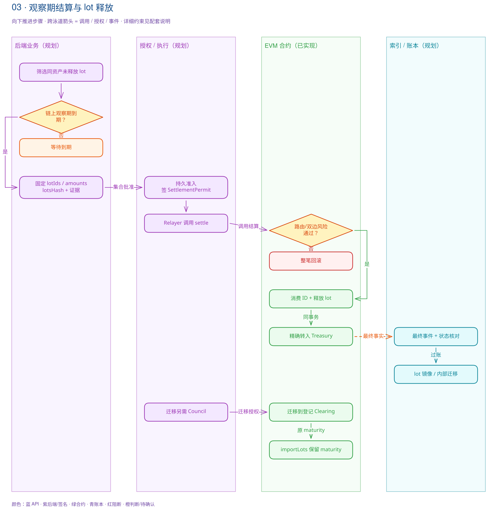

### 图外重点

- 普通结算入口 ClearingVault.settle，目标 Treasury；lot 数组 1—50 项且无重复，累计 released≤amount。
- SettlementPermit 绑定 lotsHash，金额由签定的数组求和；失败回滚并不证明授权永久失效。
- Clearing 迁移需 SETTLEMENT_SIGNER+Council、Migration 路由和双边普通风险检查；允许未到期 lot，保留 maturity。
- 直接打入 Clearing 的未知资金不生成 lot，不增加可结算额度；隔离只能使用未归属超额或同步扣 lot（08）。
- Clearing 不提供外部付款；此内部迁移不重复增加用户负债。

Mermaid flowchart 源码与彩色预览

```mermaid
%%{init: {"theme":"base","flowchart":{"curve":"linear"},"themeVariables":{"lineColor":"#1971c2","edgeLabelBackground":"#ffffff"}}}%%
flowchart LR
  subgraph APP["后端业务"]
    direction TB
    select["筛选同资产未释放 lot"]
    maturity{"链上观察期到期？"}
    wait["等待到期"]
    lots["固定 lotIds / amounts<br>lotsHash + 证据"]
  end
  subgraph AUTH["授权 / 执行"]
    direction TB
    sign["持久准入<br>签 SettlementPermit"]
    settleTx["Relayer 调用 settle"]
    council["迁移另需 Council"]
  end
  subgraph EVM["EVM 合约"]
    direction TB
    verify{"路由/双边风险通过？"}
    fail["整笔回滚"]
    release["消费 ID + 释放 lot"]
    transfer["精确转入 Treasury"]
    migration["迁移到登记 Clearing"]
    import["importLots 保留 maturity"]
  end
  subgraph BOOK["索引 / 账本"]
    direction TB
    events["最终事件 + 状态核对"]
    post["lot 镜像 / 内部迁移"]
  end
  select --> maturity
  maturity -->|否| wait
  maturity -->|是| lots
  lots -->|集合批准| sign
  sign --> settleTx
  settleTx -->|调用结算| verify
  verify -->|否| fail
  verify -->|是| release
  release -->|同事务| transfer
  transfer -.->|最终事实| events
  events -->|过账| post
  council -->|迁移授权| migration
  migration -->|原 maturity| import
  classDef app fill:#f3e8ff,stroke:#9c36b5,color:#9c36b5;
  class select,maturity,wait,lots app;
  style APP fill:#f3e8ff,stroke:#9c36b5,fill-opacity:0.25,stroke-width:1px
  classDef auth fill:#f3e8ff,stroke:#9c36b5,color:#9c36b5;
  class sign,settleTx,council auth;
  style AUTH fill:#f3e8ff,stroke:#9c36b5,fill-opacity:0.25,stroke-width:1px
  classDef evm fill:#ebfbee,stroke:#2f9e44,color:#2f9e44;
  class verify,fail,release,transfer,migration,import evm;
  style EVM fill:#ebfbee,stroke:#2f9e44,fill-opacity:0.25,stroke-width:1px
  classDef book fill:#e3fafc,stroke:#0c8599,color:#0c8599;
  class events,post book;
  style BOOK fill:#e3fafc,stroke:#0c8599,fill-opacity:0.25,stroke-width:1px
  classDef blocked fill:#fff0f0,stroke:#c92a2a,color:#c92a2a;
  class fail blocked;
  classDef decision fill:#fff3bf,stroke:#d9480f,color:#d9480f;
  class maturity,verify decision;
  classDef pending fill:#fff4e6,stroke:#e8590c,color:#e8590c;
  class wait pending;
  linkStyle 0 stroke:#9c36b5,color:#9c36b5,stroke-width:2px;
  linkStyle 1 stroke:#e8590c,color:#e8590c,stroke-width:2px;
  linkStyle 2 stroke:#9c36b5,color:#9c36b5,stroke-width:2px;
  linkStyle 3 stroke:#9c36b5,color:#9c36b5,stroke-width:2px;
  linkStyle 4 stroke:#9c36b5,color:#9c36b5,stroke-width:2px;
  linkStyle 5 stroke:#9c36b5,color:#9c36b5,stroke-width:2px;
  linkStyle 6 stroke:#c92a2a,color:#c92a2a,stroke-width:2px;
  linkStyle 7 stroke:#2f9e44,color:#2f9e44,stroke-width:2px;
  linkStyle 8 stroke:#2f9e44,color:#2f9e44,stroke-width:2px;
  linkStyle 9 stroke:#e8590c,color:#e8590c,stroke-width:2px;
  linkStyle 10 stroke:#0c8599,color:#0c8599,stroke-width:2px;
  linkStyle 11 stroke:#9c36b5,color:#9c36b5,stroke-width:2px;
  linkStyle 12 stroke:#2f9e44,color:#2f9e44,stroke-width:2px;
```

## 04 · 提现受理与最终付款

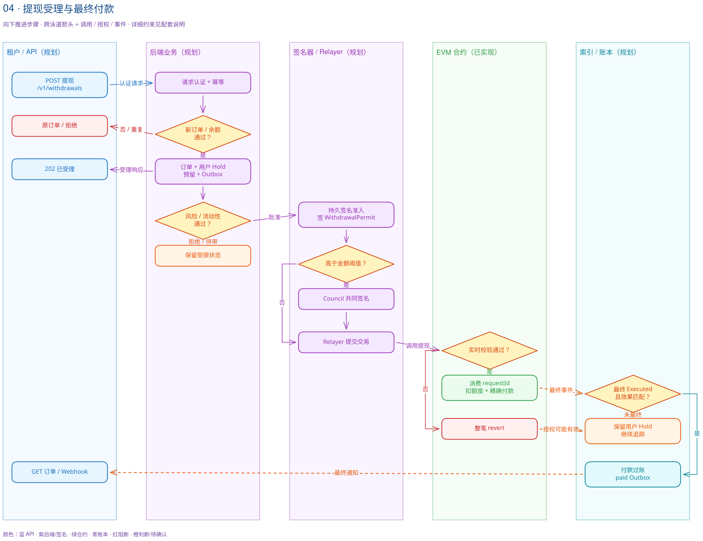

### 图外重点

- 受理事务一次写入幂等、商户订单唯一、P+F 用户 Hold、额度预留和 Outbox。
- Relayer 交易 to=Treasury、value=0；本金由 Treasury 出，Relayer 只承担 Gas。
- 实时校验包括签名/有效期/各 epoch/资产/收款规则/HOLD/预留底线/共享额度。
- 外层 revert、超时或换 Relayer 不是退款证明；取消流程见 05。

Mermaid flowchart 源码与彩色预览

```mermaid
%%{init: {"theme":"base","flowchart":{"curve":"linear"},"themeVariables":{"lineColor":"#1971c2","edgeLabelBackground":"#ffffff"}}}%%
flowchart LR
  subgraph API["租户 / API"]
    direction TB
    request["POST 提现<br>/v1/withdrawals"]
    reply["202 已受理"]
    reject["原订单 / 拒绝"]
    notice["GET 订单 / Webhook"]
  end
  subgraph APP["后端业务"]
    direction TB
    auth["请求认证 + 幂等"]
    unique{"新订单 / 余额<br>通过？"}
    accepted["订单 + 用户 Hold<br>预留 + Outbox"]
    risk{"风险 / 流动性<br>通过？"}
    wait["保留受限状态"]
  end
  subgraph AUTH["签名器 / Relayer"]
    direction TB
    gate["持久签名准入<br>签 WithdrawalPermit"]
    large{"高于金额阈值？"}
    council["Council 共同签名"]
    send["Relayer 提交交易"]
  end
  subgraph EVM["EVM 合约"]
    direction TB
    verify{"实时校验通过？"}
    pay["消费 requestId<br>扣额度 + 精确付款"]
    revert["整笔 revert"]
  end
  subgraph BOOK["索引 / 账本"]
    direction TB
    final{"最终 Executed<br>且效果匹配？"}
    uncertain["保留用户 Hold<br>继续追踪"]
    post["付款过账<br>paid Outbox"]
  end
  request -->|认证请求| auth
  auth --> unique
  unique -->|是| accepted
  unique -->|否 / 重复| reject
  accepted -->|受理响应| reply
  accepted --> risk
  risk -->|拒绝 / 待审| wait
  risk -->|批准| gate
  gate --> large
  large -->|是| council
  large -->|否| send
  council --> send
  send -->|调用提现| verify
  verify -->|是| pay
  verify -->|否| revert
  pay -.->|最终事件| final
  revert -.->|授权可能有效| uncertain
  final -->|是| post
  final -->|未最终| uncertain
  post -.->|最终通知| notice
  classDef api fill:#e7f5ff,stroke:#1971c2,color:#1971c2;
  class request,reply,reject,notice api;
  style API fill:#e7f5ff,stroke:#1971c2,fill-opacity:0.25,stroke-width:1px
  classDef app fill:#f3e8ff,stroke:#9c36b5,color:#9c36b5;
  class auth,unique,accepted,risk,wait app;
  style APP fill:#f3e8ff,stroke:#9c36b5,fill-opacity:0.25,stroke-width:1px
  classDef auth fill:#f3e8ff,stroke:#9c36b5,color:#9c36b5;
  class gate,large,council,send auth;
  style AUTH fill:#f3e8ff,stroke:#9c36b5,fill-opacity:0.25,stroke-width:1px
  classDef evm fill:#ebfbee,stroke:#2f9e44,color:#2f9e44;
  class verify,pay,revert evm;
  style EVM fill:#ebfbee,stroke:#2f9e44,fill-opacity:0.25,stroke-width:1px
  classDef book fill:#e3fafc,stroke:#0c8599,color:#0c8599;
  class final,uncertain,post book;
  style BOOK fill:#e3fafc,stroke:#0c8599,fill-opacity:0.25,stroke-width:1px
  classDef blocked fill:#fff0f0,stroke:#c92a2a,color:#c92a2a;
  class reject,wait,revert,uncertain blocked;
  classDef decision fill:#fff3bf,stroke:#d9480f,color:#d9480f;
  class unique,risk,large,verify,final decision;
  classDef pending fill:#fff4e6,stroke:#e8590c,color:#e8590c;
  class wait,uncertain pending;
  linkStyle 0 stroke:#1971c2,color:#1971c2,stroke-width:2px;
  linkStyle 1 stroke:#9c36b5,color:#9c36b5,stroke-width:2px;
  linkStyle 2 stroke:#9c36b5,color:#9c36b5,stroke-width:2px;
  linkStyle 3 stroke:#c92a2a,color:#c92a2a,stroke-width:2px;
  linkStyle 4 stroke:#9c36b5,color:#9c36b5,stroke-width:2px;
  linkStyle 5 stroke:#9c36b5,color:#9c36b5,stroke-width:2px;
  linkStyle 6 stroke:#e8590c,color:#e8590c,stroke-width:2px;
  linkStyle 7 stroke:#9c36b5,color:#9c36b5,stroke-width:2px;
  linkStyle 8 stroke:#9c36b5,color:#9c36b5,stroke-width:2px;
  linkStyle 9 stroke:#9c36b5,color:#9c36b5,stroke-width:2px;
  linkStyle 10 stroke:#9c36b5,color:#9c36b5,stroke-width:2px;
  linkStyle 11 stroke:#9c36b5,color:#9c36b5,stroke-width:2px;
  linkStyle 12 stroke:#9c36b5,color:#9c36b5,stroke-width:2px;
  linkStyle 13 stroke:#2f9e44,color:#2f9e44,stroke-width:2px;
  linkStyle 14 stroke:#c92a2a,color:#c92a2a,stroke-width:2px;
  linkStyle 15 stroke:#e8590c,color:#e8590c,stroke-width:2px;
  linkStyle 16 stroke:#e8590c,color:#e8590c,stroke-width:2px;
  linkStyle 17 stroke:#0c8599,color:#0c8599,stroke-width:2px;
  linkStyle 18 stroke:#e8590c,color:#e8590c,stroke-width:2px;
  linkStyle 19 stroke:#e8590c,color:#e8590c,stroke-width:2px;
```

## 05 · 取消竞争与安全释放 Hold

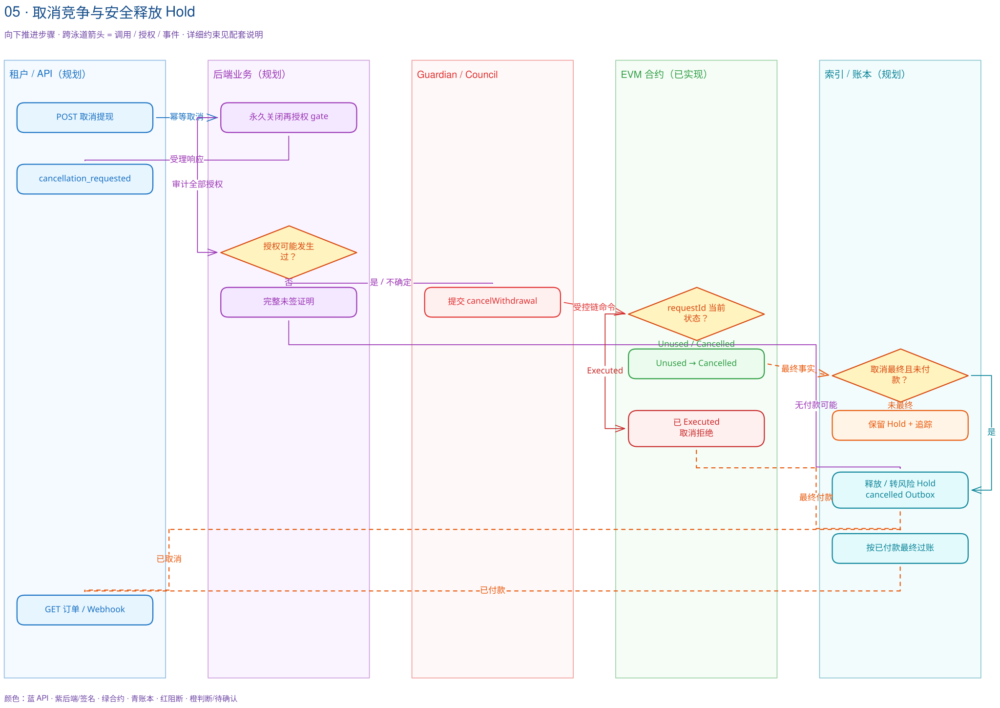

### 图外重点

- 接口 POST /v1/withdrawals/{id}/cancel；API 受理不等于链上取消成功。取消者为 Guardian/Council/Timelock，普通暂停仍可取消。
- 安全释放优先依据最终 requestStatus=Cancelled，匹配 OperationCancelled 并确认无已付款经济效果；未签路径须在事务内永久撤销签名准入。
- EOA nonce 替换、txHash 丢失、外层 revert、换 Relayer、服务器时钟过期均不能直接退款。
- 过期/epoch 终结须有最终链时间/控制与全部授权、执行覆盖证明；换 Treasury 前终结旧域，禁止双域活跃付款。
- 风险重分类涉及在途提现时先保留原 Hold，待最终未付款后再转风险冻结。

Mermaid flowchart 源码与彩色预览

```mermaid
%%{init: {"theme":"base","flowchart":{"curve":"linear"},"themeVariables":{"lineColor":"#1971c2","edgeLabelBackground":"#ffffff"}}}%%
flowchart LR
  subgraph API["租户 / API"]
    direction TB
    req["POST 取消提现"]
    reply["cancellation_requested"]
    notify["GET 订单 / Webhook"]
  end
  subgraph APP["后端业务"]
    direction TB
    gate["永久关闭再授权 gate"]
    possible{"授权可能发生过？"}
    proof["完整未签证明"]
  end
  subgraph GUARD["Guardian / Council"]
    direction TB
    submit["提交 cancelWithdrawal"]
  end
  subgraph EVM["EVM 合约"]
    direction TB
    status{"requestId 当前状态？"}
    cancelled["Unused → Cancelled"]
    paid["已 Executed<br>取消拒绝"]
  end
  subgraph BOOK["索引 / 账本"]
    direction TB
    final{"取消最终且未付款？"}
    uncertain["保留 Hold + 追踪"]
    refund["释放 / 转风险 Hold<br>cancelled Outbox"]
    paidpost["按已付款最终过账"]
  end
  req -->|幂等取消| gate
  gate -->|受理响应| reply
  gate -->|审计全部授权| possible
  possible -->|否| proof
  possible -->|是 / 不确定| submit
  proof -->|无付款可能| refund
  submit -->|受控链命令| status
  status -->|Unused / Cancelled| cancelled
  status -->|Executed| paid
  cancelled -.->|最终事实| final
  final -->|是| refund
  final -->|未最终| uncertain
  paid -.->|最终付款| paidpost
  refund -.->|已取消| notify
  paidpost -.->|已付款| notify
  classDef api fill:#e7f5ff,stroke:#1971c2,color:#1971c2;
  class req,reply,notify api;
  style API fill:#e7f5ff,stroke:#1971c2,fill-opacity:0.25,stroke-width:1px
  classDef app fill:#f3e8ff,stroke:#9c36b5,color:#9c36b5;
  class gate,possible,proof app;
  style APP fill:#f3e8ff,stroke:#9c36b5,fill-opacity:0.25,stroke-width:1px
  classDef guard fill:#fff0f0,stroke:#e03131,color:#e03131;
  class submit guard;
  style GUARD fill:#fff0f0,stroke:#e03131,fill-opacity:0.25,stroke-width:1px
  classDef evm fill:#ebfbee,stroke:#2f9e44,color:#2f9e44;
  class status,cancelled,paid evm;
  style EVM fill:#ebfbee,stroke:#2f9e44,fill-opacity:0.25,stroke-width:1px
  classDef book fill:#e3fafc,stroke:#0c8599,color:#0c8599;
  class final,uncertain,refund,paidpost book;
  style BOOK fill:#e3fafc,stroke:#0c8599,fill-opacity:0.25,stroke-width:1px
  classDef blocked fill:#fff0f0,stroke:#c92a2a,color:#c92a2a;
  class paid blocked;
  classDef decision fill:#fff3bf,stroke:#d9480f,color:#d9480f;
  class possible,status,final decision;
  classDef pending fill:#fff4e6,stroke:#e8590c,color:#e8590c;
  class uncertain pending;
  linkStyle 0 stroke:#1971c2,color:#1971c2,stroke-width:2px;
  linkStyle 1 stroke:#9c36b5,color:#9c36b5,stroke-width:2px;
  linkStyle 2 stroke:#9c36b5,color:#9c36b5,stroke-width:2px;
  linkStyle 3 stroke:#9c36b5,color:#9c36b5,stroke-width:2px;
  linkStyle 4 stroke:#9c36b5,color:#9c36b5,stroke-width:2px;
  linkStyle 5 stroke:#9c36b5,color:#9c36b5,stroke-width:2px;
  linkStyle 6 stroke:#e03131,color:#e03131,stroke-width:2px;
  linkStyle 7 stroke:#2f9e44,color:#2f9e44,stroke-width:2px;
  linkStyle 8 stroke:#c92a2a,color:#c92a2a,stroke-width:2px;
  linkStyle 9 stroke:#e8590c,color:#e8590c,stroke-width:2px;
  linkStyle 10 stroke:#0c8599,color:#0c8599,stroke-width:2px;
  linkStyle 11 stroke:#e8590c,color:#e8590c,stroke-width:2px;
  linkStyle 12 stroke:#e8590c,color:#e8590c,stroke-width:2px;
  linkStyle 13 stroke:#e8590c,color:#e8590c,stroke-width:2px;
  linkStyle 14 stroke:#e8590c,color:#e8590c,stroke-width:2px;
```

## 06 · 风险资金未归集：原址控制

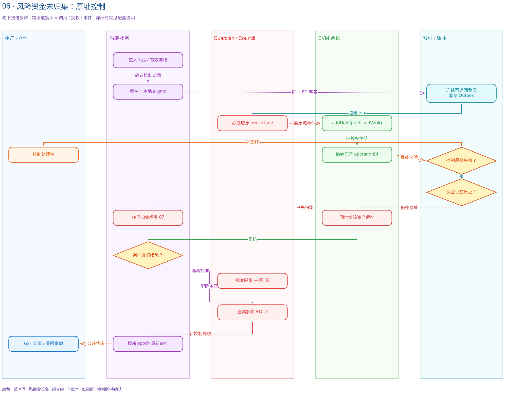

### 图外重点

- 真实签名：RiskRegistry.addHold(vault, token, false, caseId)，全资产控制另用 allAssets=true；地址无代码也可冻结。
- 同一 Vault 100 正常+20 风险，默认该资产 120 全部不普通归集；不能物理选出那笔“干净币”。
- HOLD、解除及预留更新提升相关 epoch；部署不解除 HOLD，旧授权恢复后不再有效。
- 冻结不能阻止第三方再打款。资金若已在 HOLD 生效前转走，按最终链顺序补控制实际下游，不能宣称原址阻断成功。
- 本地 gate、广播、包含、最终生效分别记录；重组/Unknown 保持 gate 关闭。

Mermaid flowchart 源码与彩色预览

```mermaid
%%{init: {"theme":"base","flowchart":{"curve":"linear"},"themeVariables":{"lineColor":"#1971c2","edgeLabelBackground":"#ffffff"}}}%%
flowchart LR
  subgraph API["租户 / API"]
    direction TB
    pending["控制处理中"]
    status["GET 充值 / 受限余额"]
  end
  subgraph APP["后端业务"]
    direction TB
    alert["重大风险 / 有效冻结"]
    gate["案件 + 本地关 gate"]
    downstream["转已归集场景 07"]
    decision{"案件复核结果？"}
    resign["按新 epoch 重新审批"]
  end
  subgraph GUARD["Guardian / Council"]
    direction TB
    guardian["独立应急 nonce lane"]
    isolate["批准隔离 → 图 08"]
    release["逐案解除 HOLD"]
  end
  subgraph EVM["EVM 合约"]
    direction TB
    hold["addHold(predictedVault)"]
    cancel["撤销已签 operationId"]
    remain["同地址该资产留存"]
  end
  subgraph BOOK["索引 / 账本"]
    direction TB
    restricted["冻结可追回负债<br>紧急 Outbox"]
    final{"控制最终生效？"}
    position{"资金仍在原址？"}
  end
  alert -->|确认控制范围| gate
  gate -->|同一 PG 事务| restricted
  restricted -->|控制 job| guardian
  guardian -->|紧急链命令| hold
  hold -->|旧授权终结| cancel
  cancel -.->|最终核验| final
  final -->|未最终| pending
  final -->|是| position
  position -->|已先归集| downstream
  position -->|仍在原址| remain
  remain -->|复核| decision
  decision -->|隔离批准| isolate
  decision -->|解除本案| release
  release -->|新控制快照| resign
  resign -.->|公开状态| status
  classDef api fill:#e7f5ff,stroke:#1971c2,color:#1971c2;
  class pending,status api;
  style API fill:#e7f5ff,stroke:#1971c2,fill-opacity:0.25,stroke-width:1px
  classDef app fill:#f3e8ff,stroke:#9c36b5,color:#9c36b5;
  class alert,gate,downstream,decision,resign app;
  style APP fill:#f3e8ff,stroke:#9c36b5,fill-opacity:0.25,stroke-width:1px
  classDef guard fill:#fff0f0,stroke:#e03131,color:#e03131;
  class guardian,isolate,release guard;
  style GUARD fill:#fff0f0,stroke:#e03131,fill-opacity:0.25,stroke-width:1px
  classDef evm fill:#ebfbee,stroke:#2f9e44,color:#2f9e44;
  class hold,cancel,remain evm;
  style EVM fill:#ebfbee,stroke:#2f9e44,fill-opacity:0.25,stroke-width:1px
  classDef book fill:#e3fafc,stroke:#0c8599,color:#0c8599;
  class restricted,final,position book;
  style BOOK fill:#e3fafc,stroke:#0c8599,fill-opacity:0.25,stroke-width:1px
  classDef blocked fill:#fff0f0,stroke:#c92a2a,color:#c92a2a;
  class downstream,remain blocked;
  classDef decision fill:#fff3bf,stroke:#d9480f,color:#d9480f;
  class final,position,decision decision;
  classDef pending fill:#fff4e6,stroke:#e8590c,color:#e8590c;
  class pending pending;
  linkStyle 0 stroke:#9c36b5,color:#9c36b5,stroke-width:2px;
  linkStyle 1 stroke:#9c36b5,color:#9c36b5,stroke-width:2px;
  linkStyle 2 stroke:#0c8599,color:#0c8599,stroke-width:2px;
  linkStyle 3 stroke:#e03131,color:#e03131,stroke-width:2px;
  linkStyle 4 stroke:#2f9e44,color:#2f9e44,stroke-width:2px;
  linkStyle 5 stroke:#e8590c,color:#e8590c,stroke-width:2px;
  linkStyle 6 stroke:#e8590c,color:#e8590c,stroke-width:2px;
  linkStyle 7 stroke:#0c8599,color:#0c8599,stroke-width:2px;
  linkStyle 8 stroke:#c92a2a,color:#c92a2a,stroke-width:2px;
  linkStyle 9 stroke:#c92a2a,color:#c92a2a,stroke-width:2px;
  linkStyle 10 stroke:#2f9e44,color:#2f9e44,stroke-width:2px;
  linkStyle 11 stroke:#9c36b5,color:#9c36b5,stroke-width:2px;
  linkStyle 12 stroke:#9c36b5,color:#9c36b5,stroke-width:2px;
  linkStyle 13 stroke:#e03131,color:#e03131,stroke-width:2px;
  linkStyle 14 stroke:#e8590c,color:#e8590c,stroke-width:2px;
```

## 07 · 风险资金已归集：逐池控制与缺口

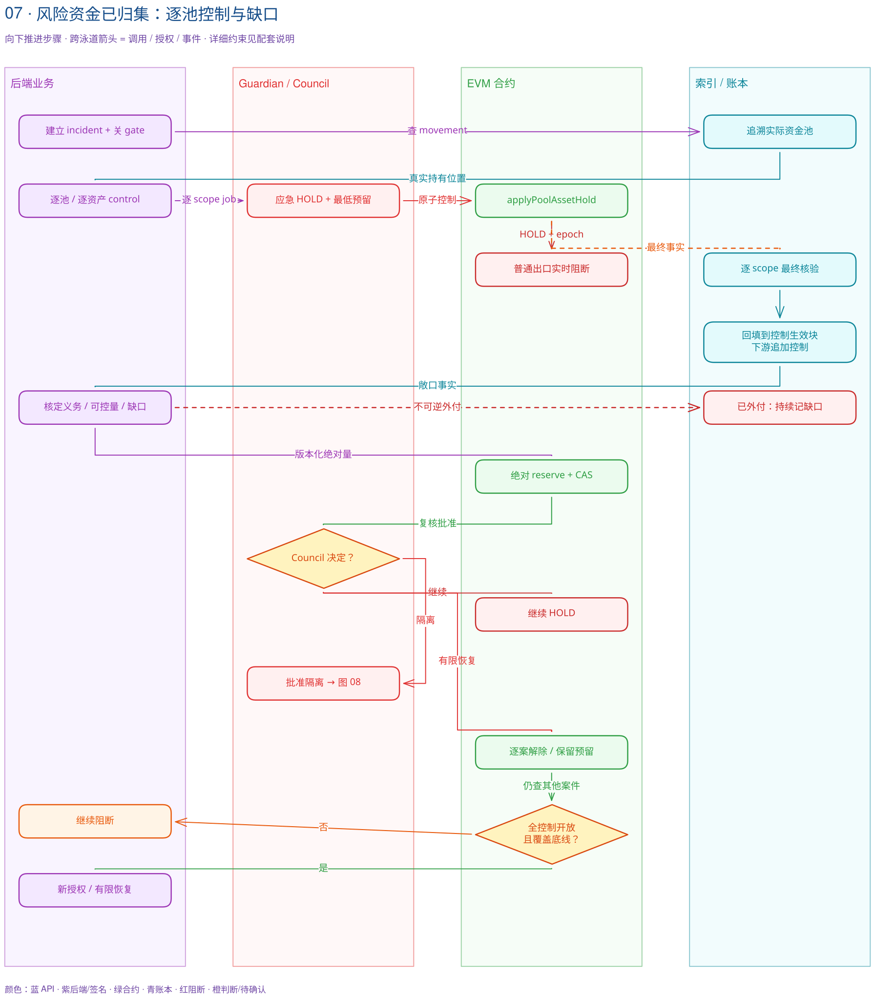

### 图外重点

- 控制对象是实际持有资产的 Clearing/Treasury/Cold；冻结原 Vault 不会自动冻结下游。
- applyPoolAssetHold(pool, token, caseId, minimumReserve) 同事务建立本案 HOLD 与预留下限；结算/提现/转冷/回款/迁移全部检查风险。
- setReserve 按绝对量+version CAS，不把重复通知累加。不同案件预留相加，重叠义务需后端明确去重分配。
- 解除本案 HOLD 不清其他原因、不自动降 reserve；普通出金后余额≥总预留+Treasury安全底线，后端另扣在途物理预留。
- 已外付无法链上撤回，记录风险义务/可控量/不可用量/缺口；不冲掉用户债权、不跨租户补缺。
- routesPaused 不能停直接提现；全面出金控制使用 RiskRegistry 或额度。

Mermaid flowchart 源码与彩色预览

```mermaid
%%{init: {"theme":"base","flowchart":{"curve":"linear"},"themeVariables":{"lineColor":"#1971c2","edgeLabelBackground":"#ffffff"}}}%%
flowchart LR
  subgraph APP["后端业务"]
    direction TB
    alert["建立 incident + 关 gate"]
    scope["逐池 / 逐资产 control"]
    exposure["核定义务 / 可控量 / 缺口"]
    resume["新授权 / 有限恢复"]
    blocked["继续阻断"]
  end
  subgraph GUARD["Guardian / Council"]
    direction TB
    command["应急 HOLD + 最低预留"]
    review{"Council 决定？"}
    quarantine["批准隔离 → 图 08"]
  end
  subgraph EVM["EVM 合约"]
    direction TB
    hold["applyPoolAssetHold"]
    check["普通出口实时阻断"]
    reserve["绝对 reserve + CAS"]
    keep["继续 HOLD"]
    open["逐案解除 / 保留预留"]
    spend{"全控制开放<br>且覆盖底线？"}
  end
  subgraph BOOK["索引 / 账本"]
    direction TB
    locate["追溯实际资金池"]
    final["逐 scope 最终核验"]
    follow["回填到控制生效块<br>下游追加控制"]
    deficit["已外付：持续记缺口"]
  end
  alert -->|查 movement| locate
  locate -->|真实持有位置| scope
  scope -->|逐 scope job| command
  command -->|原子控制| hold
  hold -->|HOLD + epoch| check
  hold -.->|最终事实| final
  final --> follow
  follow -->|敞口事实| exposure
  exposure -->|版本化绝对量| reserve
  reserve -->|复核批准| review
  review -->|继续| keep
  review -->|隔离| quarantine
  review -->|有限恢复| open
  open -->|仍查其他案件| spend
  spend -->|是| resume
  spend -->|否| blocked
  exposure -.->|不可逆外付| deficit
  classDef app fill:#f3e8ff,stroke:#9c36b5,color:#9c36b5;
  class alert,scope,exposure,resume,blocked app;
  style APP fill:#f3e8ff,stroke:#9c36b5,fill-opacity:0.25,stroke-width:1px
  classDef guard fill:#fff0f0,stroke:#e03131,color:#e03131;
  class command,review,quarantine guard;
  style GUARD fill:#fff0f0,stroke:#e03131,fill-opacity:0.25,stroke-width:1px
  classDef evm fill:#ebfbee,stroke:#2f9e44,color:#2f9e44;
  class hold,check,reserve,keep,open,spend evm;
  style EVM fill:#ebfbee,stroke:#2f9e44,fill-opacity:0.25,stroke-width:1px
  classDef book fill:#e3fafc,stroke:#0c8599,color:#0c8599;
  class locate,final,follow,deficit book;
  style BOOK fill:#e3fafc,stroke:#0c8599,fill-opacity:0.25,stroke-width:1px
  classDef blocked fill:#fff0f0,stroke:#c92a2a,color:#c92a2a;
  class check,keep,deficit blocked;
  classDef decision fill:#fff3bf,stroke:#d9480f,color:#d9480f;
  class review,spend decision;
  classDef pending fill:#fff4e6,stroke:#e8590c,color:#e8590c;
  class blocked pending;
  linkStyle 0 stroke:#9c36b5,color:#9c36b5,stroke-width:2px;
  linkStyle 1 stroke:#0c8599,color:#0c8599,stroke-width:2px;
  linkStyle 2 stroke:#9c36b5,color:#9c36b5,stroke-width:2px;
  linkStyle 3 stroke:#e03131,color:#e03131,stroke-width:2px;
  linkStyle 4 stroke:#c92a2a,color:#c92a2a,stroke-width:2px;
  linkStyle 5 stroke:#e8590c,color:#e8590c,stroke-width:2px;
  linkStyle 6 stroke:#0c8599,color:#0c8599,stroke-width:2px;
  linkStyle 7 stroke:#0c8599,color:#0c8599,stroke-width:2px;
  linkStyle 8 stroke:#9c36b5,color:#9c36b5,stroke-width:2px;
  linkStyle 9 stroke:#2f9e44,color:#2f9e44,stroke-width:2px;
  linkStyle 10 stroke:#c92a2a,color:#c92a2a,stroke-width:2px;
  linkStyle 11 stroke:#e03131,color:#e03131,stroke-width:2px;
  linkStyle 12 stroke:#e03131,color:#e03131,stroke-width:2px;
  linkStyle 13 stroke:#2f9e44,color:#2f9e44,stroke-width:2px;
  linkStyle 14 stroke:#2f9e44,color:#2f9e44,stroke-width:2px;
  linkStyle 15 stroke:#e8590c,color:#e8590c,stroke-width:2px;
  linkStyle 16 stroke:#c92a2a,color:#c92a2a,stroke-width:2px;
```

## 08 · 受限隔离与 Quarantine 释放

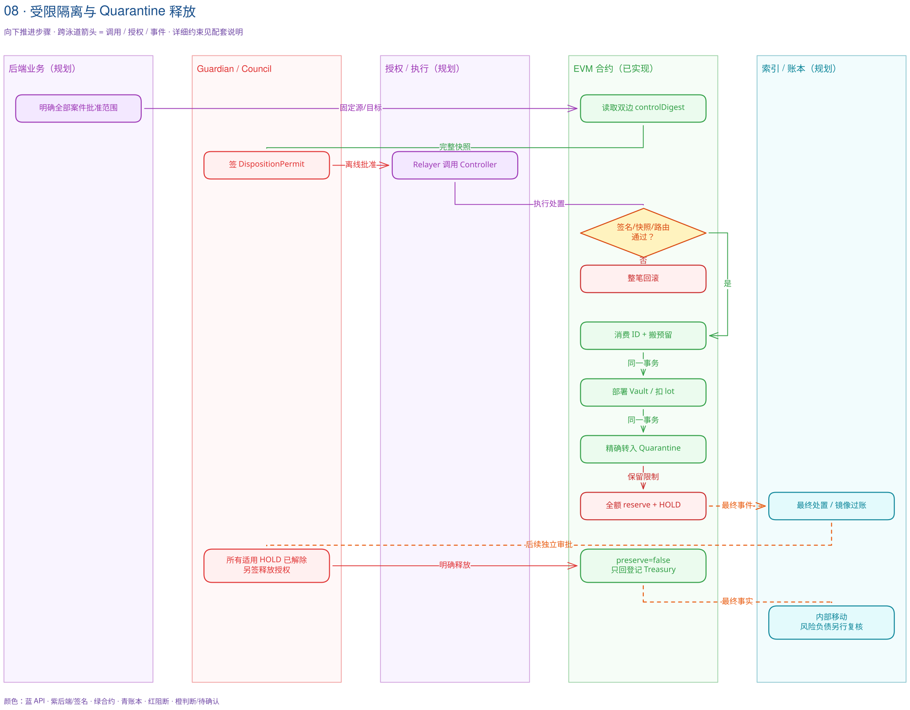

### 图外重点

- 入口 executeDisposition；Council 审核全部相关案件，合约验证签名与完整控制快照，不能解释链下法律事实。
- preserveRestriction=true：源本案扣 reserveToMove，目标为全部转入 amount 建 reserve/HOLD；其他案件预留留在源池。
- Clearing 登记 lot 须签 lotsHash 并原子扣释放量；无 lot 仅能消耗 balance-outstanding 的未归属超额。
- 隔离可明确例外移动 HOLD 资金，但不能越过源/目标 SECURITY_PAUSED 或侵占其他案件预留；转账/lot/预留/消费标记全原子回滚。
- preserve=false 只允许 Quarantine→登记 Treasury，双边全部 HOLD 清除、相应预留释放；普通外付仍走 Treasury 提现。
- 隔离仅改变保管位置，源池风险、用户受限负债和案件义务不会自动消失。

Mermaid flowchart 源码与彩色预览

```mermaid
%%{init: {"theme":"base","flowchart":{"curve":"linear"},"themeVariables":{"lineColor":"#1971c2","edgeLabelBackground":"#ffffff"}}}%%
flowchart LR
  subgraph APP["后端业务"]
    direction TB
    proposal["明确全部案件批准范围"]
  end
  subgraph GUARD["Guardian / Council"]
    direction TB
    approve["签 DispositionPermit"]
    release["所有适用 HOLD 已解除<br>另签释放授权"]
  end
  subgraph AUTH["授权 / 执行"]
    direction TB
    send["Relayer 调用 Controller"]
  end
  subgraph EVM["EVM 合约"]
    direction TB
    snap["读取双边 controlDigest"]
    verify{"签名/快照/路由通过？"}
    revert["整笔回滚"]
    reserve["消费 ID + 搬预留"]
    prepare["部署 Vault / 扣 lot"]
    transfer["精确转入 Quarantine"]
    restricted["全额 reserve + HOLD"]
    back["preserve=false<br>只回登记 Treasury"]
  end
  subgraph BOOK["索引 / 账本"]
    direction TB
    final["最终处置 / 镜像过账"]
    ledger["内部移动<br>风险负债另行复核"]
  end
  proposal -->|固定源/目标| snap
  snap -->|完整快照| approve
  approve -->|离线批准| send
  send -->|执行处置| verify
  verify -->|否| revert
  verify -->|是| reserve
  reserve -->|同一事务| prepare
  prepare -->|同一事务| transfer
  transfer -->|保留限制| restricted
  restricted -.->|最终事件| final
  release -->|明确释放| back
  back -.->|最终事实| ledger
  final -.->|后续独立审批| release
  classDef app fill:#f3e8ff,stroke:#9c36b5,color:#9c36b5;
  class proposal app;
  style APP fill:#f3e8ff,stroke:#9c36b5,fill-opacity:0.25,stroke-width:1px
  classDef guard fill:#fff0f0,stroke:#e03131,color:#e03131;
  class approve,release guard;
  style GUARD fill:#fff0f0,stroke:#e03131,fill-opacity:0.25,stroke-width:1px
  classDef auth fill:#f3e8ff,stroke:#9c36b5,color:#9c36b5;
  class send auth;
  style AUTH fill:#f3e8ff,stroke:#9c36b5,fill-opacity:0.25,stroke-width:1px
  classDef evm fill:#ebfbee,stroke:#2f9e44,color:#2f9e44;
  class snap,verify,revert,reserve,prepare,transfer,restricted,back evm;
  style EVM fill:#ebfbee,stroke:#2f9e44,fill-opacity:0.25,stroke-width:1px
  classDef book fill:#e3fafc,stroke:#0c8599,color:#0c8599;
  class final,ledger book;
  style BOOK fill:#e3fafc,stroke:#0c8599,fill-opacity:0.25,stroke-width:1px
  classDef blocked fill:#fff0f0,stroke:#c92a2a,color:#c92a2a;
  class revert,restricted blocked;
  classDef decision fill:#fff3bf,stroke:#d9480f,color:#d9480f;
  class verify decision;
  linkStyle 0 stroke:#9c36b5,color:#9c36b5,stroke-width:2px;
  linkStyle 1 stroke:#2f9e44,color:#2f9e44,stroke-width:2px;
  linkStyle 2 stroke:#e03131,color:#e03131,stroke-width:2px;
  linkStyle 3 stroke:#9c36b5,color:#9c36b5,stroke-width:2px;
  linkStyle 4 stroke:#c92a2a,color:#c92a2a,stroke-width:2px;
  linkStyle 5 stroke:#2f9e44,color:#2f9e44,stroke-width:2px;
  linkStyle 6 stroke:#2f9e44,color:#2f9e44,stroke-width:2px;
  linkStyle 7 stroke:#2f9e44,color:#2f9e44,stroke-width:2px;
  linkStyle 8 stroke:#c92a2a,color:#c92a2a,stroke-width:2px;
  linkStyle 9 stroke:#e8590c,color:#e8590c,stroke-width:2px;
  linkStyle 10 stroke:#e03131,color:#e03131,stroke-width:2px;
  linkStyle 11 stroke:#e8590c,color:#e8590c,stroke-width:2px;
  linkStyle 12 stroke:#e8590c,color:#e8590c,stroke-width:2px;
```

## 09 · 转冷与每笔离线批准回款

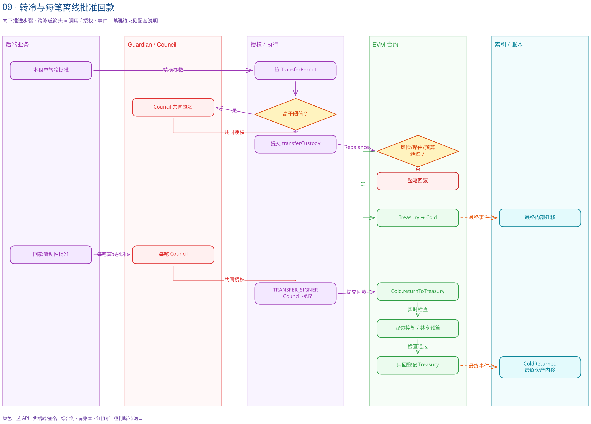

### 图外重点

- Treasury.transferCustody(kind=Rebalance) 高于阈值另需 Council；Cold.returnToTreasury 任何金额都必须 TRANSFER_SIGNER+Council。
- Domain：Milon Treasury/1 和 Milon Cold/1，各自绑定实际 verifyingContract；双边 risk epochs、route/policy epochs 实时校验。
- 提现、转冷、回款、普通调拨共用单笔/UTC日/最近25小时桶预算，双向分别消费额度。
- Cold 是固定合约，不是外部 EOA/Safe；无任意外部付款，源余额须覆盖 reserve，Treasury另保留安全底线。
- 所有内部调度只记资产位置迁移，不重复改变用户负债。

Mermaid flowchart 源码与彩色预览

```mermaid
%%{init: {"theme":"base","flowchart":{"curve":"linear"},"themeVariables":{"lineColor":"#1971c2","edgeLabelBackground":"#ffffff"}}}%%
flowchart LR
  subgraph APP["后端业务"]
    direction TB
    coldPlan["本租户转冷批准"]
    returnPlan["回款流动性批准"]
  end
  subgraph GUARD["Guardian / Council"]
    direction TB
    co["Council 共同签名"]
    returnCo["每笔 Council"]
  end
  subgraph AUTH["授权 / 执行"]
    direction TB
    sign["签 TransferPermit"]
    threshold{"高于阈值？"}
    send["提交 transferCustody"]
    returnSign["TRANSFER_SIGNER<br>+ Council 授权"]
  end
  subgraph EVM["EVM 合约"]
    direction TB
    verify{"风险/路由/预算通过？"}
    blocked["整笔回滚"]
    cold["Treasury → Cold"]
    return["Cold.returnToTreasury"]
    check["双边控制 / 共享预算"]
    treasury["只回登记 Treasury"]
  end
  subgraph BOOK["索引 / 账本"]
    direction TB
    post["最终内部迁移"]
    final["ColdReturned<br>最终资产内移"]
  end
  coldPlan -->|精确参数| sign
  sign --> threshold
  threshold -->|是| co
  threshold -->|否| send
  co -->|共同授权| send
  send -->|Rebalance| verify
  verify -->|否| blocked
  verify -->|是| cold
  cold -.->|最终事件| post
  returnPlan -->|每笔离线批准| returnCo
  returnCo -->|共同授权| returnSign
  returnSign -->|提交回款| return
  return -->|实时检查| check
  check -->|检查通过| treasury
  treasury -.->|最终事件| final
  classDef app fill:#f3e8ff,stroke:#9c36b5,color:#9c36b5;
  class coldPlan,returnPlan app;
  style APP fill:#f3e8ff,stroke:#9c36b5,fill-opacity:0.25,stroke-width:1px
  classDef guard fill:#fff0f0,stroke:#e03131,color:#e03131;
  class co,returnCo guard;
  style GUARD fill:#fff0f0,stroke:#e03131,fill-opacity:0.25,stroke-width:1px
  classDef auth fill:#f3e8ff,stroke:#9c36b5,color:#9c36b5;
  class sign,threshold,send,returnSign auth;
  style AUTH fill:#f3e8ff,stroke:#9c36b5,fill-opacity:0.25,stroke-width:1px
  classDef evm fill:#ebfbee,stroke:#2f9e44,color:#2f9e44;
  class verify,blocked,cold,return,check,treasury evm;
  style EVM fill:#ebfbee,stroke:#2f9e44,fill-opacity:0.25,stroke-width:1px
  classDef book fill:#e3fafc,stroke:#0c8599,color:#0c8599;
  class post,final book;
  style BOOK fill:#e3fafc,stroke:#0c8599,fill-opacity:0.25,stroke-width:1px
  classDef blocked fill:#fff0f0,stroke:#c92a2a,color:#c92a2a;
  class blocked blocked;
  classDef decision fill:#fff3bf,stroke:#d9480f,color:#d9480f;
  class threshold,verify decision;
  linkStyle 0 stroke:#9c36b5,color:#9c36b5,stroke-width:2px;
  linkStyle 1 stroke:#9c36b5,color:#9c36b5,stroke-width:2px;
  linkStyle 2 stroke:#9c36b5,color:#9c36b5,stroke-width:2px;
  linkStyle 3 stroke:#9c36b5,color:#9c36b5,stroke-width:2px;
  linkStyle 4 stroke:#e03131,color:#e03131,stroke-width:2px;
  linkStyle 5 stroke:#9c36b5,color:#9c36b5,stroke-width:2px;
  linkStyle 6 stroke:#c92a2a,color:#c92a2a,stroke-width:2px;
  linkStyle 7 stroke:#2f9e44,color:#2f9e44,stroke-width:2px;
  linkStyle 8 stroke:#e8590c,color:#e8590c,stroke-width:2px;
  linkStyle 9 stroke:#9c36b5,color:#9c36b5,stroke-width:2px;
  linkStyle 10 stroke:#e03131,color:#e03131,stroke-width:2px;
  linkStyle 11 stroke:#9c36b5,color:#9c36b5,stroke-width:2px;
  linkStyle 12 stroke:#2f9e44,color:#2f9e44,stroke-width:2px;
  linkStyle 13 stroke:#2f9e44,color:#2f9e44,stroke-width:2px;
  linkStyle 14 stroke:#e8590c,color:#e8590c,stroke-width:2px;
```

## 10 · 部署激活、时间锁与版本迁移

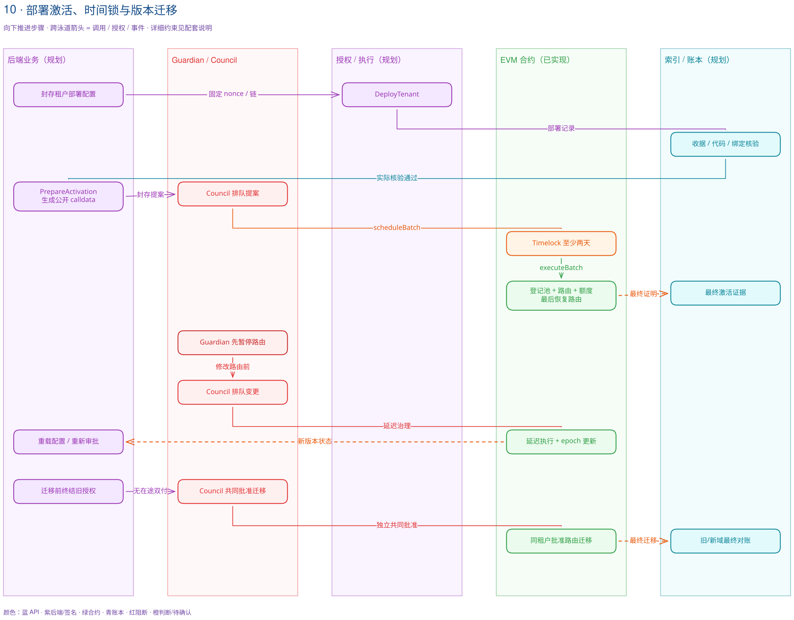

### 图外重点

- DeployTenant 固定 11 笔 CREATE；manifest planned 需真实链核验。PrepareActivation 生成 16+token数 项提案，不广播。
- 初始路由暂停、池未登记、额度零；Council scheduleBatch 等待至少两天后原子 executeBatch，不能把延迟降到两天以下。
- Guardian 可收紧/暂停、增加 reserve、撤 executor/停资产；恢复 SECURITY_PAUSED、恢复路由和扩权由 Timelock。Council 可逐案解除 HOLD、减少预留、专项处置。
- routesPaused 仅拦需 route 的移动，不暂停 Treasury.executeWithdrawal；冻结提现须按池/资产风险控制或额度。
- Treasury 迁移需 TransferPermit(kind=Migration)+Council 且消耗共享预算；Clearing 迁移保留 maturity。Cold/Quarantine 无普通 Migration。
- 新 Treasury 不继承旧请求去重映射；旧域先终结并对账，旧充值地址继续监听。

Mermaid flowchart 源码与彩色预览

```mermaid
%%{init: {"theme":"base","flowchart":{"curve":"linear"},"themeVariables":{"lineColor":"#1971c2","edgeLabelBackground":"#ffffff"}}}%%
flowchart LR
  subgraph APP["后端业务"]
    direction TB
    config["封存租户部署配置"]
    plan["PrepareActivation<br>生成公开 calldata"]
    reload["重载配置 / 重新审批"]
    terminate["迁移前终结旧授权"]
  end
  subgraph GUARD["Guardian / Council"]
    direction TB
    schedule["Council 排队提案"]
    pause["Guardian 先暂停路由"]
    change["Council 排队变更"]
    approve["Council 共同批准迁移"]
  end
  subgraph AUTH["授权 / 执行"]
    direction TB
    deploy["DeployTenant"]
  end
  subgraph EVM["EVM 合约"]
    direction TB
    wait["Timelock 至少两天"]
    activate["登记池 + 路由 + 额度<br>最后恢复路由"]
    execute["延迟执行 + epoch 更新"]
    migrate["同租户批准路由迁移"]
  end
  subgraph BOOK["索引 / 账本"]
    direction TB
    verify["收据 / 代码 / 绑定核验"]
    check["最终激活证据"]
    reconcile["旧/新域最终对账"]
  end
  config -->|固定 nonce / 链| deploy
  deploy -->|部署记录| verify
  verify -->|实际核验通过| plan
  plan -->|封存提案| schedule
  schedule -->|scheduleBatch| wait
  wait -->|executeBatch| activate
  activate -.->|最终证明| check
  pause -->|修改路由前| change
  change -->|延迟治理| execute
  execute -.->|新版本状态| reload
  terminate -->|无在途双付| approve
  approve -->|独立共同批准| migrate
  migrate -.->|最终迁移| reconcile
  classDef app fill:#f3e8ff,stroke:#9c36b5,color:#9c36b5;
  class config,plan,reload,terminate app;
  style APP fill:#f3e8ff,stroke:#9c36b5,fill-opacity:0.25,stroke-width:1px
  classDef guard fill:#fff0f0,stroke:#e03131,color:#e03131;
  class schedule,pause,change,approve guard;
  style GUARD fill:#fff0f0,stroke:#e03131,fill-opacity:0.25,stroke-width:1px
  classDef auth fill:#f3e8ff,stroke:#9c36b5,color:#9c36b5;
  class deploy auth;
  style AUTH fill:#f3e8ff,stroke:#9c36b5,fill-opacity:0.25,stroke-width:1px
  classDef evm fill:#ebfbee,stroke:#2f9e44,color:#2f9e44;
  class wait,activate,execute,migrate evm;
  style EVM fill:#ebfbee,stroke:#2f9e44,fill-opacity:0.25,stroke-width:1px
  classDef book fill:#e3fafc,stroke:#0c8599,color:#0c8599;
  class verify,check,reconcile book;
  style BOOK fill:#e3fafc,stroke:#0c8599,fill-opacity:0.25,stroke-width:1px
  classDef blocked fill:#fff0f0,stroke:#c92a2a,color:#c92a2a;
  class pause blocked;
  classDef pending fill:#fff4e6,stroke:#e8590c,color:#e8590c;
  class wait pending;
  linkStyle 0 stroke:#9c36b5,color:#9c36b5,stroke-width:2px;
  linkStyle 1 stroke:#9c36b5,color:#9c36b5,stroke-width:2px;
  linkStyle 2 stroke:#0c8599,color:#0c8599,stroke-width:2px;
  linkStyle 3 stroke:#9c36b5,color:#9c36b5,stroke-width:2px;
  linkStyle 4 stroke:#e8590c,color:#e8590c,stroke-width:2px;
  linkStyle 5 stroke:#2f9e44,color:#2f9e44,stroke-width:2px;
  linkStyle 6 stroke:#e8590c,color:#e8590c,stroke-width:2px;
  linkStyle 7 stroke:#e03131,color:#e03131,stroke-width:2px;
  linkStyle 8 stroke:#e03131,color:#e03131,stroke-width:2px;
  linkStyle 9 stroke:#e8590c,color:#e8590c,stroke-width:2px;
  linkStyle 10 stroke:#9c36b5,color:#9c36b5,stroke-width:2px;
  linkStyle 11 stroke:#e03131,color:#e03131,stroke-width:2px;
  linkStyle 12 stroke:#e8590c,color:#e8590c,stroke-width:2px;
```

## 11 · 最终链事件、账本通知与恢复

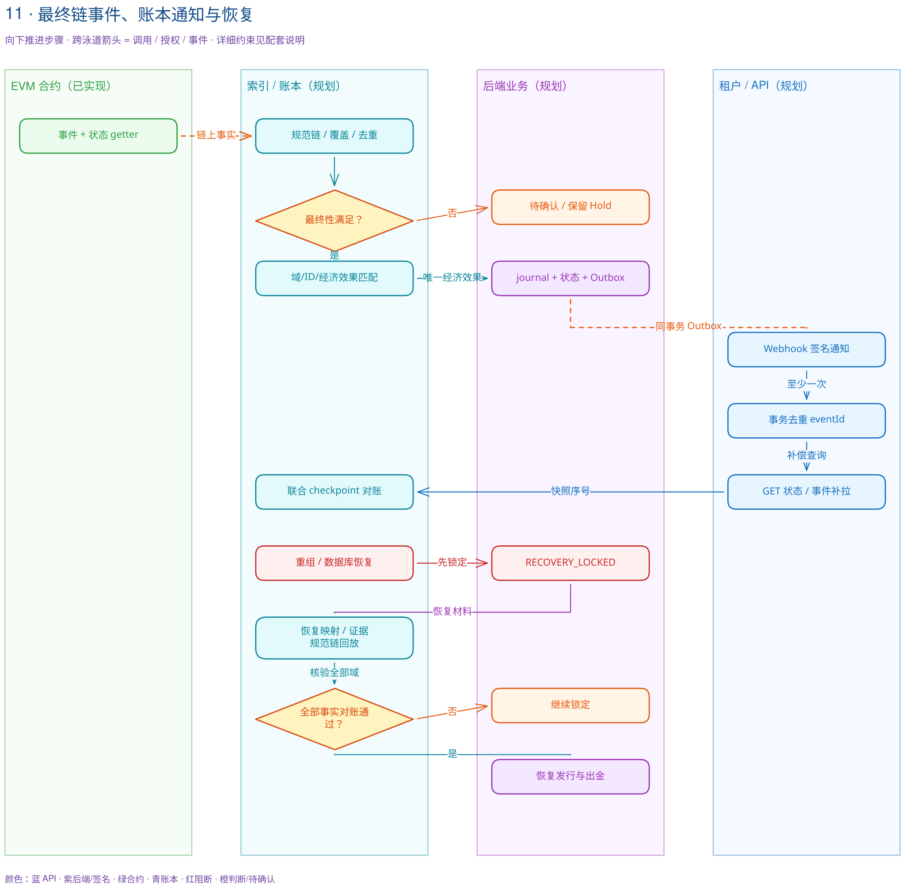

### 图外重点

- 事件至少包含 SweepExecuted、LotRecorded/LotReleased、SettlementExecuted、WithdrawalExecuted、DispositionExecuted、控制/预留事件；交叉核验 operationStatus/requestStatus。
- 业务、EIP-712 授权和外层 EOA 交易分别建状态机。外层 FINAL_REVERT 不等于经济业务永久取消。
- Webhook 稳定 eventId/版本、平台签名、至少一次投递，接收方事务去重；GET /v1/events 用于补偿。
- 最终充值先记受限负债，用户可用由风险决定；内部 movement 不记新充值，网络费用按真实资产独立过账。
- 恢复先锁定，恢复永久地址映射、批准/签名证据和配置，从共同 checkpoint 回放，核验各执行域。链日志不能重建全部用户归属。
- 深重组使用审批后的冲正 cycle，不改历史分录；控制重组或覆盖缺口期间本地 gate 保持关闭。

Mermaid flowchart 源码与彩色预览

```mermaid
%%{init: {"theme":"base","flowchart":{"curve":"linear"},"themeVariables":{"lineColor":"#1971c2","edgeLabelBackground":"#ffffff"}}}%%
flowchart LR
  subgraph EVM["EVM 合约"]
    direction TB
    facts["事件 + 状态 getter"]
  end
  subgraph BOOK["索引 / 账本"]
    direction TB
    coverage["规范链 / 覆盖 / 去重"]
    final{"最终性满足？"}
    match["域/ID/经济效果匹配"]
    reconcile["联合 checkpoint 对账"]
    reorg["重组 / 数据库恢复"]
    replay["恢复映射 / 证据<br>规范链回放"]
    checked{"全部事实对账通过？"}
  end
  subgraph APP["后端业务"]
    direction TB
    pending["待确认 / 保留 Hold"]
    post["journal + 状态 + Outbox"]
    lock["RECOVERY_LOCKED"]
    closed["继续锁定"]
    resume["恢复发行与出金"]
  end
  subgraph API["租户 / API"]
    direction TB
    notice["Webhook 签名通知"]
    dedupe["事务去重 eventId"]
    query["GET 状态 / 事件补拉"]
  end
  facts -.->|链上事实| coverage
  coverage --> final
  final -->|否| pending
  final -->|是| match
  match -->|唯一经济效果| post
  post -.->|同事务 Outbox| notice
  notice -->|至少一次| dedupe
  dedupe -->|补偿查询| query
  query -->|快照序号| reconcile
  reorg -->|先锁定| lock
  lock -->|恢复材料| replay
  replay -->|核验全部域| checked
  checked -->|否| closed
  checked -->|是| resume
  classDef evm fill:#ebfbee,stroke:#2f9e44,color:#2f9e44;
  class facts evm;
  style EVM fill:#ebfbee,stroke:#2f9e44,fill-opacity:0.25,stroke-width:1px
  classDef book fill:#e3fafc,stroke:#0c8599,color:#0c8599;
  class coverage,final,match,reconcile,reorg,replay,checked book;
  style BOOK fill:#e3fafc,stroke:#0c8599,fill-opacity:0.25,stroke-width:1px
  classDef app fill:#f3e8ff,stroke:#9c36b5,color:#9c36b5;
  class pending,post,lock,closed,resume app;
  style APP fill:#f3e8ff,stroke:#9c36b5,fill-opacity:0.25,stroke-width:1px
  classDef api fill:#e7f5ff,stroke:#1971c2,color:#1971c2;
  class notice,dedupe,query api;
  style API fill:#e7f5ff,stroke:#1971c2,fill-opacity:0.25,stroke-width:1px
  classDef blocked fill:#fff0f0,stroke:#c92a2a,color:#c92a2a;
  class reorg,lock blocked;
  classDef decision fill:#fff3bf,stroke:#d9480f,color:#d9480f;
  class final,checked decision;
  classDef pending fill:#fff4e6,stroke:#e8590c,color:#e8590c;
  class pending,closed pending;
  linkStyle 0 stroke:#e8590c,color:#e8590c,stroke-width:2px;
  linkStyle 1 stroke:#0c8599,color:#0c8599,stroke-width:2px;
  linkStyle 2 stroke:#e8590c,color:#e8590c,stroke-width:2px;
  linkStyle 3 stroke:#0c8599,color:#0c8599,stroke-width:2px;
  linkStyle 4 stroke:#0c8599,color:#0c8599,stroke-width:2px;
  linkStyle 5 stroke:#e8590c,color:#e8590c,stroke-width:2px;
  linkStyle 6 stroke:#1971c2,color:#1971c2,stroke-width:2px;
  linkStyle 7 stroke:#1971c2,color:#1971c2,stroke-width:2px;
  linkStyle 8 stroke:#1971c2,color:#1971c2,stroke-width:2px;
  linkStyle 9 stroke:#c92a2a,color:#c92a2a,stroke-width:2px;
  linkStyle 10 stroke:#9c36b5,color:#9c36b5,stroke-width:2px;
  linkStyle 11 stroke:#0c8599,color:#0c8599,stroke-width:2px;
  linkStyle 12 stroke:#e8590c,color:#e8590c,stroke-width:2px;
  linkStyle 13 stroke:#0c8599,color:#0c8599,stroke-width:2px;
```

